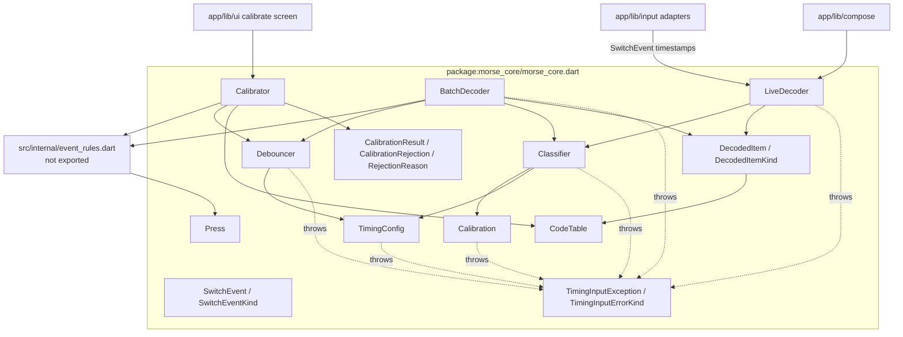
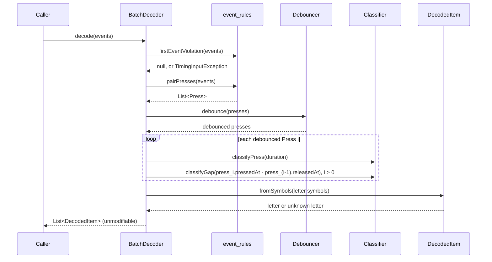
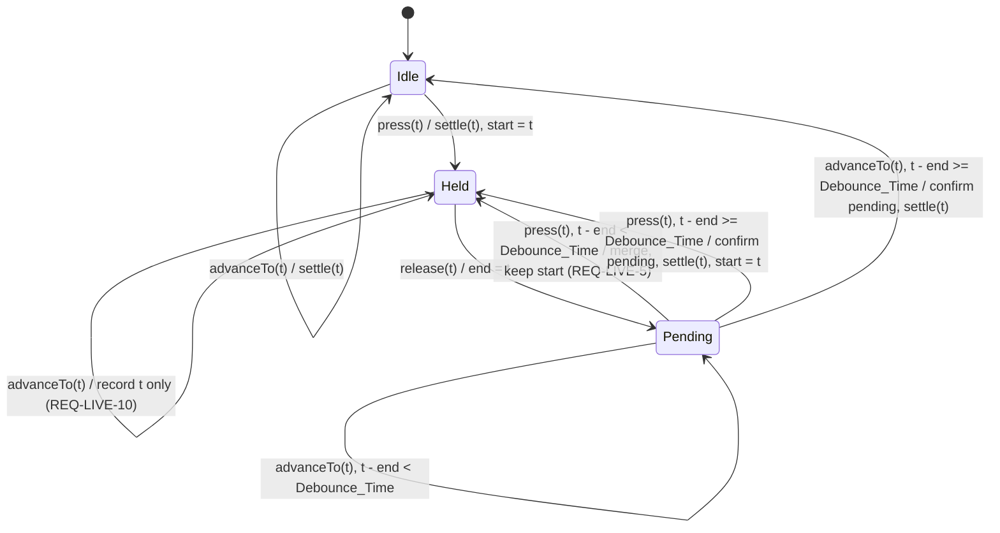

# Design Document: adaptive-timing

## Overview

`adaptive-timing` adds a timing engine to `packages/morse_core`. It turns timestamped switch presses and releases into Morse Symbols, letters and word spaces, using thresholds derived from the user's own calibrated rhythm. The engine is pure Dart: no Flutter, no I/O, no clock. Every duration it compares against comes from a `Calibration` or a `TimingConfig` (steering: "No absolute time constants in the decoder").

The existing `CodeTable`, `MorseEncoder`, `MorseDecoder` and `MorseFormatException` are unchanged. The new engine reads letters through `CodeTable.characterFor` and `CodeTable.codeFor`.

| Public type | File (`lib/src/`) | Role | Main requirements |
|---|---|---|---|
| `SwitchEventKind` | `switch_event_kind.dart` | enum `press`, `release` | REQ-EVENT-1 |
| `SwitchEvent` | `switch_event.dart` | kind + `int` timestamp in Microseconds, plus the ±2^52 range constants | REQ-EVENT-1 |
| `Press` | `press.dart` | one press/release pair, with `duration` | REQ-DEBOUNCE-4 to REQ-DEBOUNCE-6 |
| `TimingConfig` | `timing_config.dart` | Debounce_Time and Word_Gap_Factor, with defaults and validation | REQ-DEBOUNCE-1 to REQ-DEBOUNCE-3, REQ-DEBOUNCE-14 |
| `Calibration` | `calibration.dart` | the four calibrated durations, with validation | REQ-CAL-14 |
| `Calibrator` | `calibrator.dart` | measures a `Calibration` from a keyed Calibration_Word | REQ-CAL-1 to REQ-CAL-31 |
| `CalibrationResult` | `calibration_result.dart` | exactly one of a `Calibration` or a `CalibrationRejection` | REQ-CAL-31 |
| `CalibrationRejection` | `calibration_rejection.dart` | reason + English message | REQ-CAL-3, REQ-CAL-8 to REQ-CAL-13, REQ-CAL-30 |
| `RejectionReason` | `rejection_reason.dart` | enum of the six Rejection_Reasons, in precedence order | REQ-CAL-12 |
| `Debouncer` | `debouncer.dart` | merge-then-drop debounce of a `Press` list | REQ-DEBOUNCE-4 to REQ-DEBOUNCE-12, REQ-DEBOUNCE-20 to REQ-DEBOUNCE-22 |
| `Classifier` | `classifier.dart` | the three integer thresholds and press/gap classification | REQ-TIMING-1 to REQ-TIMING-8, REQ-TIMING-10, REQ-TIMING-11 |
| `MorseSymbol` | `morse_symbol.dart` | enum `dit('.')`, `dah('-')` | REQ-TIMING-3 |
| `GapClass` | `gap_class.dart` | enum `insideLetter`, `betweenLetters`, `betweenWords` | REQ-TIMING-4 |
| `BatchDecoder` | `batch_decoder.dart` | whole Event_Sequence to `List<DecodedItem>` | REQ-BATCH-1 to REQ-BATCH-12, REQ-EVENT-2 to REQ-EVENT-6 |
| `LiveDecoder` | `live_decoder.dart` | incremental state machine for the Key screen | REQ-LIVE-1 to REQ-LIVE-14 |
| `DecodedItem` | `decoded_item.dart` | a Letter_Item, Unknown_Letter_Item or Word_Space | REQ-BATCH-2 to REQ-BATCH-4 |
| `DecodedItemKind` | `decoded_item_kind.dart` | enum `letter`, `unknownLetter`, `wordSpace` | REQ-BATCH-2, REQ-BATCH-3 |
| `TimingInputException` | `timing_input_exception.dart` | the Timing_Input_Error value | REQ-EVENT-3, REQ-EVENT-4 |
| `TimingInputErrorKind` | `timing_input_error_kind.dart` | enum of error kinds, each with a fixed English phrase | REQ-EVENT-3, REQ-EVENT-4 |

One non-exported helper library, `lib/src/internal/event_rules.dart`, holds the event-sequence validator and the press pairing used by both `BatchDecoder` and `Calibrator` (see Decision T5). It declares top-level functions only, no types.

### Research findings

- **kiri_check 1.4.0 is resolved** (`pubspec.lock`: `kiri_check 1.4.0`, sha256 `434a9dc6…`). Everything below was read from the package source in the local pub cache, `kiri_check-1.4.0/lib/src/`, not guessed:
  - `forAll<T>(Arbitrary<T>, block, {int? maxExamples, int? maxTries, int? maxShrinkingTries, int? seed, EdgeCasePolicy? edgeCasePolicy, onFalsify, ignoreFalsify, …})` and `property(description, body)` (`property/top.dart`). `property` registers a `package:test` test.
  - Defaults (`property/home.dart`, `Settings`): `maxExamples` 100, `maxTries` 100, `maxShrinkingTries` 100. `Property` sets `maxTries = max(maxTries, maxExamples)` (`property_base.dart` lines 21 to 23).
  - **Filters do not reduce the example count, but they can stall.** In `GenerationContextImpl.generate` (`property_base.dart` lines 268 to 287), a `FilterException` from `.filter` hits `continue` before `_tries++`, so rejected values are retried until `maxExamples` values pass. A predicate that rarely holds makes generation loop for a long time, and one that never holds loops forever. Early `return` inside the test body, by contrast, counts as a passing example. Both facts support generate-to-satisfy (Testing Strategy).
  - **Failure output carries the seed.** On failure, `forAll` calls `onFalsify` with the shrunk value, then throws `FalsifiedException(example: shrunk, seed: random.seed, …)` (`property_base.dart` lines 137 to 162). Its `toString()` begins `Falsifying example: <shrunk> (seed <n>)` (`property/exception.dart`). `package:test` prints the thrown exception, so the shrunk input and seed appear in `dart test` output (REQ-PBT-4).
  - The random source is `RandomContextImpl.fromSeed(settings.seed ?? Settings.shared.seed)` with an xorshift generator (`random.dart`, `random_xorshift.dart`). A fixed `seed` gives the same examples on every run.
  - Arbitraries available in `arbitrary/top.dart`: `integer({min, max})`, `float({min, max, minExcluded, maxExcluded, nan, infinity})`, `constantFrom`, `constant`, `boolean`, `list({minLength, maxLength})`, `combine2` to `combine8` (Dart records), `oneOf`, `frequency(List<(int, Arbitrary)>)`, `build`, `deck()`, plus `.map`, `.filter`, `.flatMap`.
  - Integers are 64-bit on the VM (`Constants.safeIntMax`). `dart test` runs on the VM here, so test-side `int` arithmetic up to 2^63 is exact.
  - **Uncertainty:** shrinking through `flatMap` and `map` keeps the original value's state but may shrink only the outer choice. Shrunk examples for the dependent generators below may therefore be larger than minimal. They are still reproducible with the fixed seed, which is what REQ-PBT-4 requires. Determinism of the shrink path is inferred from the source (no clock or global random in `ShrinkingContext`), not from documentation.
- **Dart `int` on the web is a JavaScript double.** Integers are exact up to 2^53 ([Dart numbers](https://dart.dev/resources/language/number-representation)). REQ-EVENT-1 bounds timestamps to ±2^52, so any difference of two timestamps is within ±2^53. The engine never adds two timestamps; it subtracts them, and it computes midpoints as `a + (b − a + 1) ~/ 2` so no intermediate sum leaves the safe range.
- **Sealed classes need one library.** Dart requires every direct subtype of a `sealed` class to be in the same library ([class modifiers](https://dart.dev/language/class-modifiers#sealed)). With one public type per file (REQ-ENGINE-3), each file is its own library, so `DecodedItem` cannot be a sealed hierarchy without `part` files, which the existing purity tests do not handle. See Decision T2.
- **The existing purity tests constrain the design.** `test/purity_test.dart` checks REQ-PURE-4 by requiring each `lib/src/*.dart` file to declare exactly one public *class* (enums fail), and REQ-PURE-6 by a hard-coded four-class `_publicApi` set. Doc comment IDs are checked against `test/support/requirement_ids.dart`, which holds only the 68 morse-core IDs. All three need the updates in "Purity test changes" below.

### Decisions for review

- **T1. Exception class name.** The glossary term Timing_Input_Error is realised by `TimingInputException implements Exception`, following morse-core D1: Dart reserves `Error` for programming bugs and `Exception` for bad input a caller is expected to catch. It does not extend `FormatException`, because most of its kinds are not about parsing text.
- **T2. `DecodedItem` is one final class with a kind enum.** Letter_Item, Unknown_Letter_Item and Word_Space are three named constructors of `DecodedItem`, discriminated by `DecodedItemKind`. A `switch` on `kind` is exhaustive. The rejected alternative, a sealed class with three subclasses, needs `part` files (see Research). Trade-off: `character` and `symbols` are nullable fields instead of being present only on their variant.
- **T3. `CalibrationResult` wraps the outcome.** `Calibrator.calibrate` returns a `CalibrationResult` with exactly one of `calibration` and `rejection` non-null. Same reason as T2.
- **T4. Symbol sequences are `String`s of `.` and `-`.** This matches `CodeTable`. `MorseSymbol` is the return type of `Classifier.classifyPress`; its `code` field gives the character.
- **T5. One internal helper library.** `lib/src/internal/event_rules.dart` is not exported, declares no types, and holds `firstEventViolation` and `pairPresses`. The existing REQ-PURE-4 and REQ-PURE-5 checks list `lib/src/` non-recursively, so they do not see it. The recursive import (REQ-ENGINE-1), purity and doc-comment (REQ-ENGINE-6) checks do.
- **T6. Batch and live share pieces, not the pipeline.** Both use `Classifier`, `DecodedItem.fromSymbols` and the merge/drop rule of `Debouncer` (same `<` comparisons against the same `TimingConfig`). `BatchDecoder` is a straight pipeline over the whole list; `LiveDecoder` is an incremental state machine. REQ-LIVE-11 is then a differential test of two implementations, so a bug in either shows up as a mismatch. The rejected alternative, `BatchDecoder` driving a `LiveDecoder`, makes REQ-LIVE-11 hold by construction and leaves both open to the same bug.
- **T7. Live gaps are measured to the press timestamp of the pending press (interpretation of REQ-LIVE-6).** Read literally, REQ-LIVE-6 completes a letter when `now − r ≥ Letter_Gap_Threshold`, where `r` is the release of the last appended Press, even while a later press is held or unconfirmed. That contradicts REQ-LIVE-11 and REQ-BATCH-1. Example with the REQ-BATCH-5 Calibration: dit released at `r`, next press at `r + 400,000` (inside-letter), held until `r + 700,000` (a dah), then `advanceTo(r + 710,000)`. The literal rule completes the letter at `r + 710,000`, but the batch result puts the dah in the same letter, because the Gap is 400,000. The design measures the Gap to the pending press's press timestamp whenever a press is pending (held, or released but unconfirmed). It completes on silence alone only when no press is pending. This keeps every case of REQ-LIVE-6 where the two readings agree, and makes REQ-LIVE-11 hold. **Recommend a wording change to REQ-LIVE-6** (see Requirement gaps).
- **T8. Word_Gap_Threshold is computed exactly.** Word_Gap_Factor is a `double`, so `(factor * letterGap).ceil()` can be off by one when the product rounds. The design multiplies the factor by 2 until it is a whole number (exact for a finite double greater than 1, at most 52 steps), then does the ceiling division in `BigInt` (see Classifier). This uses only the literals 1 and 2, which keeps REQ-DEBOUNCE-2 and REQ-PBT-7 intact.
- **T9. Live error index.** A live `press` or `release` error carries the index the event would have had: the number of press and release calls accepted so far. An `advanceTo` error carries no index, because no event is involved (REQ-EVENT-4).
- **T10. `TimingConfig` and `Calibration` constructors are not `const`.** They validate and throw (REQ-DEBOUNCE-3, REQ-CAL-14), which a `const` constructor cannot do outside asserts. `TimingConfig.defaults` is a `static final` instance.
- **T11. Fixed seeds.** As in morse-core D4, each property passes a fixed seed. Property N of this design uses seed `(100 + N) * 1000 + 3`, so seeds never collide with the morse-core seeds `N * 1000 + 3`.
- **T12. `DecodedItem.toString()` omits content.** It returns only the kind name, for example `DecodedItem(letter)`. The steering bans logging what the user typed, and a decoded letter is what they typed. Tests print `character` and `symbols` explicitly in failure reasons. `Press` and `SwitchEvent` keep timestamps in `toString()`; timestamps are not user text, and the engine never prints them.

## Architecture



The UI never classifies timing (steering). The input adapters in `app/lib/input/` produce timestamps; the app calls `LiveDecoder.press`, `release` and `advanceTo` and renders `items` and `partialSequence`. The app owns the clock (for example a `Stopwatch` read in microseconds) and the ticker that calls `advanceTo`; the engine never reads time (REQ-ENGINE-2).

### Batch data flow



### Live decoder states

The Live_Decoder is in one of four states. "Pending" means a released press that could still merge with the next press.



`Idle` covers both "nothing keyed yet" and "every press confirmed". The letter being built (Partial_Sequence) is separate state that any of these can hold.

## Components and Interfaces

All signatures below are the public API. Every public declaration gets a `///` comment citing at least one ID (REQ-ENGINE-6); the comments are abbreviated here.

### SwitchEventKind, SwitchEvent (`switch_event_kind.dart`, `switch_event.dart`)

```dart
/// REQ-EVENT-1.
enum SwitchEventKind {
  /// Switch closed. REQ-EVENT-1.
  press,
  /// Switch opened. REQ-EVENT-1.
  release,
}

/// One press or release with a timestamp in Microseconds. REQ-EVENT-1.
final class SwitchEvent {
  /// REQ-EVENT-1. Never throws; range is checked by the consumers (REQ-EVENT-5).
  const SwitchEvent(this.kind, this.timestamp);
  /// REQ-EVENT-1.
  const SwitchEvent.press(int timestamp) : this(SwitchEventKind.press, timestamp);
  /// REQ-EVENT-1.
  const SwitchEvent.release(int timestamp) : this(SwitchEventKind.release, timestamp);

  /// Smallest accepted timestamp, −2^52. REQ-EVENT-1.
  static const int minTimestamp = -4503599627370496;
  /// Largest accepted timestamp, 2^52. REQ-EVENT-1.
  static const int maxTimestamp = 4503599627370496;

  /// REQ-EVENT-1.
  final SwitchEventKind kind;
  /// Microseconds. REQ-EVENT-1.
  final int timestamp;

  /// Value equality on kind and timestamp. REQ-EVENT-6.
  @override bool operator ==(Object other);
  /// REQ-EVENT-6.
  @override int get hashCode;
}
```

The range constants are timestamp bounds, not durations, and live outside the five components named in REQ-DEBOUNCE-2.

### Press (`press.dart`)

```dart
/// A press and the release that follows it. REQ-DEBOUNCE-4.
final class Press {
  /// Never throws; the Debouncer validates (REQ-DEBOUNCE-20). REQ-DEBOUNCE-4.
  const Press(this.pressedAt, this.releasedAt);
  /// REQ-DEBOUNCE-4.
  final int pressedAt;
  /// REQ-DEBOUNCE-4.
  final int releasedAt;
  /// releasedAt − pressedAt. REQ-DEBOUNCE-5.
  int get duration;
  /// Value equality. REQ-DEBOUNCE-6, REQ-DEBOUNCE-8.
  @override bool operator ==(Object other);
  /// REQ-DEBOUNCE-6.
  @override int get hashCode;
}
```

### TimingConfig (`timing_config.dart`)

```dart
/// Debounce_Time and Word_Gap_Factor. REQ-DEBOUNCE-1.
final class TimingConfig {
  /// Throws TimingInputException (invalidDebounceTime first, then
  /// invalidWordGapFactor). REQ-DEBOUNCE-1, REQ-DEBOUNCE-3, REQ-DEBOUNCE-14.
  TimingConfig({int debounceTime = defaultDebounceTime,
                double wordGapFactor = defaultWordGapFactor});

  /// 30,000 µs. The only place this value appears. REQ-DEBOUNCE-1, REQ-DEBOUNCE-2.
  static const int defaultDebounceTime = 30000;
  /// 2.0. The only place this value appears. REQ-DEBOUNCE-1, REQ-DEBOUNCE-2.
  static const double defaultWordGapFactor = 2.0;
  /// A config with both defaults. REQ-DEBOUNCE-1.
  static final TimingConfig defaults = TimingConfig();

  /// REQ-DEBOUNCE-1.
  final int debounceTime;
  /// REQ-DEBOUNCE-1.
  final double wordGapFactor;
}
```

Validation: `debounceTime < 0` throws kind `invalidDebounceTime`. Otherwise `wordGapFactor.isNaN || wordGapFactor.isInfinite || wordGapFactor <= 1.0` throws kind `invalidWordGapFactor`. Checking the Debounce_Time first gives REQ-DEBOUNCE-3's rule for two invalid fields. Supplied values are stored unchanged, so they read back exactly (REQ-DEBOUNCE-1).

### Calibration (`calibration.dart`)

```dart
/// The four calibrated durations in Microseconds. REQ-CAL-14.
final class Calibration {
  /// Throws TimingInputException naming the first invalid field. REQ-CAL-14.
  Calibration({required int ditLength, required int dahLength,
               required int symbolGap, required int letterGap});
  /// REQ-CAL-6.
  final int ditLength;
  /// REQ-CAL-6.
  final int dahLength;
  /// REQ-CAL-6.
  final int symbolGap;
  /// REQ-CAL-6.
  final int letterGap;
  /// Value equality. REQ-CAL-15.
  @override bool operator ==(Object other);
  /// REQ-CAL-15.
  @override int get hashCode;
}
```

Validation in field order (REQ-CAL-14):

| Check, in order | Kind |
|---|---|
| `ditLength <= 0` | `invalidDitLength` |
| `dahLength <= 0` or `dahLength <= ditLength` | `invalidDahLength` |
| `symbolGap <= 0` | `invalidSymbolGap` |
| `letterGap <= 0` or `letterGap <= symbolGap` | `invalidLetterGap` |

### Debouncer (`debouncer.dart`)

```dart
/// Removes switch bounce from a time-ordered Press list. REQ-DEBOUNCE-4.
final class Debouncer {
  /// Reads Debounce_Time only from [config]. REQ-DEBOUNCE-2.
  const Debouncer(this.config);
  /// REQ-DEBOUNCE-2.
  final TimingConfig config;
  /// Merge-then-drop. Returns a new unmodifiable list; [presses] is not
  /// changed. Throws TimingInputException for an invalid list.
  /// REQ-DEBOUNCE-4 to REQ-DEBOUNCE-6, REQ-DEBOUNCE-20.
  List<Press> debounce(List<Press> presses);
}
```

Algorithm, with `d = config.debounceTime`:

1. **Validate** (REQ-DEBOUNCE-20). For `i` from 0: if `presses[i].releasedAt < presses[i].pressedAt`, throw kind `releaseBeforePress` with index `i`. If `i > 0` and `presses[i].pressedAt < presses[i - 1].releasedAt`, throw kind `pressOverlapsPrevious` with index `i`. At one index the first check wins. Nothing is built before validation ends, so no partial result escapes.
2. **Merge** (REQ-DEBOUNCE-4). Walk once, keeping a current run `(start, end)`. For each next Press `p`: if `p.pressedAt − end < d`, set `end = p.releasedAt`; otherwise close the run as `Press(start, end)` and start a new run at `p`. A Gap equal to `d` closes the run.
3. **Drop** (REQ-DEBOUNCE-5). Keep only merged Presses with `duration >= d`. No merge runs after this step.
4. Return `List.unmodifiable(kept)`.

Why the REQ-DEBOUNCE-7 and REQ-DEBOUNCE-8 properties hold: after step 2, every Gap between merged Presses is at least `d`. Step 3 only removes Presses. Removing a Press joins its two neighbouring Gaps and the Press itself into one Gap, which is longer than either, so every Gap is still at least `d`. Every kept Press is at least `d` by step 3. Running the Debouncer again therefore merges nothing and drops nothing (idempotence). Every output timestamp is an input timestamp, because a merged Press takes its ends from input Presses (REQ-DEBOUNCE-6). With `d = 0`, `x < 0` is false for every Gap and `duration < 0` is false for every validated Press, so the output equals the input (REQ-DEBOUNCE-10).

### Classifier (`classifier.dart`)

```dart
/// Integer thresholds from a Calibration and a TimingConfig. REQ-TIMING-1.
final class Classifier {
  /// Computes the three thresholds once. Never throws for a valid
  /// Calibration and TimingConfig. REQ-TIMING-1, REQ-TIMING-2.
  Classifier(this.calibration, this.config);
  /// REQ-TIMING-1.
  final Calibration calibration;
  /// REQ-TIMING-1.
  final TimingConfig config;
  /// ⌈(Dit_Length + Dah_Length) / 2⌉. REQ-TIMING-1.
  final int pressThreshold;
  /// ⌈(Symbol_Gap + Letter_Gap) / 2⌉. REQ-TIMING-1.
  final int letterGapThreshold;
  /// Smallest integer > Letter_Gap and ≥ Word_Gap_Factor × Letter_Gap. REQ-TIMING-1.
  final int wordGapThreshold;
  /// dit if duration < pressThreshold, else dah. Throws for a negative
  /// duration. REQ-TIMING-3, REQ-TIMING-11.
  MorseSymbol classifyPress(int duration);
  /// REQ-TIMING-4, REQ-TIMING-11.
  GapClass classifyGap(int duration);
}
```

Threshold formulas (REQ-TIMING-1):

- `pressThreshold = dit + (dah − dit + 1) ~/ 2`. For whole numbers `a < b`, `a + ⌈(b − a)/2⌉ = ⌈(a + b)/2⌉`, and the form never computes `a + b`, so it stays exact on the web. `letterGapThreshold` uses the same form with Symbol_Gap and Letter_Gap.
- `wordGapThreshold`:
  1. `m = factor; k = 0; while (m != m.truncateToDouble()) { m *= 2; k++; }`. Multiplying a double by 2 is exact. A finite double greater than 1 with a fractional part is below 2^52 and has at most 52 fractional bits, so the loop ends within 52 steps with `factor = m / 2^k` exactly.
  2. `num = BigInt.from(m) * BigInt.from(letterGap)`, `den = BigInt.one << k`, `w0 = (num + den − BigInt.one) ~/ den`. This is `⌈factor × letterGap⌉` exactly.
  3. `wordGapThreshold = max(w0, letterGap + 1)`, converted with `toInt()`.
  
  Example (REQ-TIMING-6): factor 2.5, letter gap 700,001: `m = 5, k = 1`, `w0 = ⌈3,500,005 / 2⌉ = 1,750,003`.

Why integer comparison is exact and scale invariant: for a whole number `x` and a real `r`, `x ≥ ⌈r⌉` holds exactly when `x ≥ r`. So "duration ≥ pressThreshold" means "duration ≥ (dit + dah)/2" with no rounding error, and multiplying the duration and every Calibration value by a whole number `k` multiplies both sides of the real comparison by `k` (REQ-TIMING-10). The same holds for `wordGapThreshold`, where `x ≥ W` means `x > letterGap` and `x ≥ factor × letterGap`.

Classification (REQ-TIMING-3, REQ-TIMING-4): a negative duration throws kind `negativeDuration` with no index (REQ-TIMING-11). Otherwise `classifyPress` returns `dit` when `duration < pressThreshold`, else `dah`; `classifyGap` returns `insideLetter` when `duration < letterGapThreshold`, `betweenLetters` when `duration < wordGapThreshold`, else `betweenWords`. The ordering proof for REQ-TIMING-2: `dah − dit ≥ 1` gives `pressThreshold ≥ dit + 1` and `pressThreshold ≤ dit + (dah − dit) = dah`; the same for the letter gap; and `wordGapThreshold ≥ letterGap + 1` by step 3.

The Classifier does not check REQ-TIMING-9 (Debounce_Time against Dit_Length and Symbol_Gap). That check belongs to the decoders, so REQ-TIMING-2 and REQ-TIMING-10 can range over all Calibrations and Timing_Configs.

### MorseSymbol, GapClass (`morse_symbol.dart`, `gap_class.dart`)

```dart
/// REQ-TIMING-3.
enum MorseSymbol {
  /// REQ-TIMING-3.
  dit('.'),
  /// REQ-TIMING-3.
  dah('-');
  const MorseSymbol(this.code);
  /// `.` or `-`, as in CodeTable. REQ-TIMING-3.
  final String code;
}

/// REQ-TIMING-4.
enum GapClass {
  /// REQ-TIMING-4.
  insideLetter,
  /// REQ-TIMING-4.
  betweenLetters,
  /// REQ-TIMING-4.
  betweenWords,
}
```

### DecodedItem, DecodedItemKind (`decoded_item.dart`, `decoded_item_kind.dart`)

```dart
/// REQ-BATCH-2, REQ-BATCH-3, REQ-BATCH-4.
enum DecodedItemKind {
  /// REQ-BATCH-2.
  letter,
  /// REQ-BATCH-3.
  unknownLetter,
  /// REQ-BATCH-1.
  wordSpace,
}

/// One Decoded_Item. REQ-BATCH-1.
final class DecodedItem {
  /// A Letter_Item. REQ-BATCH-2.
  const DecodedItem.letter(String this.character)
      : kind = DecodedItemKind.letter, symbols = null;
  /// An Unknown_Letter_Item with a non-empty Symbol sequence. REQ-BATCH-3.
  const DecodedItem.unknownLetter(String this.symbols)
      : kind = DecodedItemKind.unknownLetter, character = null;
  /// A Word_Space. REQ-BATCH-1.
  const DecodedItem.wordSpace()
      : kind = DecodedItemKind.wordSpace, character = null, symbols = null;
  /// Letter_Item if CodeTable knows [symbols], else Unknown_Letter_Item.
  /// Shared by BatchDecoder and LiveDecoder. REQ-BATCH-2, REQ-BATCH-3, REQ-LIVE-6.
  factory DecodedItem.fromSymbols(String symbols);

  /// REQ-BATCH-2.
  final DecodedItemKind kind;
  /// Uppercase character, letters only. REQ-BATCH-2.
  final String? character;
  /// Symbol sequence, unknown letters only. REQ-BATCH-3.
  final String? symbols;
  /// Value equality on all three fields. REQ-LIVE-11.
  @override bool operator ==(Object other);
  /// REQ-LIVE-11.
  @override int get hashCode;
  /// Kind only, never the character or symbols (T12). REQ-ENGINE-5.
  @override String toString();
}
```

### event_rules (`lib/src/internal/event_rules.dart`, not exported)

```dart
/// The first Valid_Event_Sequence violation, or null. Never throws.
/// REQ-EVENT-3, REQ-EVENT-5.
TimingInputException? firstEventViolation(List<SwitchEvent> events);

/// Pairs a Valid_Event_Sequence into Presses. REQ-BATCH-1, REQ-CAL-5.
List<Press> pairPresses(List<SwitchEvent> events);
```

`firstEventViolation` scans `i` from 0 and returns at the first rule that breaks, checking at each index in the REQ-EVENT-3 precedence order:

1. `timestamp < SwitchEvent.minTimestamp || timestamp > SwitchEvent.maxTimestamp`: `timestampOutOfRange`.
2. `i == 0` and kind is release: `startsWithRelease`.
3. `i > 0`, both press: `twoPressesInARow`.
4. `i > 0`, both release: `twoReleasesInARow`.
5. `i > 0` and `timestamp < events[i − 1].timestamp`: `decreasingTimestamp`.

After the loop, if the list is non-empty and the last event is a press: `endsWithPress` at `length − 1`. Rule 5 never compares against an out-of-range timestamp, because the scan would have stopped at that earlier index. The function only reads the list, so the caller's list is unchanged (REQ-EVENT-6).

### Calibrator, CalibrationResult, CalibrationRejection, RejectionReason

```dart
/// Rejection reasons in precedence order (REQ-CAL-12). REQ-CAL-3.
enum RejectionReason {
  /// REQ-CAL-3.
  unsuitableWord,
  /// REQ-CAL-11.
  invalidEvents,
  /// REQ-CAL-8.
  wrongPressCount,
  /// REQ-CAL-9.
  pressesOverlap,
  /// REQ-CAL-10.
  gapsOverlap,
  /// REQ-CAL-30.
  zeroDuration,
  /// Median above the 2^40 cap. REQ-CAL-12, REQ-CAL-31.
  durationTooLong,
}

/// REQ-CAL-13.
final class CalibrationRejection {
  /// REQ-CAL-13.
  const CalibrationRejection(this.reason, this.message);
  /// REQ-CAL-12.
  final RejectionReason reason;
  /// English, no timestamps, durations or Symbols. REQ-CAL-13.
  final String message;
  /// Returns [message]. REQ-ENGINE-5.
  @override String toString();
}

/// Exactly one of [calibration] and [rejection] is non-null. REQ-CAL-31.
final class CalibrationResult {
  /// REQ-CAL-31.
  const CalibrationResult.accepted(Calibration this.calibration) : rejection = null;
  /// REQ-CAL-31.
  const CalibrationResult.rejected(CalibrationRejection this.rejection) : calibration = null;
  /// REQ-CAL-6.
  final Calibration? calibration;
  /// REQ-CAL-12.
  final CalibrationRejection? rejection;
  /// True when [calibration] is non-null. REQ-CAL-31.
  bool get isAccepted;
}

/// Measures a Calibration from a keyed Calibration_Word. REQ-CAL-1.
final class Calibrator {
  /// Uses TimingConfig.defaults when [config] is null. REQ-CAL-5.
  Calibrator([TimingConfig? config]);
  /// REQ-CAL-1.
  static const String defaultWord = 'PARIS';
  /// REQ-CAL-5.
  final TimingConfig config;
  /// Never throws. REQ-CAL-2 to REQ-CAL-31.
  CalibrationResult calibrate(List<SwitchEvent> events, {String word = defaultWord});
}
```

`calibrate` runs these steps and returns at the first rejection, which gives the REQ-CAL-12 order by construction:

1. **Word check** (REQ-CAL-3, REQ-CAL-20, REQ-CAL-21). "Characters" are UTF-16 code units, the same unit `CodeTable.codeFor` takes. In order: empty; more than 16 code units; any unit that is a space or has `codeFor(unit) == null`; fewer than 2 units; no `.` in the concatenated codes; no `-`; no code of length 2 or more. The message names the rule, for example "The calibration word has no character with two or more symbols." The events are not looked at.
2. **Expected plan** (REQ-CAL-2). Concatenate `codeFor` of each unit, so case folding comes from `CodeTable` (REQ-CAL-20). Record each Press's expected Symbol and each Gap's class: Gap `j` is between letters when Press `j + 1` is the first Symbol of a character. For `PARIS` this gives 14 Presses and between-letter Gaps 3, 5, 8, 10 (REQ-CAL-4).
3. **Event check** (REQ-CAL-11). `firstEventViolation(events)`; if non-null, reject `invalidEvents` with a message containing the index and the rule phrase of that kind, for example "Event 4 is invalid: two presses in a row."
4. **Debounce** (REQ-CAL-5). `Debouncer(config).debounce(pairPresses(events))`. This cannot throw, because a Valid_Event_Sequence pairs into a valid Press list.
5. **Count** (REQ-CAL-8). If the count differs from the plan, reject `wrongPressCount`: "Expected 14 presses but received 13 after debounce."
6. **Separation** (REQ-CAL-9, REQ-CAL-10). Reject `pressesOverlap` if `max(expected dits) >= min(expected dahs)`. Then reject `gapsOverlap` if `max(inside-letter gaps) >= min(between-letter gaps)`. Step 1 guarantees all four groups are non-empty.
7. **Medians** (REQ-CAL-6, REQ-CAL-7). Sort a copy of each group. Odd count: the middle value. Even count: `a + (b − a + 1) ~/ 2` for the two middle values `a ≤ b`, which is the mean rounded half up.
8. **Zero** (REQ-CAL-30). If any median is 0, reject `zeroDuration`.
9. **Too long** (REQ-CAL-31). If any median is greater than 2^40, reject `durationTooLong`. Timestamps span ±2^52, so a measured duration can exceed the REQ-CAL-14 cap.
10. Return `CalibrationResult.accepted(Calibration(...))`. Step 6 makes every dit median smaller than every dah median, and likewise for gaps, step 8 removes zeros and step 9 removes values above the cap, so the constructor cannot throw (REQ-CAL-31).

The method wraps nothing in `try`/`catch`: each step is total for the inputs that reach it. A property test (Property 5) checks that it never throws.

### BatchDecoder (`batch_decoder.dart`)

```dart
/// Decodes a whole Event_Sequence. REQ-BATCH-1.
final class BatchDecoder {
  /// Throws debounceTimeTooLong when Debounce_Time > Dit_Length or
  /// > Symbol_Gap. REQ-TIMING-9.
  BatchDecoder(Calibration calibration, TimingConfig config);
  /// REQ-BATCH-1.
  final Classifier classifier;
  /// Returns an unmodifiable list. Throws TimingInputException for an
  /// invalid sequence, before any debounce. REQ-BATCH-1 to REQ-BATCH-4, REQ-EVENT-3.
  List<DecodedItem> decode(List<SwitchEvent> events);
}
```

Algorithm:

1. `firstEventViolation(events)`; throw it if non-null (REQ-EVENT-3).
2. `kept = Debouncer(config).debounce(pairPresses(events))`.
3. Walk `kept` with a `StringBuffer letter` and an output list. For press `i`: if `i > 0`, classify the Gap `kept[i].pressedAt − kept[i − 1].releasedAt`. On `betweenLetters`, flush `letter` as `DecodedItem.fromSymbols`. On `betweenWords`, flush and add `DecodedItem.wordSpace()`. Then append `classifyPress(kept[i].duration).code`.
4. Flush the last letter if non-empty and return `List.unmodifiable(output)`.

A Word_Space is only ever added between two flushed letters, so the output starts and ends with a letter and has no two Word_Spaces in a row (REQ-BATCH-4).

### LiveDecoder (`live_decoder.dart`)

```dart
/// Incremental decoder for the Key screen. REQ-LIVE-1.
final class LiveDecoder {
  /// Same TIMING-9 check as BatchDecoder. REQ-LIVE-1, REQ-TIMING-9.
  LiveDecoder(Calibration calibration, TimingConfig config);
  /// REQ-LIVE-1.
  final Classifier classifier;
  /// Unmodifiable view; only ever appended to. REQ-LIVE-2, REQ-LIVE-8.
  List<DecodedItem> get items;
  /// Confirmed Symbols of the current letter, e.g. ".-". REQ-LIVE-2, REQ-LIVE-4.
  String get partialSequence;
  /// REQ-LIVE-2, REQ-LIVE-3.
  bool get isPressed;
  /// Latest timestamp received by any call, or null. REQ-LIVE-9, REQ-LIVE-10.
  int? get latestTimestamp;
  /// REQ-LIVE-3, REQ-LIVE-4, REQ-LIVE-5, REQ-LIVE-9.
  void press(int timestamp);
  /// REQ-LIVE-3, REQ-LIVE-9.
  void release(int timestamp);
  /// REQ-LIVE-4, REQ-LIVE-6, REQ-LIVE-10, REQ-LIVE-14.
  void advanceTo(int now);
}
```

Private state:

| Field | Meaning |
|---|---|
| `_items` | completed Decoded_Items |
| `_partial` | `StringBuffer`, the Partial_Sequence |
| `_pressed` | switch is down |
| `_latest` | latest timestamp received, `int?` |
| `_eventCount` | press and release calls accepted (index for T9) |
| `_pendingStart`, `_pendingEnd` | the unconfirmed press: start set while held or pending, end set once released |
| `_lastKeptRelease` | release timestamp of the last Press appended to the Partial_Sequence (`r` below) |

Every public method first validates, then mutates. A failed check throws before any field changes (REQ-LIVE-9). Checks in order: timestamp out of range; `timestamp < _latest` (`decreasingTimestamp`); then for `press`, already pressed (`twoPressesInARow`); for `release`, not pressed (`startsWithRelease` when `_eventCount == 0`, else `twoReleasesInARow`).

- `press(t)`: if a pending press exists with `t − _pendingEnd < d`, merge: clear `_pendingEnd`, keep `_pendingStart` (REQ-LIVE-5). Otherwise `_settle(t)`, then `_pendingStart = t`. Set `_pressed`, `_latest = t`, `_eventCount++`.
- `release(t)`: `_pendingEnd = t`, clear `_pressed`, `_latest = t`, `_eventCount++`. Nothing is confirmed on release, even when `d` is 0; the next `advanceTo` or `press` confirms it (REQ-LIVE-4).
- `advanceTo(t)`: if pressed, set `_latest = t` and return (REQ-LIVE-10). Otherwise `_settle(t)` and `_latest = t`.

`_settle(now)`:

1. **Confirm** (REQ-LIVE-4, REQ-LIVE-14). If a pending press is released and `now − _pendingEnd ≥ d`: if its duration `≥ d`, call `_appendKept(start, end)`; otherwise discard it. Clear the pending press.
2. **Complete on silence** (REQ-LIVE-6, T7). If `_partial` is non-empty and no press is pending and `now − r ≥ letterGapThreshold`, flush: append `DecodedItem.fromSymbols(_partial)` and clear `_partial`. If a press is pending with `_pendingStart − r ≥ letterGapThreshold`, flush as well: that Gap is between letters whatever happens to the pending press, since a later drop only lengthens it.

`_appendKept(start, end)` with `g = start − r`:

1. If `_partial` is non-empty and `g ≥ letterGapThreshold`, flush (REQ-LIVE-6).
2. If `_partial` is empty, `_items` is non-empty and `g ≥ wordGapThreshold`, append `DecodedItem.wordSpace()` (REQ-LIVE-7). Silence alone never does this.
3. Append `classifyPress(end − start).code` to `_partial`; set `r = end`.

Why live equals batch (REQ-LIVE-11):

- **Same merges.** Both merge exactly when the next press comes less than `d` after the previous release. The live decoder decides this when the next press arrives, before confirming, so a press that is later dropped can still absorb a following press. The batch Debouncer merges before dropping too.
- **Same drops.** A pending press is confirmed only once `now − end ≥ d`. After that, no later press can be within `d` of its release, so its merged extent is final, and the `duration ≥ d` test matches REQ-DEBOUNCE-5.
- **Same Gaps.** `r` advances only on kept Presses, so `g` equals the batch Gap between consecutive debounced Presses, including any dropped Presses inside it.
- **Same grouping.** A letter is flushed early on silence only when no press is pending and `now − r ≥ letterGapThreshold`. Any kept Press after that starts at or after `now`, so its batch Gap is also between letters or longer. Step 2 of `_appendKept` adds the Word_Space exactly when the batch Gap is between words, because `wordGapThreshold > letterGapThreshold`.
- **Final flush.** The trailing `advanceTo(lastRelease + max(d, letterGapThreshold))` confirms the last press and then flushes the last letter, so the Partial_Sequence ends empty.

Checking REQ-LIVE-12 and REQ-LIVE-13 against this: press 0, release 100,000, `advanceTo(130,000)`: `130,000 − 100,000 = 30,000 ≥ d`, so the dit is confirmed and the Partial_Sequence is `.`. `advanceTo(800,000)`: `800,000 − 100,000 = 700,000 ≥ 475,000`, so `E` is flushed.

### TimingInputException, TimingInputErrorKind

```dart
/// REQ-EVENT-3, REQ-EVENT-4.
enum TimingInputErrorKind {
  timestampOutOfRange('timestamp is out of range'),       // REQ-EVENT-5
  startsWithRelease('sequence starts with a release'),    // REQ-EVENT-3
  twoPressesInARow('two presses in a row'),               // REQ-EVENT-3, REQ-LIVE-9
  twoReleasesInARow('two releases in a row'),             // REQ-EVENT-3, REQ-LIVE-9
  decreasingTimestamp('timestamp is earlier than the one before'), // REQ-EVENT-3, REQ-LIVE-9
  endsWithPress('sequence ends with a press'),            // REQ-EVENT-3
  invalidDebounceTime('debounce time is negative'),       // REQ-DEBOUNCE-3
  invalidWordGapFactor('word gap factor must be a finite number greater than 1'), // REQ-DEBOUNCE-3
  invalidDitLength('dit length is invalid'),              // REQ-CAL-14
  invalidDahLength('dah length is invalid'),              // REQ-CAL-14
  invalidSymbolGap('symbol gap is invalid'),              // REQ-CAL-14
  invalidLetterGap('letter gap is invalid'),              // REQ-CAL-14
  debounceTimeTooLong('debounce time is longer than the dit length or symbol gap'), // REQ-TIMING-9
  negativeDuration('duration is negative'),               // REQ-TIMING-11
  releaseBeforePress('press is released before it is pressed'), // REQ-DEBOUNCE-20
  pressOverlapsPrevious('press starts before the previous press is released'); // REQ-DEBOUNCE-20

  const TimingInputErrorKind(this.phrase);
  /// Fixed English phrase, unique per kind. REQ-EVENT-4.
  final String phrase;
}

/// The Timing_Input_Error. REQ-EVENT-3, REQ-EVENT-4.
final class TimingInputException implements Exception {
  /// REQ-EVENT-4.
  TimingInputException(this.kind, {this.index});
  /// REQ-EVENT-3.
  final TimingInputErrorKind kind;
  /// Zero-based event or Press index, where one is involved. REQ-EVENT-3, REQ-DEBOUNCE-20.
  final int? index;
  /// "Event 4: two presses in a row." or "Invalid timing: debounce time is negative."
  /// REQ-EVENT-4.
  String get message;
  /// Returns [message]. REQ-ENGINE-5.
  @override String toString();
}
```

Each value has its own `///` comment in the real file (shown as `//` above for space). The message holds only the phrase and, when present, the index (`"Event"` for event indexes, `"Press"` for Debouncer indexes). It is built from `kind` and `index` alone, so no timestamp, Symbol or character can reach it (REQ-EVENT-4, REQ-ENGINE-5).

## Data Models

### Value types

| Type | Fields | Invariants |
|---|---|---|
| `SwitchEvent` | `kind`, `timestamp: int` | none at construction; consumers check ±2^52 |
| `Press` | `pressedAt`, `releasedAt: int` | none at construction; Debouncer checks `releasedAt ≥ pressedAt` and order |
| `TimingConfig` | `debounceTime: int`, `wordGapFactor: double` | `debounceTime ≥ 0`; factor finite and `> 1.0` |
| `Calibration` | `ditLength`, `dahLength`, `symbolGap`, `letterGap: int` | all `> 0`; `dah > dit`; `letterGap > symbolGap` |
| `CalibrationResult` | `calibration?`, `rejection?` | exactly one non-null |
| `CalibrationRejection` | `reason`, `message` | message non-empty, no timestamps, durations or Symbols |
| `DecodedItem` | `kind`, `character?`, `symbols?` | letter: `character` is a `CodeTable` key; unknown: `symbols` non-empty, `characterFor(symbols) == null`; word space: both null |
| `TimingInputException` | `kind`, `index?` | message from `kind.phrase` and `index` only |

### Derived thresholds for the reference Calibration

The reference Calibration used by REQ-BATCH-5 and later: Dit_Length 100,000, Dah_Length 300,000, Symbol_Gap 250,000, Letter_Gap 700,000, default Timing_Config.

| Threshold | Value | Class boundaries |
|---|---|---|
| Press_Threshold | 200,000 | press < 200,000 is a dit |
| Letter_Gap_Threshold | 475,000 | gap < 475,000 is inside a letter; the spike user's 214,000 to 314,000 gaps fall here |
| Word_Gap_Threshold | 1,400,000 | gap ≥ 1,400,000 ends a word |

### Calibration plan for `PARIS` (REQ-CAL-4)

| Letter | Code | Press indexes | Gap after the letter |
|---|---|---|---|
| P | `.--.` | 0 to 3 | Gap 3 (between letters) |
| A | `.-` | 4, 5 | Gap 5 |
| R | `.-.` | 6 to 8 | Gap 8 |
| I | `..` | 9, 10 | Gap 10 |
| S | `...` | 11 to 13 | none |

10 dits, 4 dahs, 9 inside-letter Gaps (0, 1, 2, 4, 6, 7, 9, 11, 12), 4 between-letter Gaps.

### Package layout after this spec

```
packages/morse_core/
  lib/morse_core.dart                  library doc + 4 existing + 19 new exports
  lib/src/                             one public type per file, names as in the Overview table
  lib/src/internal/event_rules.dart    not exported; functions only
  test/switch_event_test.dart          REQ-EVENT-*
  test/timing_config_test.dart         REQ-DEBOUNCE-1, -3, -14; REQ-CAL-14
  test/debouncer_test.dart             REQ-DEBOUNCE-10 to -12, -20 to -22; REQ-PBT-6
  test/calibrator_test.dart            REQ-CAL-*
  test/classifier_test.dart            REQ-TIMING-5, -6, -9, -11; REQ-PBT-6
  test/batch_decoder_test.dart         REQ-BATCH-*, REQ-DEBOUNCE-13
  test/live_decoder_test.dart          REQ-LIVE-*
  test/timing_properties_test.dart     every property below
  test/purity_test.dart                updated; adds REQ-ENGINE-* and REQ-PBT-7 tests
  test/support/timing_arbitraries.dart kiri_check generators (no import of package:morse_core)
  test/support/timing_oracles.dart     reference models and Ideal_Timing builder (ITU fixture only)
  test/support/timing_requirement_ids.dart  the 96 adaptive-timing IDs
```

## Correctness Properties

*A property is a characteristic or behavior that should hold true across all valid executions of a system-essentially, a formal statement about what the system should do. Properties serve as the bridge between human-readable specifications and machine-verifiable correctness guarantees.*

Each property lists the REQ IDs it covers ("Traces to") and the same criteria as `X.Y` numbers (Requirement X, criterion Y in document order) in the Validates line. For example, REQ-DEBOUNCE-7 is the 4th criterion of Requirement 3, so 3.4.

Reflection on the prework merged overlapping candidates:

- REQ-DEBOUNCE-4, -5, -6 and -7 are one model comparison plus shape checks on the same output, so they form Property 1. REQ-DEBOUNCE-8 (idempotence) stays separate because REQ-PBT-1 names it and it checks a different relation.
- REQ-TIMING-1 and REQ-TIMING-2 share Property 6: matching the exact oracle formula implies the ordering, but the ordering is asserted directly too, because REQ-PBT-1 names REQ-TIMING-2.
- REQ-TIMING-3, -4 and -11 are the same "classification is a threshold comparison" rule and form Property 7.
- REQ-TIMING-7 and REQ-TIMING-8 stay separate (Properties 8 and 9). They have different preconditions on the generated duration and REQ-PBT-1 lists each.
- REQ-CAL-2, -6, -20 and -15 form Property 4. A wrong plan, wrong median group or case-sensitive lookup each breaks the round trip.
- REQ-CAL-7 to -12 and -31 form Property 5, a model comparison of the whole Calibrator against an oracle that applies the rules in order.
- REQ-LIVE-3, -4, -8 and -11 form Property 15. The final state is compared with the batch output, and every intermediate state is checked for append-only items and pressed state.
- REQ-EVENT-6 is asserted inside Properties 5 and 14 rather than as its own property.
- REQ-EVENT-4, REQ-CAL-13 and REQ-ENGINE-5 all constrain message text and form Property 18.

### Property 1: Debouncer matches merge-then-drop and leaves no bounce

*For any* time-ordered list of 0 to 50 Presses with Press and Gap durations from 0 to 2,000,000 µs, any start timestamp (including negative values) and any Debounce_Time `d` from 0 to 100,000 µs, `Debouncer(TimingConfig(debounceTime: d)).debounce(list)` equals the oracle `referenceDebounce(list, d)`. The oracle merges runs whose Gaps are all `< d` and then drops Presses shorter than `d`. The output is also time-ordered, has no more Presses than the input, every Press and every Gap in it lasts at least `d`, every timestamp in it occurs in the input, every unmerged input Press lasting at least `d` appears unchanged, and the input list equals its copy taken before the call.

Traces to: REQ-DEBOUNCE-4, REQ-DEBOUNCE-5, REQ-DEBOUNCE-6, REQ-DEBOUNCE-7, REQ-DEBOUNCE-10.

**Validates: Requirements 3.1, 3.2, 3.3, 3.4, 3.7**

### Property 2: Debounce is idempotent

*For any* list and Debounce_Time in the ranges of Property 1, debouncing the Debouncer's output again with the same Debounce_Time returns a list equal to that output.

Traces to: REQ-DEBOUNCE-8.

**Validates: Requirements 3.5**

### Property 3: Bounce never becomes a Symbol

*For any* Valid_Event_Sequence (durations 0 to 10,000,000 µs, at least 10 percent of cases with a Press or Gap shorter than `d`), any Calibration and any Timing_Config with `d ≤ min(Dit_Length, Symbol_Gap)`, let `kept = Debouncer(config).debounce(pairs)`. The Symbols of the `BatchDecoder` output, read in order, equal `kept.map((p) => classifier.classifyPress(p.duration).code).join()`. A Letter_Item contributes `CodeTable.codeFor(character)`, an Unknown_Letter_Item its `symbols`, and a Word_Space nothing. So there is exactly one Symbol per debounced Press and none from a Press that the merge leaves shorter than `d`.

Traces to: REQ-DEBOUNCE-9, REQ-BATCH-1.

**Validates: Requirements 3.6, 7.1**

### Property 4: Calibration round trip

*For any* Calibration, any Calibration_Word that passes REQ-CAL-3 (2 to 16 Code_Table characters in random ASCII case), any Timing_Config with `d ≤ min(Dit_Length, Symbol_Gap)` and any start timestamp, `Calibrator(config).calibrate(idealTiming(word, calibration, start), word: word)` is accepted with a Calibration equal to the original. Calibrating the same events with `word` in all upper case and in all lower case returns the same result.

Traces to: REQ-CAL-2, REQ-CAL-6, REQ-CAL-15, REQ-CAL-20.

**Validates: Requirements 4.2, 4.5, 5.2, 5.11**

### Property 5: Calibrator follows the rejection order and never throws

*For any* Calibration_Word (suitable or drawn to break one REQ-CAL-3 rule), any Event_Sequence (a jittered or perturbed keying of the word, with wrong counts, overlapping classes, zero-length Presses when `d = 0`, or an injected invalid event) and any Timing_Config, `calibrate` returns normally with exactly one of `calibration` and `rejection` non-null. The result equals the oracle `referenceCalibrate`, which applies the rules in the REQ-CAL-12 order and computes medians as in REQ-CAL-7: same Rejection_Reason when rejected, same four values when accepted. The caller's Event_Sequence equals its copy taken before the call.

Traces to: REQ-CAL-3, REQ-CAL-7, REQ-CAL-8, REQ-CAL-9, REQ-CAL-10, REQ-CAL-11, REQ-CAL-12, REQ-CAL-31, REQ-EVENT-2, REQ-EVENT-6.

**Validates: Requirements 4.3, 5.3, 5.4, 5.5, 5.6, 5.7, 5.8, 5.14, 1.2, 1.6**

### Property 6: Thresholds match the exact formulas and are ordered

*For any* Calibration (values 1 to 10,000,000 µs) and any Word_Gap_Factor (finite, greater than 1, including `1 + 2^-52`, multiples of 0.25 and arbitrary doubles up to 1,000), the Classifier's `pressThreshold`, `letterGapThreshold` and `wordGapThreshold` equal the oracle values computed with exact rational arithmetic. They also satisfy `dit < pressThreshold ≤ dah`, `symbolGap < letterGapThreshold ≤ letterGap` and `wordGapThreshold > letterGap`.

Traces to: REQ-TIMING-1, REQ-TIMING-2.

**Validates: Requirements 6.1, 6.2**

### Property 7: Classification is a threshold comparison

*For any* Calibration, Timing_Config and duration `x` from 0 to 10 × `wordGapThreshold` (with extra weight on each threshold and its neighbours ±1), `classifyPress(x)` is `dah` exactly when `x ≥ pressThreshold`. `classifyGap(x)` is `insideLetter` when `x < letterGapThreshold`, `betweenWords` when `x ≥ wordGapThreshold`, and `betweenLetters` otherwise. *For any* negative `x`, both methods throw a `TimingInputException` of kind `negativeDuration`.

Traces to: REQ-TIMING-3, REQ-TIMING-4, REQ-TIMING-11.

**Validates: Requirements 6.3, 6.4, 6.11**

### Property 8: Press jitter is tolerated

*For any* Well_Separated_Calibration and any whole-µs Press duration `x` with `5x ≤ 6 × Dit_Length` (that is, `x ≤ 1.2 × Dit_Length` exactly), `classifyPress(x)` is `dit`. *For any* `x` with `5x ≥ 4 × Dah_Length`, it is `dah`.

Traces to: REQ-TIMING-7.

**Validates: Requirements 6.7**

### Property 9: Gap jitter is tolerated

*For any* Well_Separated_Calibration and whole-µs Gap `x`: if `5x ≤ 6 × Symbol_Gap` then `classifyGap(x)` is `insideLetter`; if `4 × Letter_Gap ≤ 5x ≤ 6 × Letter_Gap` then it is `betweenLetters`; if `5x ≥ 6 × wordGapThreshold` then it is `betweenWords`.

Traces to: REQ-TIMING-8.

**Validates: Requirements 6.8**

### Property 10: Classification is scale invariant

*For any* Calibration, Word_Gap_Factor that is a multiple of 0.25 from 1.25 to 8.0, duration `x` from 0 to 10 × `wordGapThreshold` and whole number `k` from 1 to 1,000, the Classifier built from the Calibration with every value multiplied by `k` gives `classifyPress(k·x)` and `classifyGap(k·x)` equal to the original Classifier's `classifyPress(x)` and `classifyGap(x)`.

Traces to: REQ-TIMING-10.

**Validates: Requirements 6.10**

### Property 11: Jittered keying decodes to the text

*For any* text of 1 to 20 characters made of Code_Table characters and single spaces (no leading or trailing space), any Well_Separated_Calibration with every value at least 1,000 µs (the test draws it from `wellSeparated(min: 1000)`, because REQ-BATCH-8 requires every Dit_Length, Dah_Length, Symbol_Gap and Letter_Gap to be at least 1,000 Microseconds), and any per-Press and per-Gap factor from 0.8 to 1.2, the `BatchDecoder` output for the jittered Ideal_Timing has one Letter_Item per non-space character, carrying that character in order, and one Word_Space per space, with no Unknown_Letter_Item.

Traces to: REQ-BATCH-8, REQ-BATCH-2.

**Validates: Requirements 7.8, 7.2**

### Property 12: Batch decoding is scale invariant

*For any* Valid_Event_Sequence, Calibration and Timing_Config built by the margin-respecting generator (every Press, Gap and Calibration duration at least 1,000 µs, and no raw or post-debounce Press or Gap duration within the margin of the Debounce_Time or of a threshold), and any `k` from 0.25 to 4, the `BatchDecoder` output for the scaled input (as defined in REQ-BATCH-9) equals the output for the original input.

Traces to: REQ-BATCH-9.

**Validates: Requirements 7.9**

### Property 13: Batch output matches the reference decoder and is well formed

*For any* Valid_Event_Sequence, Calibration and Timing_Config with `d ≤ min(Dit_Length, Symbol_Gap)`, `decode` returns normally and its output equals the oracle `referenceDecode`, built from `referenceDebounce`, the oracle thresholds and the ITU fixture. Unknown Symbol sequences become Unknown_Letter_Items, and decoding goes on after them. The output is empty or starts and ends with a letter item, and contains no two Word_Spaces in a row.

Traces to: REQ-BATCH-1, REQ-BATCH-3, REQ-BATCH-4, REQ-EVENT-2.

**Validates: Requirements 7.1, 7.3, 7.4, 1.2**

### Property 14: Invalid sequences are rejected at the lowest index

*For any* Valid_Event_Sequence with one to three corruptions injected (swap a kind, drop an event, lower a timestamp, push a timestamp just outside ±2^52, append a press), `decode` throws a single `TimingInputException` whose kind and index equal the oracle validator's first violation, the oracle validator being separate from `event_rules.dart`. The input list equals its copy taken before the call.

Traces to: REQ-EVENT-3, REQ-EVENT-5, REQ-EVENT-6.

**Validates: Requirements 1.3, 1.5, 1.6**

### Property 15: Live decoding equals batch decoding

*For any* Valid_Event_Sequence, Calibration and Timing_Config with `d ≤ min(Dit_Length, Symbol_Gap)`, and any non-decreasing `advanceTo` times inserted between events (at least 10 percent of cases with one or more), feed the calls to a new `LiveDecoder` and then call `advanceTo(lastRelease + max(d, letterGapThreshold))`. At the end, `items` equals the `BatchDecoder` output and `partialSequence` is empty. After every call, `isPressed` matches the kind of the last event, each earlier `items` list is a prefix of the current one, `items` never ends with a Word_Space, and `partialSequence` equals the oracle's confirmed Symbols at that time.

Traces to: REQ-LIVE-3, REQ-LIVE-4, REQ-LIVE-7, REQ-LIVE-8, REQ-LIVE-11.

**Validates: Requirements 8.3, 8.4, 8.7, 8.8, 8.11**

### Property 16: Invalid live calls change nothing

*For any* valid prefix of live calls followed by one invalid call (press while pressed, release while not pressed, a timestamp below `latestTimestamp`, or a timestamp outside ±2^52), the invalid call throws a `TimingInputException` of the expected kind. Afterwards `items`, `partialSequence`, `isPressed` and `latestTimestamp` equal their values before the call, and continuing with the rest of a valid sequence gives the same result as a decoder that never saw the invalid call.

Traces to: REQ-LIVE-9, REQ-EVENT-5.

**Validates: Requirements 8.9, 1.5**

### Property 17: Determinism

*For any* call sequence (valid or invalid) on `Debouncer`, `Classifier`, `Calibrator`, `BatchDecoder` or `LiveDecoder`, two new instances built from equal arguments and given the same calls return equal results, or throw `TimingInputException`s with the same kind and index.

Traces to: REQ-ENGINE-2.

**Validates: Requirements 9.2**

### Property 18: Messages leak no input

*For any* invalid input from the Property 14, 16 and 5 generators, shifted so that every timestamp is at least 1,000,000 and differs from every index, and *for any* resulting `TimingInputException` or `CalibrationRejection`, the message and `toString()`:

- contain the kind's fixed phrase;
- contain the index in decimal when there is one;
- contain no input timestamp or measured duration in decimal;
- contain no `.`/`-` run of two or more characters and no decoded character from the input.

Only a `wrongPressCount` rejection contains Press counts, and only an `invalidEvents` rejection contains an event index.

Traces to: REQ-EVENT-4, REQ-CAL-13, REQ-ENGINE-5.

**Validates: Requirements 1.4, 5.9, 9.5**

### Property 19: Config and Calibration validation

*For any* Debounce_Time (including negatives) and Word_Gap_Factor (including NaN, ±infinity, 1.0, values just above and below 1.0), `TimingConfig(...)` succeeds exactly when `d ≥ 0` and the factor is finite and greater than 1.0. A successful config reads both values back exactly. A failure names the Debounce_Time whenever it is invalid, and otherwise the Word_Gap_Factor. *For any* four integers, `Calibration(...)` succeeds exactly when REQ-CAL-14 allows it, and a failure names the first invalid field in the order Dit_Length, Dah_Length, Symbol_Gap, Letter_Gap.

Traces to: REQ-DEBOUNCE-1, REQ-DEBOUNCE-3, REQ-CAL-14.

**Validates: Requirements 2.1, 2.3, 5.10**

## Error Handling

| Situation | Behaviour | Requirement |
|---|---|---|
| Event_Sequence breaks Valid_Event_Sequence (batch) | `firstEventViolation` runs before debounce; throw one `TimingInputException` with the lowest index and the highest-precedence kind at that index; return nothing | REQ-EVENT-3 |
| Timestamp outside ±2^52 | kind `timestampOutOfRange`: thrown by batch and live, `invalidEvents` rejection from the Calibrator | REQ-EVENT-5 |
| Invalid live call | throw before any field changes; index = accepted event count for `press`/`release`, none for `advanceTo` | REQ-LIVE-9, T9 |
| `advanceTo` while pressed | record the timestamp only | REQ-LIVE-10 |
| Invalid `TimingConfig` | `invalidDebounceTime` checked before `invalidWordGapFactor` | REQ-DEBOUNCE-3 |
| Invalid `Calibration` | first invalid field in order Dit, Dah, Symbol_Gap, Letter_Gap | REQ-CAL-14 |
| Debounce_Time > Dit_Length or > Symbol_Gap at decoder creation | `debounceTimeTooLong`; equal values accepted | REQ-TIMING-9 |
| Negative duration to the Classifier | `negativeDuration`, no index | REQ-TIMING-11 |
| Invalid Press list to the Debouncer | `releaseBeforePress` or `pressOverlapsPrevious` with the lowest Press index; at one index `releaseBeforePress` wins | REQ-DEBOUNCE-20 |
| Any calibration problem | `CalibrationResult.rejected` with the first reason in REQ-CAL-12 order; the Calibrator never throws | REQ-CAL-12, REQ-CAL-31 |
| Unknown Symbol sequence | `DecodedItem.unknownLetter`, no error, decoding continues | REQ-BATCH-3 |
| Empty sequence, or debounce removes all Presses | empty list | REQ-BATCH-4 |

Notes:

- `TimingInputException` is the only exception type the engine throws for bad input. Any other throwable from the engine is a bug.
- Messages are built from the kind's phrase and the index only. `CalibrationRejection` messages are fixed English text per reason, with the two counts for `wrongPressCount` and the index and rule phrase for `invalidEvents`. No message is built from timestamps, durations, Symbols or characters (REQ-ENGINE-5).
- Nothing in `lib/` prints or logs. All lists returned to callers are unmodifiable, so callers cannot corrupt the decoder's state.

## Testing Strategy

### Tools and commands

- `package:test` and `kiri_check 1.4.0` (already in `dev_dependencies`). No new dependency.
- `cd packages/morse_core && dart test` runs everything. `dart analyze` covers REQ-ENGINE-7.
- Test files import `package:morse_core/morse_core.dart` only, never `lib/src/` or `lib/src/internal/`. `event_rules.dart` is tested through `BatchDecoder` and `Calibrator`.

### Property tests (`test/timing_properties_test.dart`)

- One `property(...)` per correctness property, 19 in total, each with a single `forAll`.
- `maxExamples: 200` (REQ-PBT-1 needs 100), the fixed seed `(100 + N) * 1000 + 3` (T11), and `onFalsify: report(seed)` from the existing `support/arbitraries.dart`. A failure prints the shrunk input through `printOnFailure` and through kiri_check's `FalsifiedException` text `Falsifying example: … (seed n)`. Rerunning with the same seed and source gives the same examples and the same shrink (REQ-PBT-4).
- Each test name starts with the REQ IDs it covers, and a comment carries the tag `Feature: adaptive-timing, Property N: <text>`:

```dart
// Feature: adaptive-timing, Property 15: live decoding equals batch decoding
property('REQ-LIVE-11 REQ-LIVE-3 REQ-LIVE-4 REQ-LIVE-7 REQ-LIVE-8 '
    'live decoding equals batch decoding', () {
  var counted = 0, withAdvance = 0;
  forAll(liveScenario(), (s) {
    counted++;
    if (s.hasAdvanceCalls) withAdvance++;
    // build Calibration/TimingConfig from s, run live and batch, compare
  },
      maxExamples: 200,
      seed: 115003,
      onFalsify: report(115003),
      tearDownAll: () {
        expect(counted, greaterThanOrEqualTo(100));        // REQ-PBT-1
        expect(withAdvance / counted, greaterThanOrEqualTo(0.10)); // REQ-PBT-8
      });
});
```

`forAll`'s `tearDownAll` runs inside the property before kiri_check reports its result (`property_base.dart` line 159), so a failed `expect` there fails the test. The same counter pattern checks the 10 percent short-duration share for Properties 1, 2 and 3 (REQ-PBT-8). The counters read the generated value's metadata, never the code under test.

### Generators (`test/support/timing_arbitraries.dart`)

The generators return plain records of `int`s, `double`s and `String`s, and the test bodies build `Calibration`, `TimingConfig`, `SwitchEvent` and `Press` values from them. The file does not import `package:morse_core`, so a bug in the engine cannot shape its own inputs. Codes come from the ITU fixture `test/support/itu_fixture.dart`.

**Generate to satisfy, never filter.** kiri_check counts every value that comes out of the generator, and it retries filtered-out values without limit (Research). A precondition checked with an early `return` in the body would count a skipped case as a pass. So every precondition is built into the generator, usually with `flatMap` from the values the precondition depends on:

| Generator | Construction | Used by |
|---|---|---|
| `calibrationValues({min = 1, max = 10000000})` | `combine4` of `dit`, `dahExtra ≥ 1`, `sg`, `lgExtra ≥ 1`; `dah = dit + dahExtra`, `lg = sg + lgExtra` | 6, 7, 10, 13, 15, 17, 19 |
| `wellSeparated({min = 1})` | `dah = 2·dit + extra`, `lg = 2·sg + extra`; factor from `float(min: 1.5, max: 8)`; `d` from `integer(0, min(dit, sg) ~/ 2)` | 8, 9, 11 |
| `wordGapFactor()` | `frequency`: `float(min: 1.0, minExcluded: true, max: 1000)`, `constantFrom([1 + 2^-52, 1.25, 1.5, 2.0, 2.5, 7.75, 8.0])`, multiples of 0.25 via `integer(5, 32).map((n) => n / 4)` | 6, 7, 17 |
| `decoderConfig(cal)` | `d` from `frequency([(1, constant(0)), (1, constant(min(dit, sg))), (6, integer(0, min(dit, sg)))])`, so both boundaries appear | 3, 13, 15 |
| `pressList({maxLength = 50, maxDuration})` | `integer(0, 100000)` for `d` (Property 1, 2), then `flatMap` to `list` of `(press, gap)` pairs. Each duration comes from `frequency([(1, integer(0, d)), (3, integer(0, maxDuration))])`, so short values are common; start from `integer(−2^52, 2^52 − 50·2·maxDuration)` | 1, 2 |
| `validEvents(cal, cfg)` | same shape, durations up to 10,000,000 (REQ-PBT-8), start timestamp including negatives and bounded so the last event stays within 2^52 | 3, 13, 14, 15, 16, 17 |
| `corrupted(events)` | `combine` of 1 to 3 edit kinds and positions applied to `validEvents` | 14, 18 |
| `suitableWord()` | `list(constantFrom(43 keys, no space), minLength: 1, maxLength: 15)` plus `'A'` (`.-`: one dit, one dah, two Symbols) inserted at a random position, then random ASCII case per letter. Every result passes REQ-CAL-3 without filtering | 4, 5 |
| `unsuitableWord()` | one constructor per REQ-CAL-3 rule: `''`, 17+ units, a space or `#` inside, one character, only `E`/`I`/`S`/`H`/`5`, only `T`/`M`/`O`/`0`, only `E` and `T` | 5 |
| `calibrationKeying(word, cal)` | Ideal_Timing of the word, then per-Press/Gap jitter and one optional perturbation: drop or add a Press, a zero-length Press when `d = 0`, swap a dit and dah length, swap two gap classes, inject an invalid event | 5, 18 |
| `jitteredText(cal)` | text of 1 to 20 units (fixture keys and single spaces, built word by word so spaces are never leading, trailing or doubled), Ideal_Timing, then a factor `integer(80, 120) / 100` per duration, rounded with `.round()` and timestamps rebuilt from 0 | 11 |
| `marginScenario()` | see below | 12 |
| `liveScenario()` | `validEvents` plus a list of `(afterEventIndex, offset)` pairs turned into non-decreasing `advanceTo` times between events; `frequency` puts at least one pair in about a third of cases | 15, 16 |
| `durationNear(t)` | `frequency` of `constantFrom([t − 1, t, t + 1])` and `integer(0, 10·t)` | 7, 10 |
| `jitterDuration(cal)` | for Property 8, `integer(0, 6·dit ~/ 5)` and `integer((4·dah + 4) ~/ 5, 10·dah)`; for Property 9, the three bands with the same integer bounds | 8, 9 |

**Margin-respecting generator for Property 12 (REQ-BATCH-9).** The generator first draws a Calibration and Timing_Config with all values at least 1,000 µs, then computes the thresholds with the oracle. It builds the sequence at the debounced level: each kept Press and kept Gap is drawn from the bands that lie more than 2 percent away from `d` and from every threshold (a segment index, then an offset inside the segment). It then optionally adds bounce in ways that leave every kept duration unchanged:

- split a kept Press into Press, short Gap, Press, with the Gap in `[1,000, 0.99·d]`;
- put a short Press in `[1,000, 0.99·d]` inside a kept Gap, with both remaining parts at least `1.01·d` and outside the threshold margins.

Every raw duration also stays more than 1 percent from `d` and the thresholds, as REQ-BATCH-9 requires. The 2 percent margin on post-debounce durations is stricter than the requirement, for the reason in Requirement gaps item G2. Bounce needs `d ≥ 1,011` to fit; the generator draws `d` from 0 and from `[1,011, min(dit, sg)]`, and adds bounce only in the second case.

### Oracles (`test/support/timing_oracles.dart`)

Independent of `lib/`; they use the ITU fixture and `BigInt`:

- `referenceValidate(events)`: the REQ-EVENT-3 rules written as a separate loop that collects every violation and picks `(lowest index, precedence)`, a different shape from the early-return `event_rules.dart`.
- `referenceDebounce(presses, d)`: groups Press indexes into runs, then filters.
- `exactThresholds(cal, factor)`: turns the factor into a `BigInt` fraction by reading its IEEE-754 bits through `ByteData.getUint64`, which the VM supports, and computes all three ceilings in rationals. This differs from the doubling loop in `Classifier`.
- `idealTiming(text, cal, factor, start)`: the glossary Ideal_Timing, with word gaps `(1.5 × W).round()`. 1.5 × W is exact in `double` for W below 2^52.
- `referenceDecode`, `referenceCalibrate` and `liveOracleTrace`, built from the above.

### Example-based unit tests

| File | Covers |
|---|---|
| `switch_event_test.dart` | REQ-EVENT-3, one case per rule (starts with release, two presses, two releases, decreasing, ends with press, out of range) plus precedence at one index; REQ-EVENT-4 phrases unique across `TimingInputErrorKind.values`; REQ-EVENT-5 at ±(2^52 + 1) for batch, calibrator and live, and acceptance of exactly ±2^52; REQ-EVENT-6 |
| `timing_config_test.dart` | REQ-DEBOUNCE-1 defaults and read-back; REQ-DEBOUNCE-3 (both invalid names Debounce_Time); REQ-DEBOUNCE-14 (0, 1.5 accepted; −1, 1.0 rejected); REQ-CAL-14 one case per field and the order |
| `debouncer_test.dart` | REQ-DEBOUNCE-10, -11, -12, -20 (both rules, both at one index), -21, -22; REQ-PBT-6 with REQ-DEBOUNCE-6: Press and Gap exactly `d` kept |
| `classifier_test.dart` | REQ-TIMING-5, -6 exact values; REQ-TIMING-9 (`d = dit` and `d = sg` accepted, `+1` rejected, for both decoders); REQ-TIMING-11; REQ-PBT-6 with REQ-TIMING-3 and REQ-TIMING-4 (exactly Press_Threshold is dah, exactly Letter_Gap_Threshold is between letters, exactly Word_Gap_Threshold is between words); `1 + 2^-52` factor with Letter_Gap 2^40 |
| `calibrator_test.dart` | REQ-CAL-1, -3 (one test per rule, plus an invalid sequence with an empty word returning `unsuitableWord`), -4, -8 (message has 14 and 13), -9, -10, -11, -12, -13, -16, -20, -21, -30 (`d = 0`, zero-length dit), -31; REQ-CAL-5 with one bounce press that debounce removes |
| `batch_decoder_test.dart` | REQ-BATCH-3, -4, -5 (`SOS`), -6 (`HI THERE`), -7, -10, -11, -12; REQ-DEBOUNCE-13 |
| `live_decoder_test.dart` | REQ-LIVE-2 (fresh state, reads do not mutate), -3, -5, -6, -7, -8, -9 (each rule, state unchanged), -10, -12, -13, -14; the T7 case (dah held across the Letter_Gap_Threshold stays in its letter) |

### Purity test changes (`test/purity_test.dart`)

| Test | Change |
|---|---|
| REQ-PURE-6 `_publicApi` | Replaced by `_publicTypes`, the 23 names of REQ-ENGINE-4. The new test `REQ-ENGINE-4 REQ-PURE-6 lib/morse_core.dart exports exactly the public API` collects the public classes and enums declared in every exported file and asserts the set equals `_publicTypes`. No test checks the old four-class list (REQ-PBT-7 c). |
| REQ-PURE-6 description and example | Keep the scaffold checks. The description and `example/` tests now assert that the names they use are a subset of `_publicTypes`. The example keeps using the four original classes and may use timing types. |
| REQ-PURE-4 | Renamed `REQ-PURE-4 REQ-ENGINE-3 …`; accepts kind `class` or `enum` (Decision B15); still requires exactly one public type per file and the `snake_case` file name. |
| REQ-PURE-5 | Unchanged logic; `lib/src/internal/` is listed non-recursively, so it is neither required nor allowed to be exported. A new assertion checks that `morse_core.dart` exports nothing under `src/internal/`. |
| REQ-PURE-7 and REQ-TEST-4 | Check IDs against `requirementIds.union(timingRequirementIds)` (REQ-ENGINE-6). `timing_requirement_ids.dart` holds the 96 adaptive-timing IDs: EVENT 1 to 6, DEBOUNCE 1 to 14 and 20 to 22, CAL 1 to 16, 20, 21, 30, 31, TIMING 1 to 11, BATCH 1 to 12, LIVE 1 to 14, ENGINE 1 to 8, PBT 1 to 8. The declaration scanner also counts enum values as declarations. |
| New REQ-ENGINE-1 | The import rules of REQ-PURE-1 applied to every file under `lib/` recursively, with a planted bad import in a self-check string. |
| New REQ-ENGINE-2 | The existing impure-identifier and mutable-global scans applied to the timing files, plus Property 17. |
| New REQ-ENGINE-5 | Each timing source file contains no `print(`, no `dart:developer`, no `log(`, no `stdout` or `stderr`. A self-check string with each violation must be caught. |
| New REQ-DEBOUNCE-2 | `debouncer.dart` and `classifier.dart` (and also `calibrator.dart`, `batch_decoder.dart` and `live_decoder.dart`) contain no numeric literal `≥ 1000` after comments and strings are stripped, and `30000` and `2.0` appear in `timing_config.dart` only. A self-check catches a planted `30000` and `0x100000`. |
| New REQ-ENGINE-8 and REQ-PBT-3 | Meta-tests: every ID in REQ-PBT-1, REQ-PBT-2, REQ-PBT-6, REQ-PBT-7 and REQ-ENGINE-1 to -6 starts at least one test name, using the existing `_testNames` scanner, which already reads `property(` names. |

REQ-PBT-7 (b) is met by the self-check strings: each scanner is run on a planted violation and must report it, as the existing REQ-PURE-3 and REQ-PURE-7 self-checks do.

### Suite-level requirements

- REQ-PBT-5: no `skip`, no network, the VM only. Estimated cost: 19 properties × 200 cases. The largest are Properties 13 and 15 (up to about 100 events and a few `advanceTo` calls each), which take well under a second each, so the suite stays far below 60 seconds.
- REQ-PBT-4 is shown by fixed seeds and the kiri_check output format confirmed in the source. No test runs a deliberately failing property.

### Requirement gaps

These need a decision before or during task planning. The design takes the stated position for now.

- **G1. Very large Word_Gap_Threshold.** REQ-TIMING-1 and REQ-TIMING-2 range over all Calibrations and all finite factors above 1.0. With large values, the exact threshold can exceed 2^53 (inexact on the web) or 2^63 (beyond VM `int`). The design computes it exactly in `BigInt` and converts it with `toInt()`. Generated tests stay below 2^53. Suggested requirement change: cap Word_Gap_Factor (for example at 1,000) and Calibration values (for example at 2^40 µs), and reject larger values in REQ-DEBOUNCE-3 and REQ-CAL-14.
- **G2. REQ-BATCH-9 near merged durations.** The 1 percent margin applies to raw Press and Gap durations. A merged Press or a Gap containing a dropped Press is a sum of up to three scaled, rounded parts, so its rounding error can reach 1.5 µs, against a scaled 1 percent margin of 2.5 µs at k = 0.25 and thresholds near 1,000 µs. A sum that lands within that margin can change class. The generator keeps post-debounce durations 2 percent away. Suggested change: apply the margin to post-debounce durations as well.
- **G3. REQ-LIVE-6 wording.** As described in T7, the literal text can split a letter when a press is held across the Letter_Gap_Threshold. Suggested wording: "…and no press is pending, or the pending press's timestamp minus the release timestamp of the last Press appended to the Partial_Sequence is at least the Letter_Gap_Threshold…". REQ-LIVE-7 already measures to the press timestamp and needs no change.
- **G4. REQ-PURE-4 says "class".** REQ-ENGINE-3 and Decision B15 extend one-type-per-file to enums, so the REQ-PURE-4 test is widened as above. No requirement text change is needed if B15 is read as amending REQ-PURE-4.
