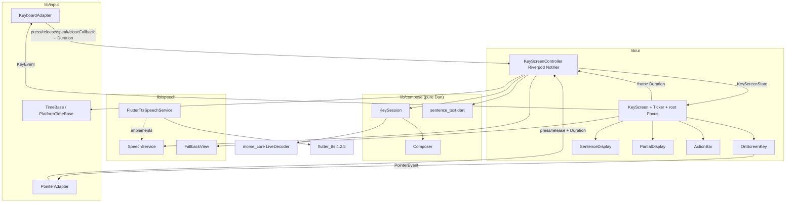
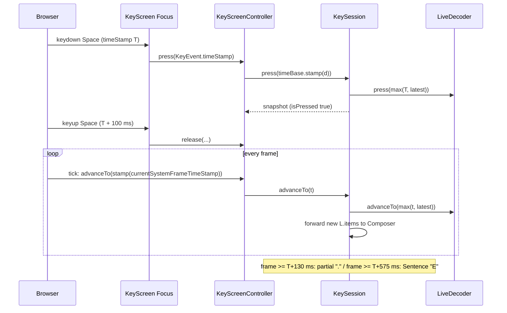

# Design Document: key-screen

## Overview

The Key_Screen is the first real screen of `app/`. One switch (the Space key or the On_Screen_Key) drives one `LiveDecoder`; a frame ticker calls `advanceTo` once per frame; decoded items flow once each into a pure Dart `Composer`; Enter or the Speak button passes the Speak_Text to a `SpeechService` backed by `flutter_tts`. Calibration, Shorthand, expansion and phrases are out of scope.

Scope is kept small so the feature ships today: 17 new files under `app/lib/` plus a rewritten `main.dart`, 8 test files and 3 test support files, a `pubspec.yaml` change and one new workflow step.

### Research findings

All engine and framework facts below were read from the local Flutter 3.47.7 SDK (`C:\dev\flutter`, engine `deb287481e`) and from the package archives on pub.dev, not guessed.

**R1. Every web timestamp comes from the browser's `DOMHighResTimeStamp` clock (milliseconds since `timeOrigin`).**

| Source | Where it is made on Flutter web | Browser value it uses |
|---|---|---|
| `KeyEvent.timeStamp` | `lib/web_ui/lib/src/engine/keyboard_binding.dart` line 404: `_eventTimeStampToDuration(event.timeStamp!)`; the framework copies it unchanged (`services/hardware_keyboard.dart` line 1362, `keyData.timeStamp`) | DOM `KeyboardEvent.timeStamp` |
| `PointerEvent.timeStamp` | `engine/pointer_binding.dart` lines 370, 419, 778, 1260: `_BaseAdapter._eventTimeStampToDuration(event.timeStamp!)`; the framework copies `datum.timeStamp` (`gestures/converter.dart` line 81). Resampling is off by default (`gestures/binding.dart` line 610, `resamplingEnabled = false`) | DOM `PointerEvent.timeStamp` |
| Frame timestamp | `engine/frame_service.dart` lines 97 and 193: `requestAnimationFrame((highResTime) …)`, then `Duration(microseconds: (1000 * highResTime).toInt())` passed to `onBeginFrame`. `SchedulerBinding.currentSystemFrameTimeStamp` returns that raw value unchanged (`scheduler/binding.dart` lines 1151 and 1231), while `currentFrameTimeStamp` and `Ticker` elapsed time are shifted to an epoch and scaled by `timeDilation` | `requestAnimationFrame` callback argument |

MDN states that `Event.timeStamp` is a `DOMHighResTimeStamp` measured from the global object's time origin ([Event.timeStamp](https://developer.mozilla.org/en-US/docs/Web/API/Event/timeStamp)), and that the `requestAnimationFrame` argument is a `DOMHighResTimeStamp` based on milliseconds since the time origin, equal to `document.timeline.currentTime` ([requestAnimationFrame](https://developer.mozilla.org/en-US/docs/Web/API/Window/requestAnimationFrame)). `performance.now()` reads the same clock. So all three Flutter values are the same clock, converted by the engine to a `Duration`. Both conversions truncate toward zero at the microsecond, so the same instant can differ by at most 1 µs between the two code paths. Content was rephrased for compliance with licensing restrictions.

**R2. They are the same base but not mutually ordered.** The `requestAnimationFrame` argument is the end time of the previous frame's rendering (MDN, same page), not the time the callback runs. An input event created after that instant but dispatched before the callback has a larger timestamp than the frame that follows it. So `advanceTo(frame)` can be smaller than the previous `press(event)`, which `LiveDecoder` rejects with `decreasingTimestamp`. This is why REQ-KEY-4 needs a clamp (Decision D2).

**R3. Precision.** Browsers coarsen these timestamps: Chrome to 0.1 ms, Safari and Firefox to 1 ms by default (MDN, Event.timeStamp). The smallest calibrated duration that matters is the 30,000 µs Debounce_Time, so 1 ms of rounding is acceptable. Firefox with `privacy.resistFingerprinting` coarsens to 16.7 ms; that setting is not supported and is listed under Known limitations.

**R4. Space and Enter routing.** `KeyEventManager.handleRawKeyMessage` calls `HardwareKeyboard` handlers and then always dispatches to the focus system (`hardware_keyboard.dart` lines 1110 to 1125), so a global `HardwareKeyboard.addHandler` cannot stop a focused button from activating on Space. Focus `onKeyEvent` handlers run from the focused node up to the root, and the Space and Enter `ActivateIntent` shortcuts live in `WidgetsApp`'s root `Shortcuts`. A `Focus` that wraps the whole Key_Screen therefore sees Space and Enter before those shortcuts and can stop them by returning `KeyEventResult.handled`. On web, when the framework answers the `flutter/keyevent` message with `handled: true`, the engine calls `preventDefault()` and `stopPropagation()` on the DOM event (`engine/raw_keyboard.dart` line 152). The answer arrives through Dart futures, that is, in microtasks. Microtasks run when the listener returns and before the browser performs the default action, so the `preventDefault` still takes effect. This ordering is inferred from the HTML event-loop rules, not tested in a browser here, so a widget test cannot prove it. The manual check in Testing Strategy covers it. The Flutter web host element also fills the viewport and does not scroll by itself.

**R5. Text to speech: `flutter_tts` 4.2.5** (pub.dev, published 2026-01-05, SDK `>=3.4.0 <4.0.0`, declares a `web` plugin `FlutterTtsPlugin` in `flutter_tts_web.dart`). Read from the 4.2.5 archive:

- API used: `FlutterTts()`, `Future speak(String text)`, `Future stop()`, `Future get getVoices`, `setStartHandler(VoidCallback)`, `setCompletionHandler(VoidCallback)`, `setCancelHandler(VoidCallback)`, `setErrorHandler(void Function(dynamic message))`.
- On web, `speak` only calls `speechSynthesis.speak` when the plugin's state is stopped or paused (`_speak`, line 181). The state becomes playing on the utterance `start` event and stopped on `end` or `error`. A `speak` call while playing is silently dropped.
- `stop()` calls `speechSynthesis.cancel()`, which ends the current utterance with an `error` event (Web Speech error codes `interrupted` or `canceled`). The plugin forwards it to the error handler.
- With `awaitSpeakCompletion(true)`, an error clears the completer without completing it (lines 93 to 100), so the future never completes. The design does not use `awaitSpeakCompletion`.
- `getVoices` returns `speechSynthesis.getVoices()` as is. Chrome fills that list asynchronously after page load.
- The plugin's error listener calls `print(event)` on the DOM event object. That prints the event type, not the utterance text, so it does not log what the user said.

**R6. State: `flutter_riverpod` 3.5.0** (pub.dev, published 2026-11-06, SDK `^3.12.0`). Read from the 3.5.0 archives: `ProviderScope`, `ConsumerStatefulWidget`, `Provider` with `overrideWithValue`, and `NotifierProvider(create)` with `Notifier<T>.build()` (`riverpod/lib/src/providers/notifier/orphan.dart` lines 51 and 78).

**R7. `kiri_check` 1.4.0** is already used by `packages/morse_core`. The adaptive-timing design records its API from the source: `property(description, body)`, `forAll(arbitrary, block, maxExamples:, seed:)`, `integer`, `constantFrom`, `list(minLength:, maxLength:)`, `oneOf`, `frequency`, `combine2` and later, `.map`, `.flatMap`.

No Dart MCP server was available in this session, so versions came from the pub.dev API (`https://pub.dev/api/packages/<name>`).

### Decisions

- **D1. One clock: the browser `DOMHighResTimeStamp`, read from each event's own timestamp.** Key events use `KeyEvent.timeStamp`, pointer events use `PointerEvent.timeStamp`, and frames use `SchedulerBinding.instance.currentSystemFrameTimeStamp`, each converted with `Duration.inMicroseconds`. R1 shows these are one time base. The rejected alternative reads `performance.now()` inside each handler. That is also the same clock, but it adds dispatch latency to every event, and Chrome aligns input dispatch to animation frames, so press lengths would pick up up to one frame (about 16.7 ms) of jitter. The user's spike already measured presses accurately with `KeyEvent.timeStamp`.
- **D2. Clamp to the decoder's latest timestamp.** Before every Live_Decoder call, `KeySession` uses `t = max(raw, decoder.latestTimestamp ?? raw)`. This gives REQ-KEY-4 by construction and means `decreasingTimestamp` can never happen. Trade-off (R2): when a frame timestamp is below the previous event, `advanceTo` runs at the event time, so confirming a dit or completing a letter can be at most one frame late. In the rare case that an event is created before a frame but dispatched after it, that event is stamped up to one frame late too. Both errors are under 16.7 ms, below the 30 ms Debounce_Time.
- **D3. Injected `TimeBase`.** All three sources pass their platform `Duration` through one `TimeBase.stamp(Duration)`. Production returns `d.inMicroseconds`. Tests override the provider with `ManualTimeBase`, which ignores the argument and returns a value the test sets (REQ-CI-2c). Widget-test key and pointer events carry `Duration.zero` time stamps, so a test-controlled clock is required.
- **D4. Frame_Ticker is a `Ticker`.** `KeyScreen` creates a `Ticker` in `initState` and starts it; each tick calls `advanceTo` with the stamped `currentSystemFrameTimeStamp`. A transient frame callback runs once per frame inside `handleBeginFrame`, after `_lastRawTimeStamp` is set, so the value is that frame's timestamp (REQ-KEY-5). The ticker schedules a frame every vsync while the screen is shown. Without that, nothing would complete a letter after silence. Rendered frames stay identical while nothing changes (REQ-KEY-12). Tests must use `pump`, not `pumpAndSettle`.
- **D5. Pure session core.** `KeySession` in `lib/compose/` holds the `LiveDecoder`, the `Composer`, the clamp and the forwarding counter. It is pure Dart, so the forwarding and clamp rules are property-tested without widgets. The Riverpod `KeyScreenController` in `lib/ui/` wraps it and publishes immutable snapshots.
- **D6. Speech failure.** A Speech_Failure is: `getVoices` returns an empty list at speak time, `speak` throws, or the error handler fires with a code other than `interrupted` or `canceled`. Those two codes come from our own `stop()` and are ignored. No watchdog timer is used (product principle 3), so an utterance that silently never starts shows no Fallback_View (Known limitations).
- **D7. Speak while speaking.** Because the plugin drops `speak` while playing (R5), `FlutterTtsSpeechService` keeps one pending text. If it is busy, it stores the text and calls `stop()`; when the cancel, error or completion handler fires, it speaks the pending text. The latest Speak_Action wins and each Speak_Action reaches the plugin at most once.
- **D8. Space, Enter and Escape at the screen root.** A `Focus(autofocus: true, onKeyEvent: …)` wraps the whole Key_Screen, including the Fallback_View layer (R4, D10). It handles Space, Enter and Escape (all three event types) and returns `handled`, so no child button activates and the browser does not scroll, whichever control has focus. Space is always the switch: key-down presses, key-up releases (REQ-KEY-1). A non-repeat Enter key-down is always a Speak_Action, including when the Fallback_View's Close button has focus; a Speak_Action that completes successfully hides the Fallback_View (REQ-SPEAK-5). A non-repeat Escape key-down closes the Fallback_View when it is shown and does nothing otherwise (REQ-SPEAK-4). Repeat events for all three keys make no call (REQ-KEY-2). Other keys return `ignored`, so Tab still moves focus.
- **D9. No hover, splash or timed effects.** Buttons use `splashFactory: NoSplash.splashFactory`, a transparent `overlayColor`, and `animationDuration: Duration.zero`. The On_Screen_Key is a `Listener` around a plain `DecoratedBox` with no `InkWell`. Focus outlines change only when the user moves focus with Tab.
- **D10. Fallback_View is a layer, not a route.** It is drawn in a `Stack` over the Key_Screen, inside the same root `Focus`, so the switch keeps working while it is shown and the Fallback_View text always matches the current Sentence.
- **D11. Dependencies.** `morse_core` moves to `dependencies` (K6). Add `flutter_riverpod: ^3.5.0` and `flutter_tts: ^4.2.5` to `dependencies`, and `kiri_check: ^1.4.0` to `dev_dependencies`.

## Architecture



### Event flow for one dit



## Components and Interfaces

### lib/input

```dart
// time_base.dart
/// Converts a platform timestamp to Time_Base Microseconds. REQ-KEY-4.
abstract interface class TimeBase {
  int stamp(Duration platformTimeStamp);
}
/// DOMHighResTimeStamp in µs (research R1). REQ-KEY-4.
final class PlatformTimeBase implements TimeBase {
  const PlatformTimeBase();
  @override
  int stamp(Duration d) => d.inMicroseconds;
}

// keyboard_adapter.dart
/// What a key event means to the Key_Screen. REQ-KEY-1, REQ-KEY-2, REQ-SPEAK-4.
enum KeyAction { press, release, speak, closeFallback, swallow, ignore }
/// Pure mapping, no state. REQ-KEY-1, REQ-KEY-2, REQ-SPEAK-4.
KeyAction keyActionFor(KeyEvent event);

// pointer_adapter.dart
/// Tracks the one pointer that pressed the On_Screen_Key. REQ-KEY-3.
final class PointerAdapter {
  /// Returns true when this down should make a press call (no pointer tracked).
  bool down(int pointer);
  /// Returns true when [pointer] is the tracked one; clears it. Used for up and cancel.
  bool end(int pointer);
}
```

`keyActionFor`:

| Event | Space | Enter | Escape | Other keys |
|---|---|---|---|---|
| `KeyDownEvent` | `press` | `speak` | `closeFallback` | `ignore` |
| `KeyUpEvent` | `release` | `swallow` | `swallow` | `ignore` |
| `KeyRepeatEvent` | `swallow` | `swallow` | `swallow` | `ignore` |

`swallow` and the four action values return `KeyEventResult.handled`; `ignore` returns `ignored`. Matching uses `event.logicalKey == LogicalKeyboardKey.space`, `LogicalKeyboardKey.enter` or `numpadEnter`, and `LogicalKeyboardKey.escape`. `keyActionFor` has no state, so `closeFallback` is returned whether or not the Fallback_View is shown; `KeyScreenController.closeFallback` does nothing when it is hidden (REQ-SPEAK-4).

`PointerAdapter`: a second pointer going down while one is tracked still returns true, so a press call is made and the Live_Decoder rejects it as two presses in a row (REQ-KEY-7, K3). Its up or cancel returns false, because only the tracked pointer releases. A `Listener` keeps receiving events for a pointer that went down on it even after the pointer leaves, so up and cancel arrive wherever the pointer is (REQ-KEY-3).

### lib/compose (pure Dart, REQ-COMPOSE-1)

```dart
// composer.dart
/// The Spell mode Sentence. REQ-COMPOSE-1 to REQ-COMPOSE-5.
final class Composer {
  /// Unmodifiable view. REQ-COMPOSE-2.
  List<DecodedItem> get sentence;
  void append(DecodedItem item);   // REQ-COMPOSE-2
  void undo();                     // REQ-COMPOSE-3, no-op when empty
  void clear();                    // REQ-COMPOSE-4
}

// sentence_text.dart
const String placeholder = '\u25A1';                 // K4
/// Letter → character, unknown → Placeholder, Word_Space → ' '. REQ-KEY-11.
String sentenceText(List<DecodedItem> items);
/// Placeholders removed, space runs collapsed, trimmed. REQ-SPEAK-1, REQ-SPEAK-2.
String speakText(List<DecodedItem> items);
/// '.' → '·' (U+00B7), '-' → '–' (U+2013). REQ-KEY-10, K9.
String partialGlyphs(String partialSequence);

// key_session.dart
/// LiveDecoder + Composer + clamp + forwarding. REQ-KEY-4, REQ-KEY-6, REQ-KEY-7, REQ-COMPOSE-2.
final class KeySession {
  KeySession();                    // default Calibration and TimingConfig.defaults (REQ-KEY-6, K2)
  KeySession.withDecoder(LiveDecoder decoder); // tests
  bool press(int t);               // false when the decoder rejected the call
  bool release(int t);
  void advanceTo(int t);
  void undo();
  void clear();
  List<DecodedItem> get sentence;
  String get partialSequence;
  bool get isPressed;
}
```

`KeySession` rules:

1. Every call stamps `t' = max(t, decoder.latestTimestamp ?? t)` (D2).
2. It calls the decoder inside `try … on TimingInputException`. On the exception it returns false and changes nothing: the decoder itself changes nothing on an invalid call (REQ-LIVE-9), and the session updates nothing before the call returns (REQ-KEY-7).
3. After every accepted call it forwards `decoder.items.sublist(_forwarded)` to `composer.append` in order and sets `_forwarded = decoder.items.length`. `items` is append-only (REQ-LIVE-8), so each item is forwarded exactly once and in order (REQ-COMPOSE-2).
4. `undo` and `clear` touch only the Composer, never the decoder or `_forwarded` (K8).

Default Calibration: `Calibration(ditLength: 100000, dahLength: 300000, symbolGap: 250000, letterGap: 700000)` with `TimingConfig.defaults`. These literals live in `key_session.dart` only, as named constants with a REQ-KEY-6 comment. They are app defaults, not decoder constants, so the "no absolute time constants in the decoder" rule is not touched.

### lib/speech

```dart
// speech_service.dart
enum SpeechResult { completed, failed, superseded }
/// Speaks text it is given. Never speaks on its own. REQ-SPEAK-1, REQ-SPEAK-2.
abstract interface class SpeechService {
  Future<void> init();             // warms the voice list (R5)
  Future<SpeechResult> speak(String text);
}

// flutter_tts_speech_service.dart
final class FlutterTtsSpeechService implements SpeechService { ... }

// fallback_view.dart
/// Full-screen Sentence text + "Speech failed" notice + Close. REQ-SPEAK-3.
class FallbackView extends StatelessWidget { ... }
```

`FlutterTtsSpeechService.speak(text)`:

1. `voices = await tts.getVoices`; if it is null or empty, return `failed`.
2. If idle: set busy, create a `Completer`, call `tts.speak(text)` inside `try`; a throw completes `failed`.
3. If busy: complete the previous completer with `superseded`, store `text` as pending, call `tts.stop()` (D7).
4. Completion handler: complete `completed`, or speak the pending text if one is stored. Error handler: a code of `interrupted` or `canceled` counts like cancel (speak pending, or complete `superseded`); any other code completes `failed`. Cancel handler: speak pending or complete `superseded`.

The service never stores, prints or logs `text`. It holds the pending text only until it is spoken.

### lib/ui

```dart
// key_screen_state.dart
@immutable
final class KeyScreenState {
  final List<DecodedItem> sentence;  // unmodifiable
  final String partialSequence;
  final bool isPressed;
  final bool fallbackVisible;
}

// key_screen_controller.dart
final timeBaseProvider = Provider<TimeBase>((ref) => const PlatformTimeBase());
final speechServiceProvider = Provider<SpeechService>((ref) => FlutterTtsSpeechService());
final keyScreenControllerProvider =
    NotifierProvider<KeyScreenController, KeyScreenState>(KeyScreenController.new);

final class KeyScreenController extends Notifier<KeyScreenState> {
  void press(Duration platformTime);
  void release(Duration platformTime);
  void frame(Duration platformTime);
  Future<void> speak();             // Speak_Action
  void undo();
  void clear();
  void closeFallback();             // Close control or Escape; no-op when hidden
}
```

`frame` publishes a new state only when `partialSequence`, `sentence` length or `isPressed` changed, so an idle frame causes no rebuild. `speak()` computes `speakText(session.sentence)`. If it is empty, it returns without calling the service (REQ-SPEAK-2). Otherwise it calls `speechService.speak` once and sets `fallbackVisible` from the result: `failed` sets it to true (REQ-SPEAK-3), `completed` sets it to false (REQ-SPEAK-5), and `superseded` leaves it unchanged. No other method calls the service. `closeFallback()` sets `fallbackVisible = false` and is called by the Close control and by the `closeFallback` key action (REQ-SPEAK-3, REQ-SPEAK-4). None of these change the Sentence (REQ-COMPOSE-5).

| Widget file | Content | Requirements |
|---|---|---|
| `key_screen.dart` | `ConsumerStatefulWidget` with `SingleTickerProviderStateMixin`; root `Focus(autofocus: true, onKeyEvent:)`; `Ticker` → `controller.frame(SchedulerBinding.instance.currentSystemFrameTimeStamp)`; `Stack` of the body and `FallbackView` | REQ-KEY-1, -2, -5, -12, REQ-SPEAK-4 |
| `on_screen_key.dart` | `Semantics(button: true, label: 'Morse key', value: 'pressed'/'released')` → `Listener(onPointerDown/Up/Cancel)` → `DecoratedBox`; at least 160 logical pixels high, full width; text label "Pressed" or "Released" and a 4 px versus 1 px border when pressed | REQ-KEY-3, -8, REQ-A11Y-1, -2, -5 |
| `sentence_display.dart` | `Semantics(label: 'Sentence', value: text or 'Sentence is empty')`, `Text(softWrap: true)` with no `maxLines` or `overflow`, 36 px | REQ-KEY-9, -11, REQ-A11Y-1, -4 |
| `partial_display.dart` | `partialGlyphs(...)`, 36 px, same semantics pattern ("Current letter") | REQ-KEY-10, REQ-A11Y-1, -5 |
| `action_bar.dart` | `Wrap` of Speak, Undo and Clear `FilledButton`s with labels as text, `minimumSize: Size(64, 64)`, D9 style | REQ-COMPOSE-3, -4, -5, REQ-A11Y-1, -2, -4 |
| `sounder_colors.dart` | palette constants (see Data Models) | REQ-A11Y-3 |

Layout: a `SingleChildScrollView` (vertical only) holding a `Column` of `SentenceDisplay`, `PartialDisplay`, `OnScreenKey` and `ActionBar`, with horizontal padding of 16. Every child takes the available width, and `ActionBar` uses `Wrap`, so at 320 px nothing overflows horizontally (REQ-A11Y-4).

`main.dart` becomes `ProviderScope(child: MaterialApp(home: KeyScreen()))` and calls `ref.read(speechServiceProvider).init()` once from `KeyScreen.initState`.

### Deploy workflow change (REQ-CI-1)

Insert between the "Engine tests" step and "Build web app":

```yaml
      - name: App tests
        working-directory: app
        run: |
          flutter pub get
          flutter test
```

No `continue-on-error` is added. A failing `flutter test` exits non-zero, which fails the job and skips the later steps. "Engine tests" stays unchanged.

## Data Models

| Type | Fields | Invariants |
|---|---|---|
| `Composer` | `_items: List<DecodedItem>` | changed only by `append`, `undo`, `clear` |
| `KeySession` | `decoder`, `composer`, `_forwarded: int` | `_forwarded == decoder.items.length` after every call; timestamps passed to the decoder never decrease |
| `KeyScreenState` | `sentence`, `partialSequence`, `isPressed`, `fallbackVisible` | immutable; `sentence` unmodifiable |
| `PointerAdapter` | `_active: int?` | at most one tracked pointer |
| `SpeechResult` | `completed`, `failed`, `superseded` | only `failed` shows the Fallback_View; `completed` hides it |

### Palette (REQ-A11Y-3)

All text is `#FFFFFF` (relative luminance 1.0). Contrast is `(1.0 + 0.05) / (L_bg + 0.05)`.

| Use | Background | Luminance | Contrast with white |
|---|---|---|---|
| Screen, Fallback_View | `#121212` | 0.006 | 18.7 : 1 |
| On_Screen_Key released, buttons | `#1E1E1E` | 0.013 | 16.7 : 1 |
| On_Screen_Key pressed | `#0D47A1` | 0.072 | 8.6 : 1 |

Every background has luminance at most 0.2 and every ratio is at least 7:1. A unit test computes these values with the WCAG formula from the constants in `sounder_colors.dart`.

### Test files

```
app/test/
  composer_test.dart              REQ-COMPOSE-2 to -5 examples
  sentence_text_test.dart         REQ-KEY-10, -11, REQ-SPEAK-1, -2 examples
  compose_properties_test.dart    Properties 1 to 6 (kiri_check)
  keyboard_adapter_test.dart      REQ-KEY-1, -2, REQ-SPEAK-4 table
  colors_test.dart                REQ-A11Y-3
  key_session_test.dart           REQ-KEY-6 and a dit-to-E example
  source_rules_test.dart          REQ-COMPOSE-1, REQ-CI-2 names, REQ-CI-3
  key_screen_test.dart            widget tests, REQ-KEY-*, REQ-SPEAK-* (incl. -4, -5), REQ-A11Y-*, REQ-CI-2c, -2d, -2e, -2f
  support/manual_time_base.dart   ManualTimeBase
  support/mock_speech_service.dart MockSpeechService (REQ-CI-3)
  support/item_arbitraries.dart   kiri_check generators
```

## Correctness Properties

*A property is a characteristic or behavior that should hold true across all valid executions of a system-essentially, a formal statement about what the system should do. Properties serve as the bridge between human-readable specifications and machine-verifiable correctness guarantees.*

PBT applies to the pure parts only: `Composer`, `sentence_text.dart`, `KeySession` and `PointerAdapter`. Widgets, focus routing, the browser clock and `flutter_tts` are covered by example and widget tests. Validates lines use `X.Y` for Requirement X, criterion Y.

Reflection on the prework: the first property is a special case of the second, but it stays because REQ-CI-2(b) names it. The Placeholder rule (REQ-KEY-11) and the glyph rule (REQ-KEY-10) are both pure display mappings and form Property 3. The clamp, error-discard and forwarding rules all concern one `KeySession` call sequence and form Property 5.

### Property 1: Append then undo round trip

*For any* list of 0 to 200 Decoded_Items (Letter_Items, Unknown_Letter_Items and Word_Spaces) appended to a new Composer, and *for any* k from 0 to the list length, applying Undo k times leaves a Sentence equal to the first (length − k) items, in order. With k equal to the length the Sentence is empty.

Traces to: REQ-COMPOSE-6, REQ-COMPOSE-3.

**Validates: Requirements 3.6, 3.3**

### Property 2: Composer matches a list model

*For any* sequence of 0 to 300 operations, each an append of a random Decoded_Item, an Undo or a Clear, applied to a new Composer and to a plain Dart list (add, remove last if non-empty, clear), the Composer Sentence equals the list after every operation, and no operation throws.

Traces to: REQ-COMPOSE-2, REQ-COMPOSE-3, REQ-COMPOSE-4.

**Validates: Requirements 3.2, 3.3, 3.4**

### Property 3: Display text maps item by item

*For any* list of 0 to 200 Decoded_Items, `sentenceText(items)` has exactly one UTF-16 code unit per item, and at index i it is the item's character for a Letter_Item, `□` for an Unknown_Letter_Item and a space for a Word_Space. *For any* string of 0 to 20 `.` and `-` characters, `partialGlyphs(s)` has the same length and maps each `.` to `·` and each `-` to `–`.

Traces to: REQ-KEY-11, REQ-KEY-10.

**Validates: Requirements 2.3, 2.2**

### Property 4: Speak_Text is the letters, words separated by single spaces

*For any* list of 0 to 200 Decoded_Items, `speakText(items)` equals the oracle: split the list at Word_Spaces, keep only the Letter_Item characters of each part, drop empty parts and join with one space. So it contains no `□`, no two spaces in a row and no leading or trailing space, and it is empty exactly when the list has no Letter_Item.

Traces to: REQ-SPEAK-1, REQ-SPEAK-2.

**Validates: Requirements 4.1, 4.2**

### Property 5: KeySession clamps, discards errors and forwards each item once

*For any* sequence of 0 to 150 session calls, each a `press`, `release` or `advanceTo` with a timestamp from 0 to 20,000,000 µs drawn independently (so timestamps can go backwards and press and release can repeat), interleaved with Undo and Clear calls:

- the decoder's `latestTimestamp` never decreases between calls, and no call raises a `decreasingTimestamp` error;
- a call that returns false leaves `sentence`, `partialSequence` and `isPressed` equal to their values before it;
- the session `sentence` equals a model list built by appending, after every accepted call, the decoder items added by that call, and applying each Undo and Clear to the model;
- Undo and Clear leave `partialSequence` and `isPressed` unchanged.

Traces to: REQ-KEY-4, REQ-KEY-7, REQ-COMPOSE-2, REQ-COMPOSE-3, REQ-COMPOSE-4.

**Validates: Requirements 1.4, 1.7, 3.2, 3.3, 3.4**

### Property 6: Only the pressing pointer releases

*For any* sequence of 0 to 100 pointer events, each down, up or cancel with a pointer id from 0 to 3, `PointerAdapter.down` returns true for every down, and `PointerAdapter.end` returns true exactly when the id equals the tracked pointer. The tracked pointer is set by a down when none is tracked and cleared by its own up or cancel. The result matches a one-variable model.

Traces to: REQ-KEY-3, REQ-KEY-7.

**Validates: Requirements 1.3, 1.7**

## Error Handling

| Situation | Behaviour | Requirement |
|---|---|---|
| `LiveDecoder` throws `TimingInputException` (second source presses while held, release with no press) | `KeySession` catches only that type, returns false, changes nothing; no message shown | REQ-KEY-7 |
| Frame timestamp below the previous event | clamped up to `latestTimestamp` (D2) | REQ-KEY-4 |
| Space, Enter or Escape repeat | `swallow`: handled, no call | REQ-KEY-2 |
| Escape key-down while the Fallback_View is hidden | `closeFallback` is a no-op | REQ-SPEAK-4 |
| Pointer leaves the key while down | `Listener` still gets up or cancel; release is made | REQ-KEY-3 |
| Speak with empty Speak_Text | no service call, no Fallback_View | REQ-SPEAK-2 |
| No voices, plugin error, or `speak` throws | `SpeechResult.failed`; Fallback_View shown until Close, Escape or a successful Speak | REQ-SPEAK-3, REQ-SPEAK-4, REQ-SPEAK-5, D6 |
| Speak succeeds while the Fallback_View is shown | `SpeechResult.completed` hides it; Sentence unchanged | REQ-SPEAK-5 |
| `interrupted` or `canceled` from our own `stop()` | not a failure; pending text spoken | D7 |
| Speak while speaking | previous result `superseded`; new text spoken after cancel | D7 |
| Undo on empty Sentence | no-op | REQ-COMPOSE-3 |

Any other exception is a bug and is not caught. Nothing in `lib/` prints or logs the Sentence, the Partial_Sequence or the Speak_Text.

### Known limitations

- **L1. Silent speech (K11).** If the browser never fires `start`, `end` or `error` (no audio device, page not yet activated by a user gesture), no failure is reported, because the design uses no watchdog timer (product principle 3). Enter and a tap both count as user activation, so the second case should not occur in normal use. Accepted as a known limitation for this spec (K11).
- **L2. Chrome voice list.** Chrome fills `getVoices` asynchronously. A Speak_Action in the first moments after load could see an empty list and show the Fallback_View. `init()` requests the list at start to reduce the window.
- **L3. Closing the Fallback_View with the switch alone is deferred (K10).** The Fallback_View closes with a pointer on its Close control, the Escape key (REQ-SPEAK-4), or a Speak_Action (Enter or the Speak button) that completes successfully (REQ-SPEAK-5). Enter on a focused Close button is a Speak_Action, not a Close activation (D8), and Space is always a switch press. A one-switch user with no pointer and no keyboard therefore cannot close it with the switch alone until the switch-scanning spec. Keying continues behind the Fallback_View (D10), so input is never lost.
- **L4. Firefox `resistFingerprinting`** coarsens timestamps to 16.7 ms (R3); not supported.
- **L5. Focus loss.** If the browser window loses focus, Space reaches nothing until the page is focused again. Clicking anywhere on the screen refocuses it, because the root `Focus` is the nearest focus node to every child.

## Testing Strategy

Commands: `cd app && flutter test` (app) and `cd packages/morse_core && dart test` (engine, unchanged).

### Property tests (`test/compose_properties_test.dart`)

- `kiri_check` 1.4.0, one `property(...)` with a single `forAll` per correctness property, 6 in total.
- `maxExamples: 200` (at least 100, REQ-CI-2b), and a fixed seed `(200 + N) * 1000 + 3` for Property N so runs are reproducible and do not collide with the engine seeds.
- Each test name begins with its REQ IDs and a colon (REQ-CI-2), and carries the tag comment:

```dart
// Feature: key-screen, Property 1: append then undo round trip
property('REQ-COMPOSE-6, REQ-COMPOSE-3: append then undo round trip', () {
  forAll(
    combine2(itemList(maxLength: 200), integer(min: 0, max: 200)),
    (input) {
      final (items, rawK) = input;
      final k = rawK % (items.length + 1);   // generate-to-satisfy, no filter
      final c = Composer();
      items.forEach(c.append);
      for (var i = 0; i < k; i++) c.undo();
      expect(c.sentence, items.sublist(0, items.length - k));
    },
    maxExamples: 200,
    seed: 201003,
  );
});
```

Generators (`test/support/item_arbitraries.dart`): `decodedItem()` is `frequency` of a Letter_Item from the 44 code-table characters, an Unknown_Letter_Item from a `.`/`-` string that `CodeTable.characterFor` does not know (built as a fixed unknown prefix `........` plus random symbols, so no filter), and a Word_Space. `itemList` is `list(decodedItem(), minLength: 0, maxLength: n)`. `sessionCall()` is `oneOf` of press, release, advanceTo with `integer(0, 20000000)`, undo and clear. Edge cases (empty list, length 200, k = 0, k = length) come from kiri_check's edge-case policy and the `frequency` weights.

### Unit tests

| File | Covers |
|---|---|
| `composer_test.dart` | REQ-COMPOSE-2 (append keeps order), -3 (Undo on empty raises nothing), -4 (Clear on empty), -5 (the Composer API has only append, undo and clear) |
| `sentence_text_test.dart` | `HI□ THERE` example; `speakText` of only Placeholders and Word_Spaces is empty; REQ-KEY-10 glyphs |
| `keyboard_adapter_test.dart` | the `keyActionFor` table, including numpad Enter, Escape down, up and repeat (REQ-SPEAK-4, REQ-KEY-2), and an unrelated key |
| `colors_test.dart` | REQ-A11Y-3 ratios and luminance bound from the palette constants |
| `key_session_test.dart` | REQ-KEY-6 default Calibration; dit at 0, release 100,000, `advanceTo(800,000)` gives `E` |
| `source_rules_test.dart` | REQ-COMPOSE-1 (no banned imports or identifiers in `lib/compose/`), REQ-CI-3 (no `class Mock` and no import of `test/` in `lib/`), REQ-CI-2 meta-check that every test name starts with a REQ ID and a colon |

### Widget tests (`test/key_screen_test.dart`)

Every test pumps `ProviderScope(overrides: [timeBaseProvider.overrideWithValue(clock), speechServiceProvider.overrideWithValue(mock)], child: MaterialApp(home: KeyScreen()))`, where `clock` is a `ManualTimeBase` and `mock` a `MockSpeechService` that records calls and returns a preset `SpeechResult`. A helper `frameTo(int us)` advances `clock` in 16,667 µs steps and calls `tester.pump(const Duration(microseconds: 16667))` per step. `pumpAndSettle` is never used (D4).

| Test | Steps and check |
|---|---|
| REQ-CI-2c, REQ-KEY-1, REQ-KEY-5 | `clock = T`; `sendKeyDownEvent(space)`; `clock = T + 100000`; `sendKeyUpEvent(space)`; `frameTo(T + 900000)`; Sentence text is exactly `E` |
| REQ-KEY-5 | same dit; Sentence empty at the last frame below release + 475,000, `E` at the first frame at or above it |
| REQ-KEY-1 (focus) | focus the Undo button, press Space: a press is made and Undo is not activated |
| REQ-KEY-2 | `sendKeyRepeatEvent` for Space, Enter and Escape: no change, mock not called, Fallback_View state unchanged |
| REQ-KEY-3 | `tester.startGesture` on the key, move off it, `up()`: released state |
| REQ-KEY-7, REQ-KEY-8 | Space down then pointer down: still one press; key shows "Pressed" after one pump; pointer up ends it |
| REQ-KEY-9, REQ-A11Y-4 | 200-item Sentence at widths 320 and 1920: no overflow error, font size ≥ 32, controls within width |
| REQ-KEY-11 | key an unknown sequence: one `□` at its place |
| REQ-KEY-12 | after input, pump 600 frames: `KeyScreenState` unchanged and no build of the screen widgets after the first frame |
| REQ-CI-2d, REQ-SPEAK-1 | key `HI`, Enter: mock has exactly one call with `HI`; Sentence unchanged |
| REQ-SPEAK-2 | Enter with empty Sentence: no call, no Fallback_View |
| REQ-SPEAK-3, REQ-COMPOSE-5 | mock returns `failed`: Fallback_View shown, still shown after 10 s of frames, Close hides it, Sentence unchanged |
| REQ-CI-2e, REQ-SPEAK-4 | mock returns `failed`, Fallback_View shown; focus the Close button; `sendKeyDownEvent(escape)`: Fallback_View hidden, Sentence unchanged, mock still has one call |
| REQ-CI-2f, REQ-SPEAK-5 | mock returns `failed`, Fallback_View shown; set mock to `completed`; focus the Close button; `sendKeyDownEvent(enter)`: mock has a second call, Fallback_View hidden, Sentence unchanged |
| REQ-COMPOSE-3, -4 | tap Undo and Clear; Partial_Sequence unchanged |
| REQ-A11Y-1, -2, -5 | semantics labels and values; `meetsGuideline(androidTapTargetGuideline)` and sizes ≥ 48 at 320, 1024, 1920; "Pressed"/"Released" text |

### Manual check before submission

On the deployed site in Chrome and Firefox: Space with Undo focused does not activate Undo and does not scroll; a 100 ms dit decodes as `E`; Speak says the sentence; turning off the system voice (or a browser with no voices) shows the Fallback_View. Record the result in `.kiro/evidence/LOG.md`.

### Requirement gaps

No open gaps. The earlier gaps are settled:

- **G1. Hover and focus effects. Resolved.** REQ-KEY-12 now lists "a focus change made by the user" as an allowed cause of a visual change. D9 removes hover effects, and the focus outline on Tab is kept for keyboard users.
- **G2. Closing the Fallback_View with one switch. Deferred** to the switch-scanning spec and recorded as known limitation L3 (K10).
- **G3. Silent speech. Accepted** as known limitation L1 (K11).
