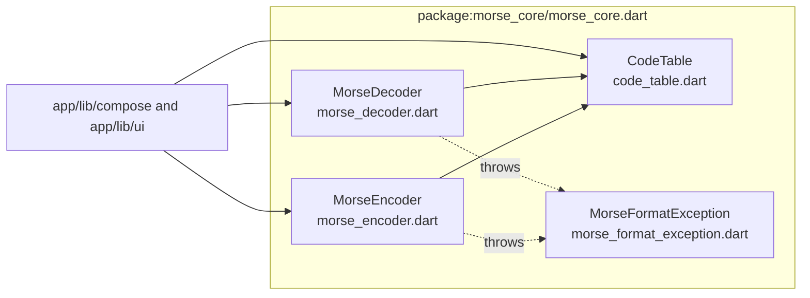
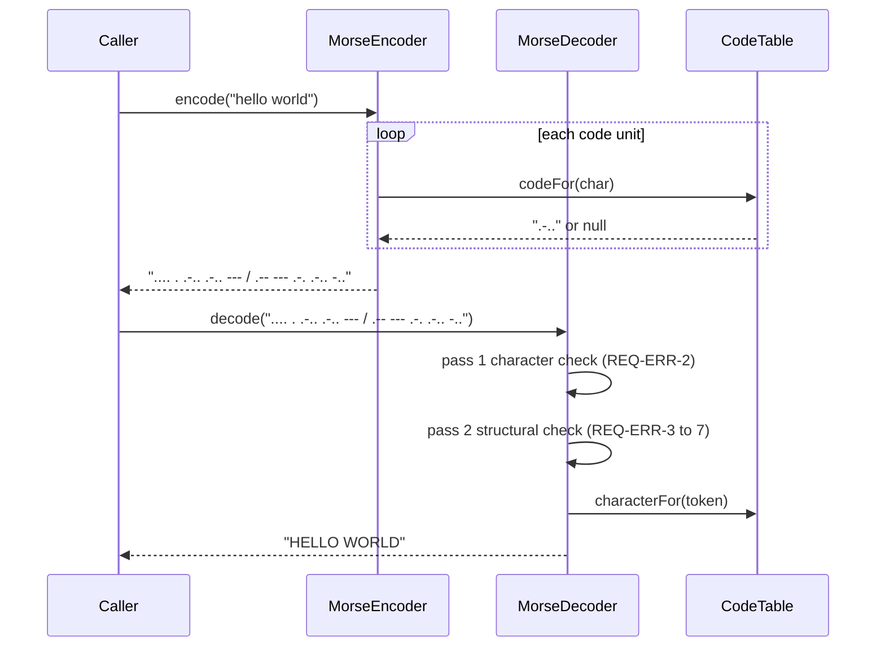
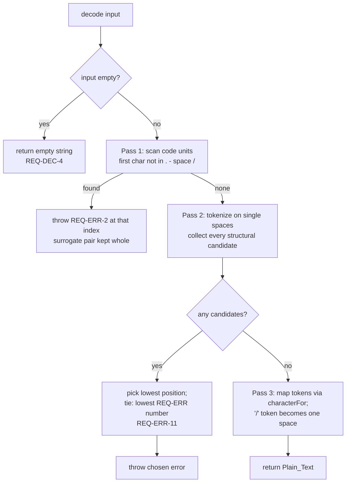

# Design Document: morse-core

## Overview

`morse_core` is the pure Dart engine in `packages/morse_core`. This spec delivers four public classes:

| Class | File | Role | Main requirements |
|---|---|---|---|
| `CodeTable` | `lib/src/code_table.dart` | The 43 ITU-R M.1677-1 codes and their reverse lookup | REQ-CODE-1 to REQ-CODE-10 |
| `MorseEncoder` | `lib/src/morse_encoder.dart` | Plain_Text to Encoded_Text | REQ-ENC-1 to REQ-ENC-13, REQ-ERR-1 |
| `MorseDecoder` | `lib/src/morse_decoder.dart` | Encoded_Text to Plain_Text | REQ-DEC-1 to REQ-DEC-10, REQ-ERR-2 to REQ-ERR-7, REQ-ERR-11 |
| `MorseFormatException` | `lib/src/morse_format_exception.dart` | The Morse_Format_Error value | REQ-ERR-8, REQ-ERR-9 |

All four are exported from `lib/morse_core.dart` (REQ-PURE-5). The package has no runtime dependencies and imports only `dart:core` (REQ-PURE-1). Every operation is a pure, synchronous function of its argument (REQ-PURE-2, REQ-PURE-3).

### Research findings

- **Property-based testing package: `kiri_check` 1.4.0.** Confirmed on pub.dev ([package page](https://pub.dev/packages/kiri_check), [API JSON](https://pub.dev/api/packages/kiri_check)): latest version 1.4.0, published 2026-10-25, SDK constraint `^3.4.0`, which is compatible with this package's `^3.13.5`. It integrates with `package:test`. The API used by this design, confirmed in the [API reference](https://pub.dev/documentation/kiri_check/latest/kiri_check/):
  - `property(description, body)` wraps `test()`.
  - `forAll<T>(Arbitrary<T> arbitrary, block, {int? maxExamples, int? seed, onFalsify, ...})` runs the property. `seed` makes a run reproducible; `onFalsify` receives the shrunk counterexample.
  - Arbitraries: `constantFrom<T>(List<T>)`, `integer({min, max})`, `list<T>(element, {minLength, maxLength})`, `combine2`..`combine8` (return Dart records), `oneOf`, `frequency`, `string`, plus `Arbitrary.map`, `.filter`, `.flatMap`, `.nonEmpty`.
  - Global defaults live in static setters on `KiriCheck` (`maxExamples`, `seed`, `verbosity`).
- **Rejected alternative: `glados` 1.1.7.** Last published 2023-12-04 with SDK constraint `>=2.12.0 <3.0.0` ([API JSON](https://pub.dev/api/packages/glados)). It does not meet the "maintained" condition in REQ-TEST-1. The kiri_check author also cites Glados's low maintenance as the reason kiri_check exists ([article](https://zenn.dev/szktty/articles/create-property-based-testing-library?locale=en)).
- **Code table source.** [Recommendation ITU-R M.1677-1 (10/2009)](https://www.itu.int/rec/R-REC-M.1677-1-200910-I/en), Part I, section 1.1. The test fixture (REQ-TEST-3) is transcribed from sections 1.1.1 (letters), 1.1.2 (figures) and 1.1.3 (the seven punctuation marks in scope). The recommendation defines further signs (colon, apostrophe, quotation mark, `=`, `+`, `@`, multiplication sign) that are out of scope per A7.
- **Dart case folding is not ASCII-safe.** `String.toUpperCase()` maps `ı` (U+0131) to `I` and `ß` to `SS`. Using it would make unsupported characters encode silently, which breaks REQ-ERR-1. The design therefore folds case for `a`-`z` only, by code unit arithmetic.
- **`FormatException.toString()` prints the source string.** Passing the user's input as `source` would put typed text into any log that prints the exception, which the steering forbids ("No logging of what the user typed"). The design passes no source to the superclass and overrides `toString()`.

### Decisions for review

- **D1. Exception class name. Status: accepted by the user.** The glossary term Morse_Format_Error is realised by the Dart class `MorseFormatException`, which extends `dart:core` `FormatException`. Dart reserves `Error` subclasses for programming bugs and `Exception` for bad input that callers are expected to catch. Callers can catch it as `on MorseFormatException` or `on FormatException`. The four public classes listed in REQ-PURE-6 are therefore `CodeTable`, `MorseEncoder`, `MorseDecoder` and `MorseFormatException`.
- **D2. Error kind without a fifth public type. Status: accepted by the user.** REQ-PURE-2 compares "error kind". Adding a public enum would break REQ-PURE-6, so the exception carries `requirementId`, a `String` such as `'REQ-ERR-3'`. This names the kind and traces straight back to the requirement.
- **D3. `Morse` prefix on encoder and decoder. Status: accepted by the user.** `MorseEncoder` and `MorseDecoder` avoid confusion with `dart:convert` codec vocabulary at import sites. They do not extend `Converter`; chunked conversion is not needed (YAGNI).
- **D4. Fixed seeds for property tests. Status: accepted by the user.** Each property passes a fixed `seed` to `forAll`, so a failure reproduces on every run (REQ-TEST-6). The trade-off is that each run explores the same cases. A developer explores new cases by changing the seed locally.

## Architecture

The package has no internal layers beyond a single dependency direction: the encoder and decoder read the code table and throw the exception type.



Later specs (`adaptive-timing` and others) add timing and calibration classes beside these. Nothing in this spec reads time.

### Data flow



### Purity rules applied to the code (REQ-PURE-1, REQ-PURE-3)

- `lib/` imports only `dart:core` (implicit) and files in `lib/src/`.
- No top-level or static variable that is not `const` or `final`. The table is a `static const` map; the reverse map is a `static final` unmodifiable map computed once from it.
- Output is built in a local `StringBuffer` and returned only after the whole input has been accepted, so no partial result can escape (REQ-ERR-9, REQ-FMT-6).

## Components and Interfaces

### CodeTable (`lib/src/code_table.dart`)

```dart
/// The 43-entry ITU-R M.1677-1 code table. REQ-CODE-1, REQ-CODE-2, REQ-CODE-3.
final class CodeTable {
  /// REQ-CODE-1.
  const CodeTable();

  /// Unmodifiable map from uppercase Supported_Character to Morse_Code.
  /// Exactly 43 entries. REQ-CODE-1, REQ-CODE-10.
  Map<String, String> get codes;

  /// Unmodifiable reverse map from Morse_Code to uppercase character.
  /// Exactly 43 entries. REQ-CODE-6, REQ-CODE-10.
  Map<String, String> get characters;

  /// Morse_Code for a one-character string, folding `a`-`z` to `A`-`Z`.
  /// Returns null for anything else. Never throws. REQ-CODE-8, REQ-CODE-9.
  String? codeFor(String character);

  /// Uppercase character for a Morse_Code, or null. Never throws. REQ-CODE-6, REQ-CODE-9.
  String? characterFor(String code);
}
```

Implementation notes:

- `codes` returns `static const Map<String, String> _codes`. Const maps throw `UnsupportedError` on `[]=`, `remove`, `clear`, `addAll` and the like (REQ-CODE-10).
- `characters` returns `static final Map<String, String> _characters = Map.unmodifiable({for (final e in _codes.entries) e.value: e.key})`. Deriving it from `_codes` means there is one transcription to check. If two codes collided, the reverse map would hold 42 entries and the REQ-CODE-6 test would fail.
- `codeFor(c)`: return null unless `c.length == 1`. If the code unit is in `0x61..0x7A`, subtract `0x20`. Look up `_codes`. No call to `toUpperCase()`.
- `characterFor(code)`: plain `_characters[code]`. Strings with spaces, `/`, empty strings and 7+ symbols are simply absent keys.

### MorseEncoder (`lib/src/morse_encoder.dart`)

```dart
/// Converts Plain_Text into Encoded_Text. REQ-ENC-1.
final class MorseEncoder {
  /// REQ-ENC-1.
  const MorseEncoder();

  /// Encodes [text]. Throws [MorseFormatException] (REQ-ERR-1) for the first
  /// Unsupported_Character. REQ-ENC-1 to REQ-ENC-13, REQ-FMT-2.
  String encode(String text);
}
```

Algorithm (one left-to-right pass over UTF-16 code units, index `i`):

1. Keep `buffer` (StringBuffer), `wordOpen` (a character has been emitted in the current word) and `gapPending` (at least one space seen since the last character).
2. If `text[i]` is U+0020: set `gapPending = true` if `buffer` is non-empty; continue.
3. Otherwise `code = table.codeFor(text[i])`.
   - If `code` is null, throw `MorseFormatException` with `requirementId: 'REQ-ERR-1'`, `position: i`, and `offending` equal to `text[i]`, or `text.substring(i, i + 2)` when `text[i]` is a high surrogate followed by a low surrogate.
   - Else, if `buffer` is non-empty, write `' / '` when `gapPending`, otherwise `' '`. Write `code`. Clear `gapPending`.
4. Return `buffer.toString()`.

Spaces before the first character never set `gapPending` (the buffer is empty), and trailing spaces leave `gapPending` set with nothing after it. This gives REQ-ENC-5, REQ-ENC-6 and REQ-ENC-7 without a separate trim step. The encoder stops at the first unsupported character, so the reported one has the lowest position (REQ-ERR-1, REQ-ERR-10).

### MorseDecoder (`lib/src/morse_decoder.dart`)

```dart
/// Converts Encoded_Text into uppercase Plain_Text. REQ-DEC-1.
final class MorseDecoder {
  /// REQ-DEC-1.
  const MorseDecoder();

  /// Decodes [morse]. Strict: accepts exactly the REQ-FMT-1 format.
  /// Throws [MorseFormatException] otherwise. REQ-DEC-1 to REQ-DEC-10, REQ-ERR-2 to REQ-ERR-7, REQ-ERR-11.
  String decode(String morse);
}
```

The decoder runs three passes. The input is short (one utterance), so the clarity of separate passes costs nothing measurable.



**Pass 1 (REQ-ERR-2).** Return at the first code unit outside `{0x2E, 0x2D, 0x20, 0x2F}`. Because this pass runs first and stops at the lowest index, REQ-ERR-2 wins over every other error, as REQ-ERR-11 requires.

**Pass 2 (structural candidates).** Walk the string once, recording tokens as `(start, text)` and spaces. Each rule adds a private `_Candidate(position, errNumber, offending)`:

| Rule | Condition | Position | Offending |
|---|---|---|---|
| REQ-ERR-3 | token of only `.`/`-` with `table.characterFor(token) == null` | token start | the token |
| REQ-ERR-4 | token contains `/` and is not exactly `/` | token start | the token |
| REQ-ERR-5 | a space directly follows a space (first such run) | index of the second space | `' '` |
| REQ-ERR-6 | input starts with space, or first token is `/` | 0 | `' '` or `'/'` |
| REQ-ERR-6 | input ends with space, or last token is `/` | length − 1 | `' '` or `'/'` |
| REQ-ERR-7 | token `/` whose previous token is `/` with exactly one space between | start of the second `/` | `'/'` |

The decoder throws the candidate with the smallest `(position, errNumber)`. Example: `... / /` produces REQ-ERR-6 at 6 and REQ-ERR-7 at 6; REQ-ERR-6 wins.

**Completeness argument (REQ-DEC-10, REQ-FMT-6).** After pass 1 the input uses only `.`, `-`, space and `/`. If no pass-2 rule fires, then: there are no leading, trailing or double spaces, so tokens are separated by exactly one space; every token is either a known Morse_Code or exactly `/`; no `/` token is first or last; and no two `/` tokens are adjacent. That is precisely the REQ-FMT-1 grammar `word (" / " word)*` with `word = code (" " code)*`. So every non-conforming non-empty input raises an error, and every conforming input reaches pass 3.

**Pass 3.** For each token, write `' '` for `/`, otherwise `table.characterFor(token)!`. The `!` is safe because pass 2 rejected unknown tokens.

### MorseFormatException (`lib/src/morse_format_exception.dart`)

```dart
/// The Morse_Format_Error raised by the encoder and decoder. REQ-ERR-8, REQ-ERR-9.
final class MorseFormatException extends FormatException {
  /// REQ-ERR-8. Passes null as the inherited `source`; this constructor
  /// must never forward the encoder or decoder input to `source`.
  MorseFormatException({
    required this.requirementId,
    required this.offending,
    required this.position,
  }) : super(_message(requirementId, offending, position), null, position);

  /// The requirement that defines this error kind, e.g. 'REQ-ERR-3'. REQ-PURE-2.
  final String requirementId;

  /// The offending character (one code point, possibly a surrogate pair or a
  /// lone surrogate) or the offending Token, verbatim. REQ-ERR-1 to REQ-ERR-7.
  final String offending;

  /// Zero-based UTF-16 index, 0 <= position < input length. REQ-ERR-8.
  final int position;

  /// Returns [message] only; never includes the input string. REQ-ERR-8.
  @override
  String toString();
}
```

Message format (`_message` is a private top-level function):

- Token errors (REQ-ERR-3, REQ-ERR-4, and REQ-ERR-6/7 when the offending value is `/`) contain the token in double quotes.
- Single-character errors contain `U+XXXX`: the code point in uppercase hex, padded to at least 4 digits. A surrogate pair renders as its combined code point (for example `U+1F600`); a lone surrogate renders as its code unit (for example `U+D800`). Lone surrogates are never written verbatim into the message.
- `/` is both a single character and a Token, so its message contains both `"/"` and `U+002F`.
- Every message contains the position as a decimal integer.

Examples:

| Input | Method | Message |
|---|---|---|
| `"hé"` | encode | `Unsupported character U+00E9 at position 1.` |
| `"... ...... ..."` | decode | `Unknown Morse code "......" at position 4.` |
| `"...  ---"` | decode | `Extra space U+0020 at position 4; letters are separated by one space.` |
| `"... /"` | decode | `Word separator "/" (U+002F) at end, position 4.` |

## Data Models

### Code table (ITU-R M.1677-1, Part I, section 1.1)

Letters:

| Char | Code | Char | Code | Char | Code | Char | Code |
|---|---|---|---|---|---|---|---|
| A | `.-` | H | `....` | O | `---` | V | `...-` |
| B | `-...` | I | `..` | P | `.--.` | W | `.--` |
| C | `-.-.` | J | `.---` | Q | `--.-` | X | `-..-` |
| D | `-..` | K | `-.-` | R | `.-.` | Y | `-.--` |
| E | `.` | L | `.-..` | S | `...` | Z | `--..` |
| F | `..-.` | M | `--` | T | `-` | | |
| G | `--.` | N | `-.` | U | `..-` | | |

Digits:

| Char | Code | Char | Code |
|---|---|---|---|
| 1 | `.----` | 6 | `-....` |
| 2 | `..---` | 7 | `--...` |
| 3 | `...--` | 8 | `---..` |
| 4 | `....-` | 9 | `----.` |
| 5 | `.....` | 0 | `-----` |

Punctuation:

| Char | Name in ITU-R M.1677-1 | Code |
|---|---|---|
| `.` | Full stop (period) | `.-.-.-` |
| `,` | Comma | `--..--` |
| `?` | Question mark | `..--..` |
| `/` | Fraction bar or division sign | `-..-.` |
| `-` | Hyphen or dash | `-....-` |
| `(` | Left-hand bracket (parenthesis) | `-.--.` |
| `)` | Right-hand bracket (parenthesis) | `-.--.-` |

Total: 26 + 10 + 7 = 43 entries, all distinct, lengths 1 to 6.

### Encoded_Text grammar (REQ-FMT-1)

```
encoded   = "" | word *( " / " word )
word      = code *( " " code )
code      = one of the 43 values in CodeTable.codes
```

### MorseFormatException fields

| Field | Type | Invariant |
|---|---|---|
| `requirementId` | `String` | One of `REQ-ERR-1` .. `REQ-ERR-7` |
| `offending` | `String` | Non-empty; one code point (1 or 2 code units) or one Token |
| `position` | `int` | `0 <= position < input.length` |
| `message` | `String` | Contains `position` in decimal; Token verbatim or `U+XXXX` as above |
| `offset` (inherited) | `int?` | Equals `position` |
| `source` (inherited) | `dynamic` | Always null (privacy) |

### Package layout after this spec

```
packages/morse_core/
  pubspec.yaml                    description updated; dev_dependencies: lints, test, kiri_check
  lib/morse_core.dart             library doc + 4 exports
  lib/src/code_table.dart
  lib/src/morse_encoder.dart
  lib/src/morse_decoder.dart
  lib/src/morse_format_exception.dart
  example/morse_core_example.dart rewritten to use only the public API
  test/code_table_test.dart
  test/encoder_test.dart
  test/decoder_test.dart
  test/errors_test.dart
  test/properties_test.dart
  test/purity_test.dart
  test/support/itu_fixture.dart   ITU-R M.1677-1 fixture as a const map
  test/support/arbitraries.dart   kiri_check generators
  test/support/oracles.dart       independent format checker and helpers
```

Removed: `lib/src/morse_core_base.dart`, `test/morse_core_test.dart` (REQ-PURE-6).

## Correctness Properties

*A property is a characteristic or behavior that should hold true across all valid executions of a system-essentially, a formal statement about what the system should do. Properties serve as the bridge between human-readable specifications and machine-verifiable correctness guarantees.*

The three properties named in the original request map as follows: round trip is Property 6, unique codes is Property 1, and "decoding never produces an unsupported character" is Property 8.

Each property lists the REQ IDs it covers ("Traces to") and the same criteria as `X.Y` numbers (Requirement X, criterion Y) in the Validates line. For example, 1.4 is REQ-CODE-4. Reflection on the prework: it listed separate candidates for each encoder layout rule (REQ-ENC-1 to REQ-ENC-6) and for case-insensitivity (REQ-ENC-11). They are merged into the reference-model Property 4, because one comparison against the model checks order, gaps, separators, collapsed spaces and case together. REQ-ENC-10 is implied by REQ-FMT-2 and shares Property 5. REQ-ERR-9 is checked inside every error property by asserting that the call throws and returns nothing. REQ-FMT-5 is covered by both Property 7 and Property 9; Property 9 adds the converse direction, so neither is redundant.

### Property 1: Codes are unique

*For any* Supported_Character `c`, exactly one entry of `CodeTable.codes` has the code `codeFor(c)`.

Traces to: REQ-CODE-4.

**Validates: Requirements 1.4**

Changed by bugfix spec `morse-core-unique-codes-property`: the earlier pairwise check missed a real E/I collision.

### Property 2: Table round trip and code shape

*For any* Supported_Character `c` (uppercase, digit, punctuation, or lowercase letter), `codeFor(c)` is non-null, matches `^[.-]{1,6}$`, and `characterFor(codeFor(c))` equals the ASCII uppercase form of `c`.

Traces to: REQ-CODE-5, REQ-CODE-7, REQ-CODE-8.

**Validates: Requirements 1.5, 1.7, 1.8**

### Property 3: Invalid lookups return null without throwing

*For any* string `s` that is not a single Supported_Character, `codeFor(s)` returns null; and *for any* string `m` that is not a key of `CodeTable.characters`, `characterFor(m)` returns null. Neither call throws.

Traces to: REQ-CODE-9.

**Validates: Requirements 1.9**

### Property 4: Encoder matches the reference model

*For any* Plain_Text `s` made of Supported_Characters and spaces, `encode(s)` equals the reference: split the Normalised_Text of `s` on single spaces (no words if it is empty), replace each character by its table code, join codes with `" "` and words with `" / "`. Also `encode(s) == encode(asciiUpper(s))`.

Traces to: REQ-ENC-1, REQ-ENC-2, REQ-ENC-3, REQ-ENC-4, REQ-ENC-5, REQ-ENC-6, REQ-ENC-7, REQ-ENC-11.

**Validates: Requirements 2.1, 2.2, 2.3, 2.4, 2.5, 2.6, 2.7, 2.11**

### Property 5: Encoder output conforms to the format

*For any* Plain_Text `s` made of Supported_Characters and spaces, `encode(s)` is accepted by the independent test oracle `isEncodedText` (the REQ-FMT-1 grammar), so it contains only `.`, `-`, space and `/`, and every `/` is the middle of a `" / "`.

Traces to: REQ-ENC-6, REQ-ENC-10, REQ-FMT-2.

**Validates: Requirements 2.6, 2.10, 4.2**

### Property 6: Text round trip

*For any* Plain_Text `s` made of Supported_Characters and spaces, `decode(encode(s))` equals the Normalised_Text of `s` and raises no error.

Traces to: REQ-FMT-3.

**Validates: Requirements 4.3**

### Property 7: Code round trip

*For any* Encoded_Text `m` built by the test generator from random words of table codes (independently of `MorseEncoder`), including the empty string and words that contain `-..-.`, `encode(decode(m)) == m` and neither call raises an error.

Traces to: REQ-DEC-1, REQ-DEC-2, REQ-DEC-3, REQ-FMT-4, REQ-FMT-5.

**Validates: Requirements 3.1, 3.2, 3.3, 4.4, 4.5**

### Property 8: Decoder output is closed

*For any* generated Encoded_Text `m` with `k` codes and `w` Word_Separators, `decode(m)` contains only uppercase Supported_Characters and single spaces, has no leading or trailing space, and has length `k + w`.

Traces to: REQ-DEC-7.

**Validates: Requirements 3.7**

### Property 9: Decoder accepts exactly the conforming strings

*For any* string `s` over the alphabet `{'.', '-', ' ', '/'}` (random strings, and near-misses made by one random insert, delete or replace in generated Encoded_Text), `decode(s)` returns a value if and only if `isEncodedText(s)`. When it returns `r`, `encode(r) == s`. When it does not, it throws exactly one `MorseFormatException` whose `requirementId` is one of `REQ-ERR-3` to `REQ-ERR-7`.

Traces to: REQ-DEC-10, REQ-FMT-5, REQ-FMT-6, REQ-ERR-9.

**Validates: Requirements 3.10, 4.5, 4.6, 5.9**

### Property 10: Encoder reports the first unsupported character

*For any* Plain_Text prefix `p` of Supported_Characters and spaces, any Unsupported_Character `u` (generated from all of Unicode, surrogate pairs, lone surrogates, and a hand-picked list such as tab, newline, `ı`, `ß`, `é`, `!`, `:`), and any suffix `q` (which may contain more unsupported characters), `encode(p + u + q)` throws a `MorseFormatException` with `requirementId == 'REQ-ERR-1'`, `position == p.length` and `offending == u`.

Traces to: REQ-ERR-1, REQ-ERR-9, REQ-ERR-10.

**Validates: Requirements 5.1, 5.9, 5.10**

### Property 11: Decoder reports an injected invalid character

*For any* non-empty generated Encoded_Text `m`, any index `i` in `m`, and any non-surrogate UTF-16 code unit `c` outside `{'.', '-', ' ', '/'}`, decoding `m` with index `i` replaced by `c` throws a `MorseFormatException` with `requirementId == 'REQ-ERR-2'`, `position == i` and `offending == c`.

The "for any" is checked by random sampling: each generated case is one `(m, i, c)` triple from the `injectedInvalid()` generator, and the test runs 200 cases (`maxExamples: 200`). It does not enumerate every index of `m` or every code unit, which keeps the suite within the 60-second limit of REQ-TEST-5.

Traces to: REQ-ERR-2, REQ-ERR-11, REQ-ERR-12.

**Validates: Requirements 5.2, 5.11, 5.12**

### Property 12: Every error is well formed

*For any* string `s` (arbitrary Unicode, the decoder alphabet, and mutated Encoded_Text), if `encode(s)` or `decode(s)` throws a `MorseFormatException` `e`, then `0 <= e.position < s.length`, `e.offset == e.position`, `e.message` contains `e.position` in decimal, `e.message` contains `e.offending` verbatim in double quotes when the error carries a Token, `e.message` contains the `U+XXXX` form when the error carries a single character, `e.source` is null, and `e.toString() == e.message`.

Traces to: REQ-ERR-8.

**Validates: Requirements 5.8**

### Property 13: Determinism

*For any* string `s`, two calls of `encode(s)` give equal results or both throw errors with the same `requirementId` and `position`; the same holds for `decode(s)`.

Traces to: REQ-PURE-2.

**Validates: Requirements 6.2**

## Error Handling

| Situation | Behaviour | Requirement |
|---|---|---|
| Unsupported character in encode input | Throw `MorseFormatException('REQ-ERR-1')` at the first one; nothing returned | REQ-ERR-1, REQ-ERR-9 |
| Character other than `. - space /` in decode input | Throw `REQ-ERR-2` at the first one, before any structural check | REQ-ERR-2, REQ-ERR-11 |
| Unknown symbol token | `REQ-ERR-3` at token start | REQ-ERR-3 |
| Token containing `/` other than `/` itself | `REQ-ERR-4` at token start | REQ-ERR-4 |
| Two or more spaces in a row | `REQ-ERR-5` at the second space of the first run | REQ-ERR-5 |
| Leading or trailing space or `/` token | `REQ-ERR-6` at 0 or length − 1 | REQ-ERR-6 |
| Empty word (`/ /`) | `REQ-ERR-7` at the second `/` | REQ-ERR-7 |
| Several structural errors | Lowest position, then lowest REQ-ERR number | REQ-ERR-11 |
| Invalid table lookup | Return null, never throw | REQ-CODE-9 |
| Attempt to mutate `codes` or `characters` | `UnsupportedError` from the unmodifiable map; contents unchanged | REQ-CODE-10, REQ-PURE-3 |
| Empty input to encode or decode | Return `''` | REQ-ENC-7, REQ-DEC-4 |

Notes:

- `MorseFormatException` is the only exception type the encoder and decoder throw for bad input. Any other throwable from them is a bug.
- The exception never stores the full input (`source` is null and `toString()` returns only the message), so logging an exception cannot leak what the user typed. The `MorseFormatException` constructor must never forward the input to `source`. Property 12 asserts `e.source == null` and `e.toString() == e.message` for every generated error, and the REQ-ERR-8 unit tests assert `e.source == null` and that `e.toString()` does not contain the input. The offending character or token is included because REQ-ERR-1 to REQ-ERR-8 require it.
- The engine never recovers or skips: there is no lenient mode in this spec (A4).

## Testing Strategy

### Tools

- `package:test` (already in `dev_dependencies`) for all tests.
- `kiri_check: ^1.4.0` added with `dart pub add dev:kiri_check`. The implementer confirms that `dart pub get` resolves it against SDK `^3.13.5` and that `pubspec.lock` records 1.4.0 (REQ-TEST-1). It is test tooling, and no file under `lib/` imports it (REQ-PURE-1).
- Run: `cd packages/morse_core && dart test`, and `dart analyze` for REQ-PURE-8.

### Property-based tests (`test/properties_test.dart`)

- One `property(...)` test per correctness property above, 13 in total, each implemented with a single `forAll`.
- Each `forAll` passes `maxExamples: 200` (at least 100 per REQ-TEST-1) and a fixed `seed` constant (D4).
- No property enumerates its input space. Every property samples one generated value per case, so each runs exactly 200 cases (REQ-TEST-5).
- Each passes `onFalsify: (x) => printOnFailure('Falsifying example: $x, seed: $seed')`, so the failing input and seed appear in the test output (REQ-TEST-6).
- Each test name begins with the REQ IDs it covers, then carries the tag comment. Example:

```dart
// Feature: morse-core, Property 6: decode(encode(s)) equals the Normalised_Text of s
property('REQ-FMT-3 text round trip', () {
  forAll(plainText(), (s) {
    expect(decoder.decode(encoder.encode(s)), normalise(s));
  }, maxExamples: 200, seed: 6003, onFalsify: report(6003));
});
```

Generators in `test/support/arbitraries.dart`, built only from the confirmed kiri_check API:

| Generator | Construction |
|---|---|
| `supportedChar()` | `constantFrom` over the 43 keys plus `a`-`z` |
| `plainText()` | `list(constantFrom(alphabetWithWeightedSpaces), maxLength: 40).map((l) => l.join())`; the alphabet repeats `' '` so space runs, leading and trailing spaces are common |
| `encodedText()` | `list(list(constantFrom(tableKeys), minLength: 1, maxLength: 6), maxLength: 6)` mapped to codes joined by `' '` and `' / '`, built from the ITU fixture, not from `MorseEncoder` |
| `unsupportedChar()` | `oneOf` of: `integer(min: 0, max: 0x10FFFF)` mapped to a string and filtered to non-supported, non-space; lone surrogates `integer(min: 0xD800, max: 0xDFFF)`; `constantFrom` of hand-picked cases |
| `decoderAlphabetString()` | `list(constantFrom(['.', '-', ' ', '/']), maxLength: 30).map(join)` |
| `nearMiss()` | `encodedText()` combined with an edit position and edit kind via `combine3` |
| `invalidCodeUnit()` | `integer(min: 0, max: 0xFFFF)` filtered to exclude 0x2E, 0x2D, 0x20, 0x2F and the surrogates 0xD800-0xDFFF, then mapped to a one-code-unit string |
| `injectedInvalid()` | `encodedText()` filtered to non-empty, then `flatMap((m) => combine2(integer(min: 0, max: m.length - 1), invalidCodeUnit()).map((r) => (m, r.$1, r.$2)))`; one `(m, i, c)` triple per case, used by Property 11 |

Oracles in `test/support/oracles.dart`: `isEncodedText(String)` (a direct check of the REQ-FMT-1 grammar using the ITU fixture codes), `normalise(String)` (ASCII uppercase, trim spaces, collapse runs), and `asciiUpper(String)`.

### Example-based unit tests

| File | Covers |
|---|---|
| `code_table_test.dart` | REQ-CODE-1, REQ-CODE-2 (A, E, T, 1, 0), REQ-CODE-3 (seven punctuation codes), REQ-CODE-6 (43 reverse entries), REQ-CODE-9 named edge cases, REQ-CODE-10 (mutation throws `UnsupportedError`, length stays 43), REQ-TEST-3 ITU fixture comparison (count, missing, extra, differing code) |
| `encoder_test.dart` | REQ-ENC-7 (`''`, `'   '`), REQ-ENC-8 (`SOS`), REQ-ENC-9 (`hello world`), REQ-ENC-12, REQ-ENC-13, REQ-FMT-7 |
| `decoder_test.dart` | REQ-DEC-3, REQ-DEC-4, REQ-DEC-5, REQ-DEC-6, REQ-DEC-8, REQ-DEC-9 |
| `errors_test.dart` | REQ-ERR-1 (`é`, tab, `ı`, surrogate pair `😀` with both code units, lone surrogate), REQ-ERR-2, REQ-ERR-3 (`... ...... ...` at 4), REQ-ERR-4 (`/.`, `-/`, `//`), REQ-ERR-5 (`...  ---` at 4), REQ-ERR-6 (` ...` at 0, `... /` at 4, `/`), REQ-ERR-7 (`... / / ...` at 6), REQ-ERR-8 (exact message checks for the table in Components; `e.source == null`; `toString()` equals `message` and does not contain the input), REQ-ERR-11 (`... / /` gives REQ-ERR-6 at 6) |

### Purity and structure tests (`test/purity_test.dart`)

These tests read files inside `packages/morse_core/` only (REQ-TEST-7) with `dart:io` in the test, never in `lib/`.

| Test | Check |
|---|---|
| REQ-PURE-1 | `pubspec.yaml` has no `dependencies` entries; every `import` in `lib/` is `dart:core`, `dart:collection`, `dart:convert`, `dart:math`, `dart:typed_data`, `dart:async` or a relative path; none is on the forbidden list |
| REQ-PURE-3 | No `lib/` file imports I/O libraries; no top-level or `static` variable without `final` or `const`; mutating `codes` and `characters` throws |
| REQ-PURE-4 | Each file in `lib/src/` declares exactly one public class, and its name in `snake_case` equals the file name |
| REQ-PURE-5 | The test imports only `package:morse_core/morse_core.dart` and uses all four classes; every public class in `lib/src/` is exported |
| REQ-PURE-6 | No `Awesome` identifier; no `morse_core_base.dart` or `morse_core_test.dart`; `pubspec.yaml` description and `example/` use only the four classes |
| REQ-PURE-7 | Every public declaration in `lib/` has a preceding `///` comment that contains `REQ-<AREA>-<n>`, and each cited ID appears in `.kiro/specs/morse-core/requirements.md`. That file lives outside the package, so the test checks against a copy of the ID list in `test/support/requirement_ids.dart`, which keeps REQ-TEST-7 intact. The copy is updated whenever `requirements.md` changes. |

REQ-PURE-2 is covered by Property 13. REQ-PURE-8 is the `dart analyze` command. REQ-PURE-9 is satisfied when `dart test` passes and the tests above exist.

### Suite-level requirements

- REQ-TEST-4: a meta-test in `purity_test.dart` lists the IDs from REQ-TEST-1 to REQ-TEST-3 and asserts each appears at the start of at least one test name, by scanning `test/*.dart` for `test('` and `property('` names.
- REQ-TEST-5: no `skip:` anywhere; the full suite runs in a few seconds (13 properties × 200 cases on short strings), well under 60 s.
- REQ-TEST-7: no Flutter, no network, file reads limited to the package directory.

### Requirement coverage gaps

None found. If review of D1 (class name `MorseFormatException`) or D2 (`requirementId` instead of an enum) changes the public API, REQ-PURE-6 and the glossary in `requirements.md` need a matching update.
