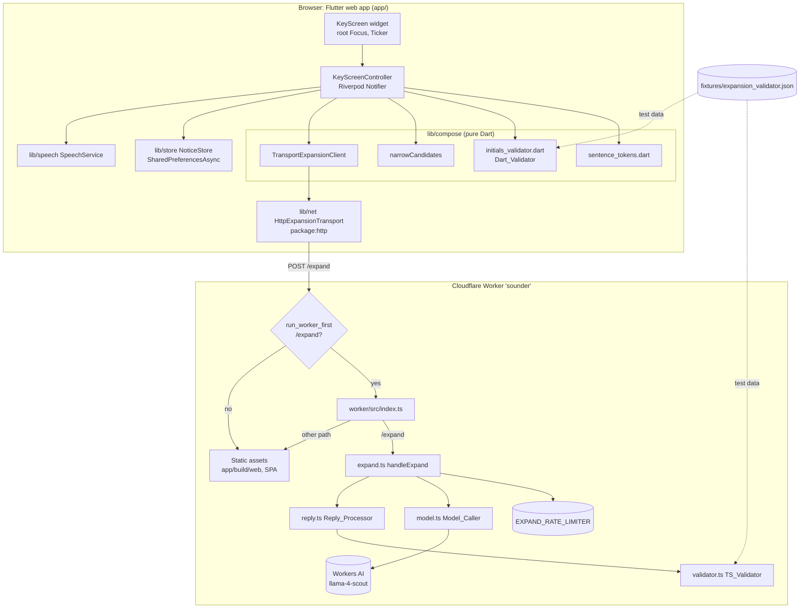
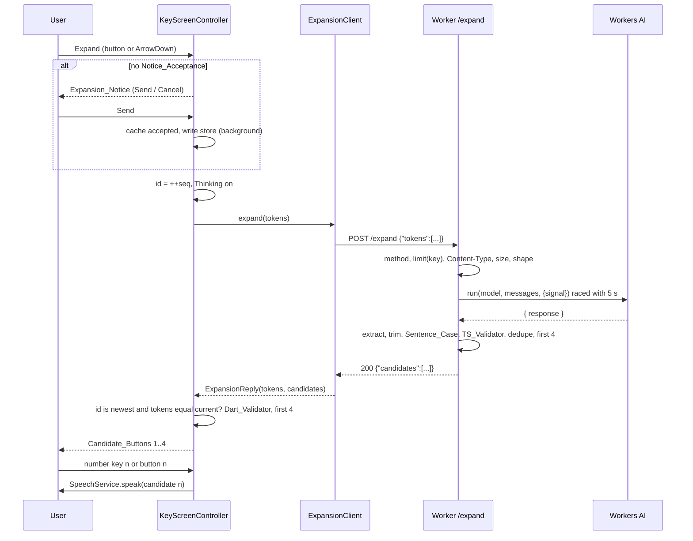
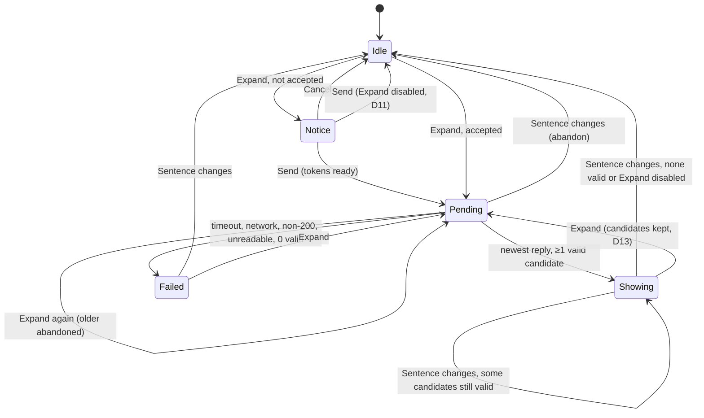

# Design Document: shorthand-expansion

## Overview

The user keys word starts (`I W S W P`), chooses Expand, and gets up to 4 sentences. Choosing one speaks it. The work has two parts with a checkpoint between them, as in the requirements:

- **Part A (server).** The existing Cloudflare Worker `sounder` (root `wrangler.jsonc`) gains a TypeScript entry point in `worker/`. Only `POST /expand` runs Worker code; every other request is served by static assets exactly as today. The endpoint checks method, rate limit, Content-Type, body size and body shape (E9 order), calls Workers AI model `@cf/meta/llama-4-scout-17b-16e-instruct`, and returns only candidates that pass the TS_Validator. It stores nothing and logs four numbers per request. CI runs `npm test` in `worker/` before the build. Steering files are updated in this part.
- **Checkpoint (REQ-CHECKPOINT-1).** All three test suites pass, the deploy succeeded, the hosted routes and one real `POST /expand` are checked by hand, and the results are written to `.kiro/evidence/`.
- **Part B (client).** The Flutter Key_Screen gains an Expand button (and ArrowDown), a one-time Expansion_Notice, a static `Thinking…` line, up to 4 Candidate_Buttons (and number keys 1 to 4), narrowing as the Sentence changes, and one Failure_Message. The Dart_Validator re-checks every candidate locally.

The Initials_Validator is defined once (REQ-VALIDATOR-1, E1 to E5) and implemented twice. Both implementations read the same fixture, `fixtures/expansion_validator.json`, and both are property-tested.

### Research findings

All Cloudflare facts were read from the current documentation on **2026-11-27**. Package versions were read from pub.dev through the dart MCP server (`pub_dev_search`, with `app/` and `packages/morse_core` registered as roots) and from the npm registry (`npm view`) on the same date. Content was rephrased for compliance with licensing restrictions.

**C1. Static assets: `run_worker_first`, `binding`, `not_found_handling`** ([Static Assets binding](https://developers.cloudflare.com/workers/static-assets/binding/), [Single Page Application](https://developers.cloudflare.com/workers/static-assets/routing/single-page-application/), both checked 2026-11-27).

- `run_worker_first` may be a boolean or an array of route patterns. With an array, the Worker script runs first only for matching paths; `*` globs and `!` negations are supported; at most 100 entries. The docs show it paired with `not_found_handling: "single-page-application"`.
- `assets.binding` names the binding; `env.ASSETS.fetch(request)` returns a response using the configured HTML handling and missing-asset fallbacks (so it applies single-page-application handling too).
- With a Worker script, `not_found_handling` set, and a compatibility date of 2025-04-01 or later, *navigation requests* (`Sec-Fetch-Mode: navigate`) do not invoke the Worker; they are served as assets. Our `compatibility_date` is `2025-11-01`, so this applies. The routing diagram on the SPA page shows that a path matching `run_worker_first` invokes the Worker first; a path with no match and no asset goes to the Worker only if it is not a navigation request, otherwise to asset serving and then `/index.html`.
- Advanced routing control (array `run_worker_first`) needs Wrangler 4.20.0 or later. The workflow pins 4.166.0.

Consequence: `GET /` and an unknown navigation path return `index.html` without running Worker code (REQ-ROUTE-3, REQ-ROUTE-4). A non-navigation request for an unknown path does reach the Worker script; the Worker passes it to `env.ASSETS.fetch` unchanged (REQ-ROUTE-5, E15), which applies the same SPA fallback.

**C2. Workers AI binding and `env.AI.run`** ([Workers Bindings](https://developers.cloudflare.com/workers-ai/configuration/bindings/), [llama-4-scout-17b-16e-instruct](https://developers.cloudflare.com/workers-ai/models/llama-4-scout-17b-16e-instruct/), [sync output schema](https://developers.cloudflare.com/workers-ai/models/llama-4-scout-17b-16e-instruct/sync-output.json), [JSON Mode](https://developers.cloudflare.com/workers-ai/features/json-mode/), all checked 2026-11-27; type declarations from [`@cloudflare/workers-types` 5.20261127.1 `index.d.ts`](https://unpkg.com/@cloudflare/workers-types/index.d.ts), checked 2026-11-27).

- Config: `"ai": { "binding": "AI" }` makes `env.AI` available.
- `env.AI.run(model, inputs, options?)` is async. For Scout, `inputs` accepts `messages`, `max_tokens` (default 256), `temperature` (default 0.15, range 0 to 5), and others. The synchronous output schema has a required `response` field typed as a string, plus `usage` and `tool_calls`.
- The JSON Mode page shows `response` returned as an already-parsed object when JSON Mode is on, and spike 3 saw that shape. Scout is **not** in the JSON Mode supported-model list (checked again today), so we send no `response_format`, and E8 handles both a string and an object.
- `AiOptions` in the type declarations includes `signal?: AbortSignal`, along with `gateway`, `tags`, `returnRawResponse` and others. The binding docs do not describe `signal`, and [cloudflare/ai issue #640](https://github.com/cloudflare/ai/issues/640) reports that binding streams do not honour an abort signal. So `signal` cannot be relied on to enforce the 5-second limit. Decision D6 races the call against a timer and also passes a signal as a best-effort cancel.

**C3. Rate limiting binding** ([Rate Limiting](https://developers.cloudflare.com/workers/runtime-apis/bindings/rate-limit/), page dated 2026-11-12, checked 2026-11-27).

- Config field: `ratelimits`, an array of `{ name, namespace_id, simple: { limit, period } }`. `namespace_id` is required: a string holding a positive integer, unique in the account. `period` must be 10 or 60.
- Runtime: `await env.NAME.limit({ key, delta? })` resolves to `{ success: boolean }`. A call that returns `success: false` does not add to the count. TypeScript type: `RateLimit`.
- Requires Wrangler 4.36.0 or later (pinned 4.166.0 is fine).
- Limits are approximate and per Cloudflare location (E14). The page recommends against IP keys because many users can share one IP. The requirements chose the IP key (REQ-EXPAND-6); this is accepted and listed under Known limitations.

**C4. Testing Workers** ([Vitest integration](https://developers.cloudflare.com/workers/testing/vitest-integration/), checked 2026-11-27). Cloudflare recommends `@cloudflare/vitest-plugin` (formerly `@cloudflare/vitest-pool-workers`) to run tests inside the Workers runtime through Miniflare. Decision D3 uses plain Vitest instead, because the handler is written against small injected interfaces and web-standard `Request`/`Response`, which Node 22 provides.

**C5. npm packages** (`npm view`, 2026-11-27): `vitest` 5.1.2 (engines: Node `^22.12.0 || ^24.0.0 || >=26.0.0`), `fast-check` 4.11.0 (Node ≥ 12.17), `typescript` 7.0.2 (latest tag), `@cloudflare/workers-types` 5.20261127.1, `wrangler` 4.168.0 (the workflow keeps 4.166.0, REQ-PIPE-3). Local Node is 22.23.3. The workflow therefore needs a Node 22 setup step; `actions/setup-node` is at major version 7 ([actions/setup-node](https://github.com/actions/setup-node)).

**C6. Dart packages** (dart MCP `pub_dev_search`, 2026-11-27):

- `http` 1.6.0 (dart.dev). On web, `BrowserClient` is backed by `window.fetch` ([BrowserClient](https://pub.dev/documentation/http/latest/browser_client/BrowserClient-class.html)). Setting a `Content-Type` header without a charset on a string body makes the package append `; charset=utf-8`; E10 accepts that. The response is decoded with `utf8.decode(response.bodyBytes)`, because our server sends `Content-Type: application/json` with no charset and `Response.body` would otherwise fall back to Latin-1.
- `shared_preferences` 2.5.6 (flutter.dev), web supported. The package now recommends `SharedPreferencesAsync` (`getBool`, `setBool`) over the legacy API ([shared_preferences](https://pub.dev/packages/shared_preferences)). On web it uses `localStorage`.
- Already in `app/pubspec.yaml`: `flutter_riverpod` ^3.5.0, `flutter_tts` ^4.2.5, `kiri_check` ^1.4.0 (dev), `morse_core` (path). The key-screen design (R6, R7) recorded the Riverpod and kiri_check APIs used here: `NotifierProvider`, `Provider.overrideWithValue`, `property`, `forAll(arb, body, maxExamples:, seed:)`, `constantFrom`, `list`, `combine2`..., `.map`, `.flatMap`.

**C7. Existing app code read.** `KeyScreenController` (Riverpod `Notifier<KeyScreenState>`) wraps a pure `KeySession`; `_publish()` is the single place the Sentence reaches the state. `keyActionFor(KeyEvent)` in `lib/input/keyboard_adapter.dart` maps Space, Enter and Escape; other keys return `ignore`. The root `Focus` in `KeyScreen` handles these, so focused buttons never activate on Space or Enter (key-screen D8). `FallbackView` takes the Sentence items. `source_rules_test.dart` enforces REQ-COMPOSE-1 on **every file** in `lib/compose/`: no Flutter, `dart:io`, `dart:html`, `dart:js_interop`, `dart:ui`, and no `Timer`, `Stopwatch`, `DateTime.now` or `Future.delayed`. It also enforces the `Mock` naming rule (REQ-CI-3) and the `REQ-…:` test-name prefix (REQ-CI-2).

### Decisions

- **D1. Worker code in `worker/`, one Worker.** `wrangler.jsonc` gains `main: "./worker/src/index.ts"`. Wrangler bundles the TypeScript itself; the Worker has no runtime npm dependencies, so `wrangler deploy` from the root needs no `npm install`. `worker/package.json` holds dev dependencies only (tests and type checks).
- **D2. Handler with injected dependencies.** `handleExpand(request, deps)` takes `{ rateLimiter, modelCaller, now, log }`. `index.ts` builds the real `deps` from `env`. Tests pass a `MockModelCaller`, a `MockRateLimiter` and a captured `log` (REQ-WORKERTEST-2).
- **D3. Plain Vitest, not the Cloudflare Vitest plugin.** The handler touches only `Request`, `Response`, `TextDecoder`, `ReadableStream`, `AbortController` and `setTimeout`, all present in Node 22. The bindings are behind interfaces. Plain Vitest avoids Miniflare, needs no Cloudflare account in CI and cannot reach the real AI binding by accident. Trade-off: runtime differences between Node and workerd are not tested; the checkpoint's manual `POST /expand` on the hosted Worker covers the real runtime once.
- **D4. Check order is E9: method → rate limit → Content-Type → body size → body shape → model.** The Rate_Limiter is called once per POST, before the body is read, so requests later rejected with 415, 413 or 400 still count. A non-POST request returns 405 and never calls the Rate_Limiter.
- **D5. Rate_Limiter failure fails open.** If `limit()` throws (not covered by the requirements), the request continues as allowed. Sounder is a communication aid, and the binding check is a local cached count that rarely fails; blocking speech on a limiter fault is the worse outcome. Accepted by the user on review (2026-11-27).
- **D6. Model timeout by race.** `callModelWithTimeout` starts a 5,000 ms `setTimeout` and `env.AI.run(..., { signal })` together and returns whichever finishes first. When the timer wins, it calls `controller.abort()` (best effort, C2) and the endpoint returns 503. The timer is cleared when the model wins.
- **D7. Body read with a byte cap.** If `Content-Length` is present and above 1,024, return 413 without reading. Otherwise read `request.body` chunk by chunk, counting bytes; on the first byte past 1,024, cancel the reader and return 413 (E11). The bytes are decoded with `new TextDecoder("utf-8", { fatal: true })`; invalid UTF-8 is a 400.
- **D8. Dart_Validator lives in `app/lib/compose/`, not `morse_core`.** `morse_core` owns the code table, encoding, decoding, timing and calibration (tech.md layering). The validator checks model sentences against typed word starts; it is about expansion, not Morse, and `structure.md` puts the expansion client in `lib/compose/`. Being in `lib/compose/` keeps it under the existing REQ-COMPOSE-1 source rule (pure Dart, no clock, no I/O), so purity (REQ-VALIDATOR-4) is enforced by a test that already exists.
- **D9. Expansion_Client split for purity.** `lib/compose/expansion_client.dart` holds `TransportExpansionClient`, which builds the request, races it against an injected `Delay`, and parses the reply. It imports nothing banned and starts no timer itself. The HTTP call is behind `ExpansionTransport`, implemented by `HttpExpansionTransport` in a new folder `app/lib/net/`. The real `Delay` (`Future.delayed`) is provided in `lib/ui/key_screen_controller.dart`. Tests inject a `MockExpansionTransport` and a `MockDelay` (REQ-APPTEST-4). `structure.md` gets one line for `lib/net/` (REQ-STEER-2 is extended by this line).
- **D10. Notice_Acceptance is cached in memory.** The controller starts reading it at `build()` and keeps a `bool`. Until the read finishes, or if it fails, the value is `false`, so the notice is shown (REQ-NOTICE-5). An Expand_Action decides synchronously, so feedback stays under the 50 ms budget. On Send, the cache becomes `true` and the write runs in the background; if the write fails, the cache returns to `false` and the request already started continues.
- **D11. Send while Expand is disabled.** The Sentence can change while the notice is shown (Space still keys). If Send is activated and the current Sentence disables Expand, the notice closes, the acceptance is stored, and no request is sent; the Tokens_Message explains why. Not covered by the requirements. Accepted by the user on review (2026-11-27).
- **D12. Escape precedence.** Escape first closes the Fallback_View if it is shown (key-screen REQ-SPEAK-4), otherwise cancels the Expansion_Notice if it is shown, otherwise does nothing. The Fallback_View is the full-screen top layer, so the visible layer closes first.
- **D13. Candidates stay during a new request.** An Expand_Action while a Candidate_List is shown clears the Failure_Message and shows the Thinking_Indicator, but keeps the current candidates until the newest reply replaces them or a failure clears them (REQ-FAIL-1). Nothing disappears by itself. Not covered by the requirements. Accepted by the user on review (2026-11-27).
- **D14. Layout keeps the key still.** The expansion area sits below the action bar: Tokens_Message, then Expansion_Notice, Thinking_Indicator, Failure_Message, then the Candidate_Buttons. Content appearing there never moves the Sentence, the Partial_Sequence or the On_Screen_Key.
- **D15. One sentence-change hook.** `KeyScreenController._publish()` compares the new Sentence with the published one (`listEquals`). On a change it abandons any Pending_Request (REQ-WAIT-4), clears the Failure_Message (E22) and narrows the Candidate_List (REQ-NARROW-1). Undo, Clear and decoded items all pass through `_publish()`, so no path is missed.
- **D16. Ratelimit namespace.** `namespace_id` is `"1001"` (required by C3, not named in the requirements). The binding name is `EXPAND_RATE_LIMITER`.

## Architecture



### Request sequence (happy path)



### Client state

The expansion area has these independent pieces of state. "Pending" is tracked by request id, not by a flag the reply can set.



## Components and Interfaces

### Part A: Worker (`worker/`)

```
worker/
  package.json            dev deps only; "test": "tsc --noEmit && vitest run"
  package-lock.json
  tsconfig.json
  vitest.config.ts
  src/
    index.ts              fetch entry: /expand -> handleExpand, else env.ASSETS.fetch
    env.ts                Env interface (ASSETS: Fetcher, AI: Ai, EXPAND_RATE_LIMITER: RateLimit)
    expand.ts             handleExpand(request, deps): checks in E9 order, responses, log line
    request.ts            readBodyLimited, parseTokenRequest (REQ-EXPAND-3, REQ-EXPAND-4)
    model.ts              ModelCaller type, workersAiModelCaller(ai), callModelWithTimeout
    prompt.ts             MODEL_ID, TEMPERATURE, MAX_TOKENS, SYSTEM_PROMPT, buildMessages
    reply.ts              processReply, extractCandidatesArray, sentenceCase, duplicateKey
    validator.ts          isValidCandidate (TS_Validator) and shared character helpers
    log.ts                ExpandLogEntry, consoleLog
  test/
    validator.test.ts           fixture test + Properties 1-3
    reply.test.ts               Properties 4-5, examples
    request.test.ts             Property 9, examples
    expand.test.ts              status codes, order, headers, timeout
    log.test.ts                 privacy capture test
    fixture_coverage.test.ts    REQ-VALIDATOR-3 coverage
    index.test.ts               routing pass-through (REQ-ROUTE-5)
    config.test.ts              wrangler.jsonc, deploy.yml, source and test-name checks (smoke)
    support/mocks.ts            MockModelCaller, MockRateLimiter, MockAssets
    support/arbitraries.ts      fast-check generators
```

#### `index.ts`

```ts
export default {
  async fetch(request: Request, env: Env): Promise<Response> {
    const url = new URL(request.url);
    if (url.pathname === "/expand") {
      return handleExpand(request, {
        rateLimiter: env.EXPAND_RATE_LIMITER,
        modelCaller: workersAiModelCaller(env.AI),
        now: () => Date.now(),
        log: consoleLog,
      });
    }
    return env.ASSETS.fetch(request); // REQ-ROUTE-5, E15: unchanged in, unchanged out
  },
} satisfies ExportedHandler<Env>;
```

#### `expand.ts`

```ts
export interface RateLimiter { limit(options: { key: string }): Promise<{ success: boolean }>; }
export interface ExpandDeps {
  rateLimiter: RateLimiter;
  modelCaller: ModelCaller;
  now: () => number;          // ms; latency only
  log: (entry: ExpandLogEntry) => void;
}
export async function handleExpand(request: Request, deps: ExpandDeps): Promise<Response>;
```

Steps (each `return` also logs one entry, see `log.ts`):

1. `request.method !== "POST"` → 405, header `Allow: POST`, body `{"error":"method_not_allowed"}`. No Rate_Limiter call.
2. `key = request.headers.get("CF-Connecting-IP") ?? "unknown"`; `await deps.rateLimiter.limit({ key })` exactly once. `success === false` → 429 `rate_limited`, body never read. A thrown error is treated as allowed (D5).
3. Media type check (E10): `(header ?? "").split(";")[0].trim().toLowerCase() === "application/json"`, else 415 `unsupported_media_type`.
4. `readBodyLimited(request, 1024)` (D7) → `"too_large"` → 413 `payload_too_large`.
5. `parseTokenRequest(bytes)` → `null` → 400 `bad_request`.
6. `callModelWithTimeout(deps.modelCaller, tokens, 5000)` → `{ kind: "error" | "timeout" }` → 503 `model_unavailable`; `{ kind: "ok", reply }` → `processReply(reply, tokens)` → 200 `{"candidates":[...]}`.

Every response is built by one helper, `jsonResponse(status, body, extraHeaders?)`, which sets `Content-Type: application/json` and `Cache-Control: no-store` and never sets `Access-Control-Allow-Origin` (REQ-EXPAND-11).

#### `request.ts`

```ts
export async function readBodyLimited(request: Request, limit: number): Promise<Uint8Array | "too_large">;
export function parseTokenRequest(bytes: Uint8Array): string[] | null;
```

`parseTokenRequest` returns the Token_List only when: the bytes are valid UTF-8; `JSON.parse` succeeds; the value is a non-null, non-array object; `Object.keys(value)` is exactly `["tokens"]`; `tokens` is an array of length 1 to 12; every item is a string matching `^[A-Za-z]{1,8}$`. Anything else returns `null` (REQ-EXPAND-4).

#### `model.ts` and `prompt.ts`

```ts
export type ModelCaller = (messages: ChatMessage[], signal: AbortSignal) => Promise<unknown>;
export function workersAiModelCaller(ai: Ai): ModelCaller; // ai.run(MODEL_ID, { messages, temperature: 0.2, max_tokens: 200 }, { signal })
export type ModelOutcome = { kind: "ok"; reply: unknown } | { kind: "error" } | { kind: "timeout" };
export function callModelWithTimeout(caller: ModelCaller, tokens: string[], timeoutMs: number): Promise<ModelOutcome>;
```

`buildMessages(tokens)` returns `[{ role: "system", content: SYSTEM_PROMPT }, { role: "user", content: tokens.join(" ") }]` (REQ-EXPAND-8). `MODEL_ID = "@cf/meta/llama-4-scout-17b-16e-instruct"`, `TEMPERATURE = 0.2`, `MAX_TOKENS = 200`. No `response_format` (C2). No `tags` option, so no user text goes to dashboard metadata.

`SYSTEM_PROMPT` (adapted from spike 3):

> You expand word starts into short spoken sentences for a person who cannot speak. The input is a list of items separated by spaces. Each item is the start of one word (one or more letters), in order. Return exactly 4 different candidate sentences as JSON, and nothing else: {"candidates":["...","...","...","..."]} Every candidate must have exactly one word per item, and each word must start with the letters of its item. Use everyday, first-person language a person would say to a carer or friend.

The cast at the `ai.run` call is kept from the spike, because the model union and a loose inputs object do not match one overload.

#### `reply.ts` (Reply_Processor)

```ts
export function processReply(reply: unknown, tokens: string[]): string[];   // REQ-REPLY-1..4
export function extractCandidatesArray(reply: unknown): unknown[] | null;   // E8
export function sentenceCase(candidate: string): string;                    // E6
export function shouldSentenceCase(candidate: string): boolean;             // REQ-REPLY-3 condition
export function duplicateKey(candidate: string): string;                    // E7
```

`processReply` runs, in order: `extractCandidatesArray` (null → `[]`); keep `typeof item === "string"`; trim E2 whitespace; apply `sentenceCase` when `shouldSentenceCase`; keep `isValidCandidate(tokens, c)`; drop items whose `duplicateKey` was already seen; take the first 4.

`extractCandidatesArray(reply)`: take `reply.response` if `reply` is a non-null object. If `response` is a non-null, non-array object, use it. If it is a string, slice from the first `{` to the last `}` inclusive (none or `last < first` → null) and `JSON.parse` it inside `try`. The parsed value must be a non-null, non-array object with an array `candidates`; otherwise null.

`sentenceCase(c)`: split `c` into alternating whitespace runs and words, keeping the whitespace. For each word, separate the leading and trailing strip-character runs (E4) from the core. Core `I`, or a core starting with `I'` or `I’`, becomes `I` plus the ASCII-lowercased rest; every other core is ASCII-lowercased. Then the first ASCII letter of the whole string is uppercased. Non-letters are never changed, so the length is unchanged.

`shouldSentenceCase(c)`: at least 2 words, and every Stripped_Word is non-empty with first character `A`-`Z`.

`duplicateKey(c)`: ASCII-lowercase, then remove the trailing run of `.`, `!`, `?`.

#### `validator.ts` (TS_Validator)

```ts
export const MAX_CANDIDATE_LENGTH = 200;
export function isE2Space(ch: string): boolean;        // U+0009..U+000D, U+0020
export function isStripChar(ch: string): boolean;      // . , ! ? ; : " ( )
export function isAsciiLetter(ch: string): boolean;
export function asciiLower(s: string): string;
export function splitWords(s: string): string[];       // runs of E2 space; no empty words
export function stripWord(w: string): string;          // E4, repeated at both ends
export function isWellFormedWord(core: string): boolean; // E3
export function isValidCandidate(tokens: readonly string[], candidate: string): boolean;
```

Algorithm, identical in Dart (REQ-VALIDATOR-1):

```
isValidCandidate(tokens, candidate):
  if tokens is not 1..12 items of 1..8 ASCII letters: return false   (outside the Token_List domain)
  t = trim E2 whitespace from both ends of candidate
  if t.length > 200: return false                                   (a; UTF-16 code units, E5)
  words = splitWords(t)
  if words.length != tokens.length: return false                    (b)
  for i in 0..words.length-1:
    core = stripWord(words[i])
    if core is empty or not isWellFormedWord(core): return false     (c)
    if not asciiLower(core).startsWith(asciiLower(tokens[i])): return false   (d)
  return true

isWellFormedWord(core):
  every character is an ASCII letter, ' (U+0027), ’ (U+2019) or - (U+002D)
  and every ' ’ - is at index j with 0 < j < len-1, core[j-1] and core[j+1] ASCII letters
```

No regex with Unicode classes is used, so the two runtimes cannot differ (E1). The helpers are pure: no I/O, clock or logging (REQ-VALIDATOR-4).

#### `log.ts`

```ts
export interface ExpandLogEntry { status: number; latencyMs: number; tokenCount: number; candidateCount: number; }
export const consoleLog = (e: ExpandLogEntry) =>
  console.log(JSON.stringify({ event: "expand", status: e.status, latencyMs: e.latencyMs,
                               tokenCount: e.tokenCount, candidateCount: e.candidateCount }));
```

`tokenCount` is the Token_List length once parsed, else 0. `candidateCount` is the returned list length for 200, else 0. `latencyMs = deps.now() - start`. No `catch` block in the Worker logs or rethrows an error object; errors are mapped to status codes (REQ-LOG-2, REQ-LOG-3). The Worker writes to no KV, cache, D1 or other binding (REQ-LOG-1). The `wrangler.jsonc` adds no `observability` block, so Workers Logs stays at its current setting.

#### `wrangler.jsonc` (REQ-ROUTE-1)

```jsonc
{
  // Cloudflare Worker that serves the Sounder web build and POST /expand.
  "name": "sounder",
  "main": "./worker/src/index.ts",
  "compatibility_date": "2025-11-01",
  "assets": {
    "directory": "./app/build/web",
    "binding": "ASSETS",
    "not_found_handling": "single-page-application",
    "run_worker_first": ["/expand"]
  },
  "ai": { "binding": "AI" },
  "ratelimits": [
    {
      "name": "EXPAND_RATE_LIMITER",
      "namespace_id": "1001",
      "simple": { "limit": 20, "period": 60 }
    }
  ]
}
```

Citation table (REQ-ROUTE-2, all checked 2026-11-27):

| Field or API | Source |
|---|---|
| `main` | [Static Assets binding](https://developers.cloudflare.com/workers/static-assets/binding/) (examples with `main` plus `assets`) |
| `assets.directory`, `assets.binding`, `env.ASSETS.fetch` | [Static Assets binding](https://developers.cloudflare.com/workers/static-assets/binding/) |
| `assets.run_worker_first` (array) | [Static Assets binding](https://developers.cloudflare.com/workers/static-assets/binding/), [SPA advanced routing](https://developers.cloudflare.com/workers/static-assets/routing/single-page-application/) |
| `assets.not_found_handling`, navigation requests | [Single Page Application](https://developers.cloudflare.com/workers/static-assets/routing/single-page-application/) |
| `ai.binding`, `env.AI.run` | [Workers AI bindings](https://developers.cloudflare.com/workers-ai/configuration/bindings/), [Scout model page](https://developers.cloudflare.com/workers-ai/models/llama-4-scout-17b-16e-instruct/) |
| `AiOptions.signal` | [`@cloudflare/workers-types` index.d.ts](https://unpkg.com/@cloudflare/workers-types/index.d.ts) |
| `response` shape | [Scout sync output schema](https://developers.cloudflare.com/workers-ai/models/llama-4-scout-17b-16e-instruct/sync-output.json), [JSON Mode](https://developers.cloudflare.com/workers-ai/features/json-mode/) |
| `ratelimits`, `namespace_id`, `simple.limit`, `simple.period`, `limit({ key })` | [Rate Limiting](https://developers.cloudflare.com/workers/runtime-apis/bindings/rate-limit/) |

#### `worker/package.json`, `tsconfig.json`, `vitest.config.ts`

```json
{
  "name": "sounder-worker",
  "private": true,
  "type": "module",
  "scripts": { "test": "tsc --noEmit && vitest run" },
  "devDependencies": {
    "@cloudflare/workers-types": "5.20261127.1",
    "fast-check": "4.11.0",
    "typescript": "7.0.2",
    "vitest": "5.1.2"
  }
}
```

`tsconfig.json`: `strict`, `noEmit`, `target`/`lib` `ES2022`, `module` `ESNext`, `moduleResolution` `Bundler`, `resolveJsonModule` `true`, `types` `["@cloudflare/workers-types"]`, `include` `["src", "test"]`. If TypeScript 7.0.2 fails to type-check `@cloudflare/workers-types` in the first task, the task pins the newest 5.x release instead and records why. `vitest.config.ts`: `test.include: ["test/**/*.test.ts"]`, `server.fs.allow: [".."]` so the fixture outside `worker/` can be imported. `vitest run` exits after one run (REQ-WORKERTEST-1).

### Part A: CI pipeline (`.github/workflows/deploy.yml`)

Two steps are inserted after `actions/checkout@v4` and before the Flutter setup, so a Worker failure stops the job before any build. Every existing step stays unchanged and in order (REQ-PIPE-3).

```yaml
      - uses: actions/setup-node@v7
        with:
          node-version: 22
          cache: npm
          cache-dependency-path: worker/package-lock.json

      - name: Worker tests
        working-directory: worker
        run: |
          npm ci
          npm test
```

There is no `continue-on-error`, so a non-zero `npm test` fails the job, and "Build web app" and "Deploy to Cloudflare" do not run (REQ-PIPE-1, REQ-PIPE-2).

### Part A: steering updates (REQ-STEER-1 to REQ-STEER-3)

`tech.md`:

- Stack, Backend: "One Cloudflare Worker, `sounder`, with code in `worker/`. It serves the web build as static assets and handles `POST /expand`, which calls Workers AI (`@cf/meta/llama-4-scout-17b-16e-instruct`). Config is the root `wrangler.jsonc`."
- Layering: "The Worker holds no API key (Workers AI is a binding), validates input, rate limits, and stores nothing." replaces the "function holds the model API key" line.
- Testing: add "Run Worker tests: `cd worker && npm test`".
- Performance budgets, expansion line: "Expansion: median under 3 s on a normal connection; client timeout 6 s; server model timeout 5 s; on failure show `No suggestions. Add letters or speak what you typed.`"

`structure.md`:

- Remove `functions/expand/`.
- Add `worker/` "the Cloudflare Worker: `/expand` handler, prompt, reply processing, validator, tests."
- Add `fixtures/` "test data shared by more than one test suite, such as the expansion validator fixture."
- Add `spikes/` "throwaway experiments and `RESULTS.md`; nothing here ships."
- Change the existing `eval/` entry from "benchmark phrase set, runner, results" to "`eval/` benchmark phrase set, runner, results, and measurements of the hosted app, such as expansion latency; nothing here ships." The `eval/` folder does not exist on disk yet; this feature creates it to hold the REQ-LATENCY-1 results (`eval/expansion_latency.md` and `eval/expansion_latency.js`, see Evidence and evaluation files).
- Under `app/`, add `lib/net/` "HTTP transports used by `lib/compose/` clients" (D9).

These edits happen in Part A, before the checkpoint (REQ-STEER-3).

### Checkpoint (REQ-CHECKPOINT-1)

Evidence file `.kiro/evidence/shorthand-expansion-checkpoint.md`, with one line per check and a summary line appended to `.kiro/evidence/LOG.md`:

1. `cd worker && npm test`, `cd packages/morse_core && dart test`, `cd app && flutter test`: pass counts.
2. GitHub Actions run URL and result for the Part A commit.
3. `GET https://sounder.kadhim-alawi.workers.dev/` in a browser: app loads.
4. Navigation to `/no-such-page`: app loads (status 200).
5. One `POST /expand` with `{"tokens":["I","W","S","W","P"]}` (for example from the browser console with `fetch`): status 200 and a `candidates` list that passes the validator. The candidate text is not copied into the evidence file; only the count and the validity result are recorded (privacy rule: no logging of what was typed).

### Part B: client (`app/`)

New and changed files:

```
app/lib/compose/initials_validator.dart   isValidCandidate + helpers (Dart_Validator)
app/lib/compose/sentence_tokens.dart      sentenceTokens(items) -> TokensCheck
app/lib/compose/narrowing.dart            narrowCandidates(candidates, tokens)
app/lib/compose/expansion_client.dart     ExpansionClient, TransportExpansionClient, ExpansionResult, ExpansionTransport, Delay
app/lib/net/http_expansion_transport.dart HttpExpansionTransport (package:http)
app/lib/store/notice_store.dart           NoticeStore, SharedPreferencesNoticeStore
app/lib/input/keyboard_adapter.dart       + expand, choose1..choose4 actions
app/lib/ui/key_screen_state.dart          + expansion fields
app/lib/ui/key_screen_controller.dart     + providers, expand/send/cancel/choose, sentence-change hook
app/lib/ui/key_screen.dart                + expansion area, key routing
app/lib/ui/action_bar.dart                + Expand button
app/lib/ui/tokens_message.dart            Tokens_Message line
app/lib/ui/expansion_notice.dart          notice text + Send / Cancel
app/lib/ui/thinking_indicator.dart        static "Thinking…"
app/lib/ui/failure_message.dart           Failure_Message
app/lib/ui/candidate_list.dart            Candidate_Buttons
app/lib/speech/fallback_view.dart         + optional candidate text
app/pubspec.yaml                          + http ^1.6.0, shared_preferences ^2.5.6
```

#### `initials_validator.dart` (Dart_Validator)

```dart
const int maxCandidateLength = 200;
bool isE2Space(int codeUnit);
bool isStripChar(int codeUnit);
bool isAsciiLetter(int codeUnit);
String asciiLower(String s);            // maps only 0x41..0x5A
List<String> splitWords(String s);
String stripWord(String word);
bool isWellFormedWord(String core);
bool isValidCandidate(List<String> tokens, String candidate);
```

Same algorithm as the TS_Validator, written over UTF-16 code units (`String.codeUnitAt`), so `’` (U+2019) is one unit in both languages and no Unicode case mapping is involved (E1, E5). `String.toLowerCase` is not used.

#### `sentence_tokens.dart`

```dart
sealed class TokensCheck { const TokensCheck(); }
final class TokensEmpty extends TokensCheck {}                 // empty Sentence: disabled, no message
final class TokensBlocked extends TokensCheck { final TokensBlock reason; }
enum TokensBlock { nonLetter, tooManyWords, wordTooLong }      // checked in this order (REQ-TOKENS-3)
final class TokensReady extends TokensCheck { final List<String> tokens; }

TokensCheck sentenceTokens(List<DecodedItem> items);
String? tokensMessageFor(TokensCheck check);
```

Words are maximal runs of non-Word_Space items (E16). An item is a letter only when it is a `DecodedItemKind.letter` whose character is one ASCII letter; Unknown_Letter_Items, digits and punctuation are non-letters. Messages: `Expand needs letters only.`, `Expand takes up to 12 words.`, `Expand takes up to 8 letters a word.` "Empty" means no words, so a Sentence of only Word_Spaces is also `TokensEmpty`.

#### `narrowing.dart`

```dart
List<String> narrowCandidates(List<String> candidates, TokensCheck check);
```

Returns `[]` unless `check` is `TokensReady`; otherwise the candidates the Dart_Validator accepts for `check.tokens`, in order (REQ-NARROW-1).

#### `expansion_client.dart`

```dart
typedef Delay = Future<void> Function(Duration duration);

final class TransportResponse { const TransportResponse(this.status, this.body); final int status; final String body; }

abstract interface class ExpansionTransport {
  /// One same-origin POST of [jsonBody] to /expand with Content-Type application/json.
  Future<TransportResponse> postExpand(String jsonBody);
}

sealed class ExpansionResult { const ExpansionResult(this.tokens); final List<String> tokens; }
final class ExpansionReply extends ExpansionResult { final List<String> candidates; }
enum ExpansionFailureKind { timeout, network, status, unreadable }
final class ExpansionFailure extends ExpansionResult { final ExpansionFailureKind kind; }

abstract interface class ExpansionClient { Future<ExpansionResult> expand(List<String> tokens); }

final class TransportExpansionClient implements ExpansionClient {
  TransportExpansionClient({required ExpansionTransport transport, required Delay delay,
                            Duration timeout = const Duration(seconds: 6)});
}
```

`expand` encodes `{"tokens":[...]}` with `jsonEncode` (REQ-WAIT-3), then returns the first of: the transport future mapped to a result (any thrown error → `network`), or `delay(timeout)` mapped to `timeout` (REQ-WAIT-5). Parsing: status ≠ 200 → `status`; `jsonDecode` throws, or the value is not a `Map` with a `List` `candidates` → `unreadable`; otherwise `ExpansionReply` with the `String` items in order. The client does not validate (the controller does, REQ-CHOICE-1), logs nothing and keeps no state (REQ-FAIL-4). It uses `Future.any`, so it starts no `Timer` itself and passes the REQ-COMPOSE-1 source rule.

#### `http_expansion_transport.dart` (`lib/net/`)

```dart
final class HttpExpansionTransport implements ExpansionTransport {
  HttpExpansionTransport(this._client);
  final http.Client _client;
  @override
  Future<TransportResponse> postExpand(String jsonBody) async {
    final r = await _client.post(Uri.base.resolve('/expand'),
        headers: const {'Content-Type': 'application/json'}, body: jsonBody);
    return TransportResponse(r.statusCode, utf8.decode(r.bodyBytes, allowMalformed: true));
  }
}
```

`Uri.base.resolve('/expand')` is the same origin as the page (REQ-WAIT-3). A late reply after a timeout is simply ignored by the controller; the fetch is not aborted.

#### `notice_store.dart` (`lib/store/`)

```dart
abstract interface class NoticeStore {
  Future<bool> isAccepted();   // may throw
  Future<void> accept();       // may throw
}
final class SharedPreferencesNoticeStore implements NoticeStore { /* SharedPreferencesAsync, key below */ }
```

Key: `sounder.expansion_notice_accepted`, value `true`. Nothing else is stored (REQ-NOTICE-3).

#### `keyboard_adapter.dart`

New `KeyAction` values: `expand` (non-repeat ArrowDown key-down), `choose1` to `choose4` (non-repeat key-down of `digit1`..`digit4` or `numpad1`..`numpad4`, E24). ArrowDown and digit key-ups and Repeat_Events return `swallow`. Escape keeps returning `closeFallback`; the screen applies D12. The table in the doc comment gains the new columns.

#### `KeyScreenState` additions

```dart
final bool noticeVisible;          // Expansion_Notice
final bool thinking;               // Thinking_Indicator (a Pending_Request exists)
final List<String> candidates;     // Candidate_List, 0..4, unmodifiable
final bool failureVisible;         // Failure_Message
final String? fallbackCandidate;   // text for the Fallback_View when a candidate failed (E21)
```

`copyWith` uses a private sentinel for `fallbackCandidate`, so it can be set back to `null`. The Tokens_Message is derived in `build` from `sentenceTokens(state.sentence)` and is not stored.

#### `KeyScreenController` additions

Providers:

```dart
final expansionClientProvider = Provider<ExpansionClient>((ref) => TransportExpansionClient(
    transport: HttpExpansionTransport(http.Client()), delay: (d) => Future<void>.delayed(d)));
final noticeStoreProvider = Provider<NoticeStore>((ref) => SharedPreferencesNoticeStore());
```

Private fields: `bool _noticeAccepted = false`, `int _requestSeq = 0`, `int? _pendingId`.

| Method | Behaviour | Requirements |
|---|---|---|
| `build()` | as today, plus `unawaited(_loadAcceptance())`: `_noticeAccepted = await store.isAccepted()`, any error → `false` | REQ-NOTICE-5 |
| `expand()` | `check = sentenceTokens(sentence)`; not `TokensReady` → return. Clear `failureVisible`. Not accepted → `noticeVisible = true`. Else `_send(tokens)` | REQ-TOKENS-2, REQ-NOTICE-1, REQ-NOTICE-4, REQ-WAIT-6 |
| `sendNotice()` | only while `noticeVisible`: hide notice, `_noticeAccepted = true`, background `store.accept()` (error → `_noticeAccepted = false`); then `_send` if the current check is `TokensReady` (D11) | REQ-NOTICE-2, REQ-NOTICE-5 |
| `cancelNotice()` | only while `noticeVisible`: hide notice; nothing else | REQ-NOTICE-3 |
| `_send(tokens)` | `id = ++_requestSeq; _pendingId = id; thinking = true`; `result = await client.expand(tokens)`; return if `!ref.mounted` or `id != _pendingId` or `!listEquals(result.tokens, currentTokens)`; then `_pendingId = null; thinking = false`; reply → `valid = candidates.where(isValidCandidate).take(4)`; empty → failure; else `candidates = valid`. Failure → `candidates = []`, `failureVisible = true` | REQ-WAIT-3, REQ-WAIT-6, REQ-CHOICE-1, REQ-NARROW-2, REQ-FAIL-1 |
| `choose(n)` | `n > candidates.length` → return. `speech.speak(candidates[n-1])` once; `failed` → `fallbackVisible = true, fallbackCandidate = text`; `completed` → hide fallback, `fallbackCandidate = null`; `superseded` → nothing. Sentence and list unchanged | REQ-CHOICE-3, REQ-CHOICE-5, REQ-CHOICE-6 |
| `speak()` | as today, and a `failed` result sets `fallbackCandidate = null` (the Sentence is shown) | REQ-CHOICE-4 |
| `escape()` | D12: fallback shown → `closeFallback()`; else notice shown → `cancelNotice()` | REQ-SPEAK-4, REQ-NOTICE-3 |
| `arrowDown()` | notice shown → `sendNotice()`; else `expand()` | REQ-TOKENS-4, E18 |
| `_publish()` | as today; if the Sentence changed (D15): `_pendingId = null`, `thinking = false`, `failureVisible = false`, `candidates = narrowCandidates(candidates, newCheck)` | REQ-WAIT-4, REQ-NARROW-1, E22 |

Only `speak()` and `choose()` call the Speech_Service (REQ-CHOICE-6). Nothing in the controller prints or logs text (REQ-FAIL-4).

#### Widgets

- **ActionBar**: adds `FilledButton('Expand')` after Clear, `onPressed: enabled ? onExpand : null`. The style keeps the same colours in the disabled state (the existing style uses `WidgetStatePropertyAll`), so contrast stays at 7:1; the disabled state is exposed in semantics and explained by the Tokens_Message.
- **TokensMessage**: one `Text` at 24 px, shown when `tokensMessageFor(check)` is non-null.
- **ExpansionNotice**: inline panel (no modal barrier, not a route) with the exact notice text (REQ-NOTICE-1) at 24 px, and `Send` and `Cancel` buttons with `sounderButtonStyle()`. The text is one constant in `expansion_notice.dart`:

  ```dart
  const String expansionNoticeText =
      'Expand sends the letters you typed to Cloudflare Workers AI to suggest sentences. Sounder stores nothing.';
  ```

  The wording promises only what Sounder does (requirements S5).
- **ThinkingIndicator**: `Semantics(liveRegion: true, child: Text('Thinking\u2026'))`, static, no spinner (REQ-WAIT-1, REQ-KEY-12).
- **FailureMessage**: `Semantics(liveRegion: true, child: Text(failureMessage))` (REQ-FAIL-2).
- **CandidateList**: a `Column` of `FilledButton`s. Each child is `Semantics(label: '$n. $text', excludeSemantics: true, child: Row([Text('$n'), Expanded(Text(text, softWrap: true))]))` at 32 px, minimum size 64 by 64 (≥ 48 by 48), no truncation (REQ-CHOICE-2).
- **FallbackView**: new optional `String? candidateText`; when set, it shows that text at 36 px in place of `SentenceDisplay` (REQ-CHOICE-5).
- **KeyScreen** `_onKeyEvent`: `expand` → `controller.arrowDown()`, `choose1..4` → `controller.choose(n)`, `closeFallback` → `controller.escape()`. Space, Enter and repeat handling are unchanged, so Space stays the Morse key in every state (REQ-TOKENS-4).

## Data Models

### Wire protocol: `POST /expand`

Request (from `TransportExpansionClient`):

```
POST /expand
Content-Type: application/json; charset=utf-8
{"tokens":["I","W","S","W","P"]}
```

Responses (every one has `Content-Type: application/json` and `Cache-Control: no-store`, no `Access-Control-Allow-Origin`):

| Status | Body | When |
|---|---|---|
| 200 | `{"candidates":["I want some water please", ...]}` (0 to 4) | model returned within 5 s |
| 400 | `{"error":"bad_request"}` | body not `{tokens: Token_List}` |
| 405 | `{"error":"method_not_allowed"}` + `Allow: POST` | not POST |
| 413 | `{"error":"payload_too_large"}` | body over 1,024 bytes |
| 415 | `{"error":"unsupported_media_type"}` | media type not `application/json` |
| 429 | `{"error":"rate_limited"}` | Rate_Limiter says over limit |
| 503 | `{"error":"model_unavailable"}` | model error or 5 s timeout |

### Token and Candidate

| Concept | TypeScript | Dart | Constraint |
|---|---|---|---|
| Token | `string` | `String` | 1 to 8 ASCII letters |
| Token_List | `string[]` | `List<String>` | 1 to 12 Tokens |
| Candidate | `string` | `String` | any string; valid per REQ-VALIDATOR-1 |
| Model reply | `unknown` (`{ response: string \| object, ... }`) | n/a | E8 |
| Log entry | `ExpandLogEntry` | n/a | 4 numbers only |

### Validator fixture: `fixtures/expansion_validator.json`

```json
{
  "version": 1,
  "cases": [
    {
      "id": "d-first-letter-mismatch",
      "tags": ["d", "d-invalid"],
      "tokens": ["I", "W"],
      "candidate": "You want",
      "valid": false
    }
  ]
}
```

JSON Schema (draft 2020-12), checked by both suites' loaders:

```json
{
  "type": "object",
  "required": ["version", "cases"],
  "additionalProperties": false,
  "properties": {
    "version": { "const": 1 },
    "cases": {
      "type": "array",
      "minItems": 1,
      "items": {
        "type": "object",
        "required": ["id", "tags", "tokens", "candidate", "valid"],
        "additionalProperties": false,
        "properties": {
          "id": { "type": "string", "pattern": "^[a-z0-9-]+$" },
          "tags": { "type": "array", "items": { "type": "string" }, "minItems": 1 },
          "tokens": {
            "type": "array", "minItems": 1, "maxItems": 12,
            "items": { "type": "string", "pattern": "^[A-Za-z]{1,8}$" }
          },
          "candidate": { "type": "string" },
          "valid": { "type": "boolean" }
        }
      }
    }
  }
}
```

`id` values are unique. Non-ASCII characters are written as `\uXXXX` escapes so the file is plain ASCII. Required tags (REQ-VALIDATOR-3), each needing at least one case:

| Tag | Meaning |
|---|---|
| `a-valid`, `a-invalid` | length condition passes / fails |
| `len-200`, `len-201` | trimmed length exactly 200 (valid) and 201 (invalid) |
| `b-valid`, `b-invalid` | word count equal / different |
| `c-valid`, `c-invalid` | character rule passes / fails |
| `d-valid`, `d-invalid` | prefix rule passes / fails |
| `strip-.` `strip-,` `strip-!` `strip-?` `strip-;` `strip-:` `strip-"` `strip-(` `strip-)` | each strip character at a word end |
| `apos-ascii`, `apos-curly` | `'` and `’` inside a word |
| `hyphen` | `-` inside a word |
| `lead-apos`, `trail-apos`, `lead-hyphen`, `trail-hyphen` | leading or trailing `'` / `-` (invalid) |
| `non-ascii-letter` | e.g. `caf\u00e9` (invalid) |
| `unicode-space` | e.g. U+00A0 between words (invalid) |
| `token-longer-than-word` | e.g. token `WAT`, word `wa` (invalid) |

Locating the file:

- **Worker suite**: `import fixture from "../../fixtures/expansion_validator.json"` in `worker/test/*.test.ts` (resolved relative to the test file by Vite, `resolveJsonModule` for `tsc`, `server.fs.allow: [".."]`).
- **App suite**: `File('../fixtures/expansion_validator.json')`; `flutter test` runs with `app/` as the working directory, as `source_rules_test.dart` already relies on.

### Browser storage

| Key | Type | Written when | Read when |
|---|---|---|---|
| `sounder.expansion_notice_accepted` | bool `true` | Send on the Expansion_Notice | controller `build()` |

### Evidence and evaluation files

- `.kiro/evidence/shorthand-expansion-checkpoint.md`: checkpoint results (REQ-CHECKPOINT-1).
- `eval/` is created by this feature (it is listed in `structure.md` but absent on disk). Nothing in it ships.
- `eval/expansion_latency.md`: method, raw durations (ms) and median for REQ-LATENCY-1. `eval/expansion_latency.js`: a console snippet for the hosted page that sends the six spike-3 Token_Lists in turn, 24 requests in total, one every 3.5 s so the 20-per-60-s limit is never hit, and records `performance.now()` from send to parsed reply. It prints durations and statuses only, never candidate text.

## Correctness Properties

*A property is a characteristic or behavior that should hold true across all valid executions of a system-essentially, a formal statement about what the system should do. Properties serve as the bridge between human-readable specifications and machine-verifiable correctness guarantees.*

Reflection on the prework, to remove redundant properties:

- REQ-VALIDATOR-5, -6 and -7 stay separate: one checks acceptance, the other two check different rejection mutations.
- REQ-REPLY-4 (step order, dedupe, first 4, model order) is folded into the output property for REQ-REPLY-6, which now also checks that the output is an in-order subsequence of the processed inputs.
- REQ-REPLY-1 and REQ-REPLY-2 are exercised by the reply generator of Property 5 (non-JSON text, wrong shapes, non-string items), with examples for the specific cases.
- REQ-TOKENS-1 to -3 are one pure function, so they form one property (Property 7).
- REQ-NARROW-1 is the rule that Property 8 checks. Property 10 (idempotence) follows from Property 8 if Property 8 also requires that every valid item is kept. It stays as its own test because REQ-NARROW-5 and REQ-APPTEST-2 ask for it explicitly.
- REQ-EXPAND-4 gains a property (Property 6) because the space of bad bodies is large and the parse function is pure and cheap. The requirements list a minimum set of property tests; this one is an addition.

The first three properties test two implementations of one rule, so each has one property test in each suite (fast-check in `worker/`, kiri_check in `app/`).

### Property 1: Generated-valid candidates are accepted

*For any* Token_List T, and *for any* Candidate C built so that Word i is Token i in any mix of letter case followed by 0 or more ASCII letters, with 0 or more strip characters at either end of each Word, Words joined by runs of 1 or more E2 whitespace characters, optional leading and trailing E2 whitespace, and at most 200 characters after trimming, both the TS_Validator and the Dart_Validator accept C for T.

**Validates: Requirements 1.5, 1.1**

Requirement IDs: REQ-VALIDATOR-5, REQ-VALIDATOR-1

### Property 2: Changing a first letter makes a candidate invalid

*For any* (T, C) generated as in Property 1, and *for any* position i, replacing the first letter of Stripped_Word i with a different ASCII letter (different ignoring case) makes both validators reject the result for T.

**Validates: Requirements 1.6, 1.1**

Requirement IDs: REQ-VALIDATOR-6, REQ-VALIDATOR-1

### Property 3: A different word count makes a candidate invalid

*For any* (T, C) generated as in Property 1, adding 1 or more Words at any positions, or removing 1 or more Words, so that the Word count differs from the Token count, makes both validators reject the result for T.

**Validates: Requirements 1.7, 1.1**

Requirement IDs: REQ-VALIDATOR-7, REQ-VALIDATOR-1

### Property 4: Sentence-case conversion preserves validity

*For any* Token_List T and *for any* string C (drawn from Property 1 candidates, the same candidates with every Word capitalised, and arbitrary strings mixing ASCII letters, strip characters, apostrophes, hyphens, digits, E2 and non-E2 spaces and non-ASCII letters), `isValidCandidate(T, C) === isValidCandidate(T, sentenceCase(C))`.

**Validates: Requirements 4.5, 4.3**

Requirement IDs: REQ-REPLY-5, REQ-REPLY-3

### Property 5: Reply processing output is small, valid, distinct and in model order

*For any* model reply R (non-objects; `{response: s}` for arbitrary text s; `{response: s}` where s is noise, a JSON object and more noise; `{response: o}` for an object o; with `candidates` arrays mixing valid candidates for T, invalid strings, near-duplicates differing only in case or trailing `.!?`, numbers, nulls, objects, and 0 to 12 items) and *for any* Token_List T, `processReply(R, T)` has at most 4 items, every item is accepted by the TS_Validator for T, no two items have the same `duplicateKey`, and the items appear in the same relative order as in the trimmed and sentence-cased string items of `candidates`.

**Validates: Requirements 4.6, 4.4, 4.1, 4.2**

Requirement IDs: REQ-REPLY-6, REQ-REPLY-4, REQ-REPLY-1, REQ-REPLY-2

### Property 6: Request body parsing accepts exactly the Token_List shape

*For any* Token_List T, `parseTokenRequest(utf8(JSON.stringify({tokens: T})))` returns T. *For any* body built by one mutation of a valid body (an extra key, no `tokens` key, `tokens` not an array, 0 or 13 to 20 items, an item of 0 or 9 to 12 letters, an item with a non-letter or non-ASCII character, a non-string item, a top-level array, `null` or number, truncated JSON text, or invalid UTF-8 bytes), `parseTokenRequest` returns `null`.

**Validates: Requirements 3.4**

Requirement IDs: REQ-EXPAND-4

### Property 7: Sentence_Tokens follow the words of the Sentence

*For any* Sentence built from 0 to 14 words, each word 1 to 10 Decoded_Items drawn from ASCII letter Letter_Items and occasionally a non-letter (an Unknown_Letter_Item, a digit or a punctuation Letter_Item), with words separated by 1 or more Word_Spaces and optional leading and trailing Word_Spaces, `sentenceTokens` returns: `TokensEmpty` when there are no words; otherwise `TokensBlocked(nonLetter)` if any word holds a non-letter; otherwise `TokensBlocked(tooManyWords)` if there are more than 12 words; otherwise `TokensBlocked(wordTooLong)` if a word has more than 8 letters; otherwise `TokensReady` whose tokens are the words' letters, in order.

**Validates: Requirements 10.1, 10.2, 10.3**

Requirement IDs: REQ-TOKENS-1, REQ-TOKENS-2, REQ-TOKENS-3

### Property 8: Narrowing keeps exactly the valid candidates, in order

*For any* Candidate_List L of 0 to 6 strings (a mix of candidates valid for some Token_List and arbitrary strings) and *for any* TokensCheck K, `narrowCandidates(L, K)` is empty when K is not `TokensReady`, and otherwise equals the in-order sublist of L whose items the Dart_Validator accepts for K's tokens. So it is an in-order sublist of L and every item is accepted.

**Validates: Requirements 14.3, 14.1**

Requirement IDs: REQ-NARROW-3, REQ-NARROW-1

### Property 9: Adding letters to tokens only narrows

*For any* Token_List T, *for any* T′ made from T by appending 1 or more ASCII letters to 1 or more Tokens while each stays at most 8 letters, and *for any* Candidate C (mostly built as in Property 1 for T′, so the premise is often true, plus arbitrary strings), if the Dart_Validator accepts C for T′ then it accepts C for T.

**Validates: Requirements 14.4**

Requirement IDs: REQ-NARROW-4

### Property 10: Narrowing is idempotent

*For any* Candidate_List L and *for any* TokensCheck K, `narrowCandidates(narrowCandidates(L, K), K)` equals `narrowCandidates(L, K)`.

**Validates: Requirements 14.5**

Requirement IDs: REQ-NARROW-5

## Error Handling

### Worker

| Condition | Response | Log entry (status, latency, tokens, candidates) |
|---|---|---|
| Method not POST | 405 `method_not_allowed`, `Allow: POST` | 405, t, 0, 0 |
| Rate limit exceeded | 429 `rate_limited` | 429, t, 0, 0 |
| Rate_Limiter throws | treated as allowed (D5) | continues |
| Content-Type missing or not `application/json` | 415 `unsupported_media_type` | 415, t, 0, 0 |
| `Content-Length` > 1024, or more than 1,024 bytes read | 413 `payload_too_large`; the reader is cancelled | 413, t, 0, 0 |
| Body stream read throws | 400 `bad_request` | 400, t, 0, 0 |
| Invalid UTF-8, bad JSON or wrong shape | 400 `bad_request` | 400, t, 0, 0 |
| Model throws (including JSON Mode or capacity errors) | 503 `model_unavailable`; error object discarded | 503, t, n, 0 |
| Model takes longer than 5,000 ms | 503 `model_unavailable`; abort signalled; late result ignored | 503, t, n, 0 |
| Reply unparseable or has no `candidates` array | 200 `{"candidates":[]}` | 200, t, n, 0 |
| Unexpected exception inside `processReply` | 200 `{"candidates":[]}` (defensive `try`) | 200, t, n, 0 |
| Any other path | passed to `env.ASSETS.fetch` unchanged | none |

No error message, stack or object is ever logged or put in a response body. Error bodies hold only the fixed code (E12).

### Client

| Condition | Behaviour |
|---|---|
| Expand pressed while disabled | Nothing happens; the Tokens_Message is already shown (non-empty Sentence) |
| Notice store read fails | Treated as not accepted; the notice is shown next time (REQ-NOTICE-5) |
| Notice store write fails | Cache reset to not accepted; the request already started continues (REQ-NOTICE-5) |
| Send while Expand is disabled | Notice closes, acceptance stored, no request (D11) |
| Transport throws (network error, CORS, offline) | `ExpansionFailure(network)` → Failure_Message |
| No reply within 6 s | `ExpansionFailure(timeout)` → Failure_Message; a late reply is ignored |
| Status other than 200 (including 429, 503) | `ExpansionFailure(status)` → Failure_Message |
| Body not JSON, or no `candidates` list | `ExpansionFailure(unreadable)` → Failure_Message |
| 200 but no candidate passes the Dart_Validator | Failure_Message (REQ-FAIL-1) |
| Reply for an abandoned or older request, or for other tokens | Ignored; screen unchanged (REQ-NARROW-2) |
| Sentence changes while pending | Request abandoned; Thinking_Indicator removed; no message (E19) |
| Speaking a candidate fails | Fallback_View with the candidate text (REQ-CHOICE-5) |
| Number key with no matching candidate | Nothing happens, no speech (REQ-CHOICE-6) |

There is always a way forward: the typed text can be spoken with Enter or Speak, letters can be added, and Expand can be tried again.

### Known limitations

- **L1. IP-keyed rate limit.** Users behind one IP share 20 requests per minute, and limits are per Cloudflare location and approximate (C3, E14). Accepted for the hackathon.
- **L2. Abort is best effort.** After the 5 s timeout the model call may keep running on Cloudflare's side (C2); its result is discarded.
- **L3. Node, not workerd, in tests.** Worker tests run in Node 22 (D3). The checkpoint's manual request covers the real runtime once.
- **L4. One-switch reach.** Expand, Send, Cancel and the number keys need a keyboard or pointer until the switch-scanning spec exists (E25).
- **L5. Latency measured outside the UI.** The latency snippet measures send to parsed reply; the frame that shows the result adds at most one frame (about 17 ms), which is added to the reported median.

## Testing Strategy

Unit and example tests cover specific behaviour, status codes, widgets and error paths. Property tests cover the pure rules (Properties 1 to 10). Automated tests never call the model or the network (REQ-WORKERTEST-2, REQ-APPTEST-4). Every test description starts with its requirement IDs and a colon (REQ-WORKERTEST-6, REQ-APPTEST-5); the existing REQ-CI-2 source rule already enforces this in `app/test/`, and a matching check is added to `worker/test/`.

### Property test configuration

| Property | Suite | Library | Seed | Runs |
|---|---|---|---|---|
| 1, 2, 3 | `worker/test/validator.test.ts` | fast-check 4.11.0 | `(600 + N) * 1000 + 7` | 200 |
| 1, 2, 3 | `app/test/expansion_properties_test.dart` | kiri_check 1.4.0 | `(600 + N) * 1000 + 3` | 200 |
| 4, 5 | `worker/test/reply.test.ts` | fast-check | `(600 + N) * 1000 + 7` | 200 |
| 6 | `worker/test/request.test.ts` | fast-check | `(600 + N) * 1000 + 7` | 200 |
| 7, 8, 9, 10 | `app/test/expansion_properties_test.dart` | kiri_check | `(600 + N) * 1000 + 3` | 200 |

- fast-check: `fc.assert(fc.property(arb, predicate), { seed, numRuns: 200 })`. kiri_check: `forAll(arb, body, maxExamples: 200, seed: seed, onFalsify: report(seed))`, as in `compose_properties_test.dart`.
- Each property is one test per suite, tagged with a comment `// Feature: shorthand-expansion, Property N: <title>`, and its description starts with the REQ IDs, for example `REQ-VALIDATOR-5: generated-valid candidates are accepted`.
- Generators build inputs that meet the preconditions by construction: no `fc.pre`, no `.filter`, no kiri_check filters (REQ-WORKERTEST-3, REQ-APPTEST-2). Examples: a "different letter" is `(first + 1 + k) mod 26` with k in 0..24; the 200-character bound is met by fixed caps (at most 12 words × (8 token letters + 2 extra letters + 2 + 2 strip characters) + 11 separators × 2 = 190); 13 to 20 items for a too-long list are generated directly.
- Generators live in `worker/test/support/arbitraries.ts` and `app/test/support/expansion_arbitraries.dart`. The Dart generators use `DecodedItem.letter`, `DecodedItem.unknownLetter` and `DecodedItem.wordSpace` as `item_arbitraries.dart` does.
- On failure, only the seed and the counterexample are printed; generated strings are synthetic, not user text.

### Worker example tests (`worker/test/`)

- `validator.test.ts`: fixture loop for the TS_Validator (REQ-VALIDATOR-2).
- `fixture_coverage.test.ts`: schema shape, unique ids, and every required tag present (REQ-VALIDATOR-3).
- `reply.test.ts`: `response` as string and as object; text around the JSON; no braces; `candidates` missing; non-string items dropped; trimming; `I Want Some Water Please` → `I want some water please`; `I'm` and `I’m` keep the capital; single word not converted; duplicates by case and trailing `!`; more than 4 valid (REQ-REPLY-1 to REQ-REPLY-4).
- `expand.test.ts` with `MockRateLimiter`, `MockModelCaller` and a captured log:
  - 200 with candidates and 200 with an empty list (REQ-EXPAND-10).
  - 405 with `Allow: POST` and no limiter call (REQ-EXPAND-1, REQ-EXPAND-5).
  - 415 for a missing header and `text/plain`; `application/json; charset=utf-8` and `Application/JSON` accepted (REQ-EXPAND-2).
  - 413 for 1,025 bytes, a large `Content-Length`, and a body larger than its `Content-Length` claims; 1,024 bytes accepted (REQ-EXPAND-3).
  - 400 examples (REQ-EXPAND-4).
  - 429 with an invalid body, and the body stream not read; requests rejected with 415, 413 and 400 still count (the 21st request in a window returns 429) (REQ-EXPAND-5 to REQ-EXPAND-7, E9).
  - Key from `CF-Connecting-IP`, and `unknown` when it is missing (REQ-EXPAND-6, E13).
  - Model input: system prompt clauses, user message `I W S W P`, temperature 0.2, max_tokens 200 (REQ-EXPAND-8). The real caller wiring is checked with a `MockAi` object passed to `workersAiModelCaller`, asserting the model id and options.
  - 503 on a model error, and on a model that never resolves with `vi.useFakeTimers()` and `vi.advanceTimersByTimeAsync(5000)`; the abort signal is aborted (REQ-EXPAND-9).
  - Headers on every status: `Content-Type: application/json`, `Cache-Control: no-store`, no `Access-Control-Allow-Origin`, and the exact error body (REQ-EXPAND-11).
- `log.test.ts`: `console.log` is spied on during requests with known tokens (`QZXW`), candidates and `CF-Connecting-IP: 203.0.113.7`, for 200, 400, 429 and 503 paths. The joined log output must not contain any of those strings, and each entry has exactly the keys `event`, `status`, `latencyMs`, `tokenCount`, `candidateCount` (REQ-LOG-2, REQ-LOG-3, REQ-WORKERTEST-5).
- `index.test.ts`: a `GET /main.dart.js` and a `POST /other` reach `MockAssets.fetch` with the same `Request` object, and its `Response` is returned unchanged (REQ-ROUTE-5).
- `config.test.ts` (smoke): reads `../wrangler.jsonc` (comments stripped) and checks the REQ-ROUTE-1 fields; reads `../.github/workflows/deploy.yml` as text and checks that "Worker tests" has `working-directory: worker`, runs `npm ci` then `npm test`, comes before "Build web app", and that no `continue-on-error` appears (REQ-PIPE-1, REQ-PIPE-3); scans `worker/src/` to confirm no use of `caches`, KV, D1 or R2 and that only `log.ts` calls `console` (REQ-LOG-1, REQ-VALIDATOR-4); checks every test description in `worker/test/` starts with REQ IDs and a colon (REQ-WORKERTEST-6).

### App tests (`app/test/`)

- `initials_validator_fixture_test.dart`: fixture loop for the Dart_Validator (REQ-VALIDATOR-2, REQ-APPTEST-1).
- `expansion_properties_test.dart`: Properties 1 to 3 and 7 to 10.
- `expansion_client_test.dart` with `MockExpansionTransport` and `MockDelay` (a `Delay` whose futures the test completes): request body and path (REQ-WAIT-3); status, unreadable, network and timeout results (REQ-WAIT-5, REQ-FAIL-1); string items kept in order.
- `keyboard_adapter_test.dart` additions: ArrowDown down/up/repeat, digits and numpad 1 to 4, digit 5 ignored (REQ-TOKENS-4, E24).
- `expansion_screen_test.dart` widget tests, with `MockExpansionClient` (records calls, completes replies on demand), `MockNoticeStore` (settable result, can throw), `MockSpeechService` and `ManualTimeBase` overriding the providers. They use `pump`, not `pumpAndSettle` (key-screen D4):
  - Notice text, found with `find.text('Expand sends the letters you typed to Cloudflare Workers AI to suggest sentences. Sounder stores nothing.')`, Send (button and ArrowDown), Cancel (button and Escape), stored acceptance skips the notice, and a throwing store (REQ-NOTICE-1 to REQ-NOTICE-5).
  - Thinking_Indicator shown with a live region; Space, Undo, Clear and Speak work while pending (REQ-WAIT-1, REQ-WAIT-2).
  - Sentence change abandons the request; a second Expand supersedes the first (REQ-WAIT-4, REQ-WAIT-6).
  - Choose by click and by number key, one speech call each, Sentence unchanged (REQ-CHOICE-3); Enter speaks the typed text while candidates are shown (REQ-CHOICE-4); speech failure shows the candidate in the Fallback_View (REQ-CHOICE-5); a reply arriving makes no speech call (REQ-CHOICE-6).
  - Candidate_Button size ≥ 48 by 48, font ≥ 32, semantic label `n. text`, wrapping at 320 px width (REQ-CHOICE-2).
  - Locally invalid candidates are dropped (REQ-CHOICE-1).
  - Failure_Message for timeout, non-200 and an empty list; it stays until the Sentence changes or Expand is pressed again (REQ-FAIL-1 to REQ-FAIL-3).
  - Stale reply ignored (REQ-NARROW-2); narrowing after adding a letter (REQ-NARROW-1).
  - The three Tokens_Message texts and a disabled Expand (REQ-TOKENS-2, REQ-TOKENS-3).
- `source_rules_test.dart` additions: no `print`, `debugPrint` or `log` call in the expansion files under `lib/compose/`, `lib/net/`, `lib/store/` and the controller (REQ-FAIL-4); no string literal under `lib/` equal (ASCII-lowercased, trailing `.!?` removed) to any valid candidate in the Validator_Fixture or to the six spike-3 sentences (REQ-APPTEST-4). The existing REQ-COMPOSE-1 and REQ-CI-3 rules now also cover the new `lib/compose/` files and the new mocks.

### Manual and integration checks

- Checkpoint list above (REQ-CHECKPOINT-1, REQ-ROUTE-3, REQ-ROUTE-4).
- Latency (REQ-LATENCY-1): run `eval/expansion_latency.js` in the browser console on the hosted site over broadband; 24 requests, 3.5 s apart; record every duration, the median (plus one frame, L5) and the statuses in `eval/expansion_latency.md`.

### Commands

- `cd worker && npm test` (type check, then `vitest run` once).
- `cd app && flutter test`.
- `cd packages/morse_core && dart test` (unchanged; no engine changes in this spec).
